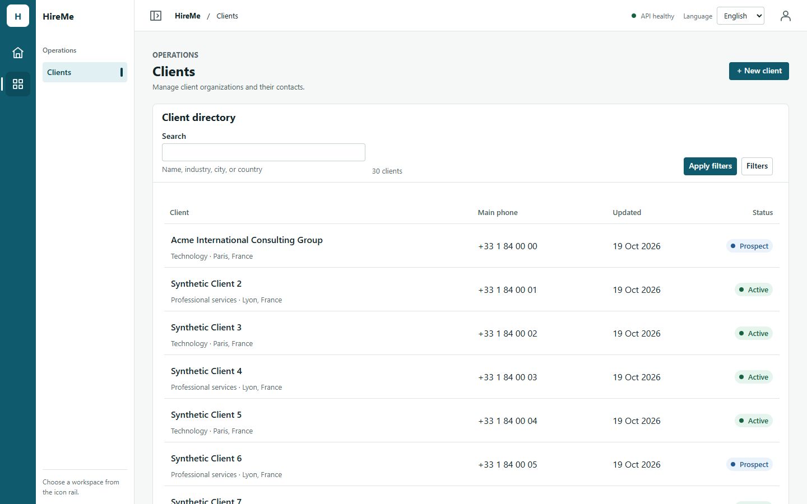
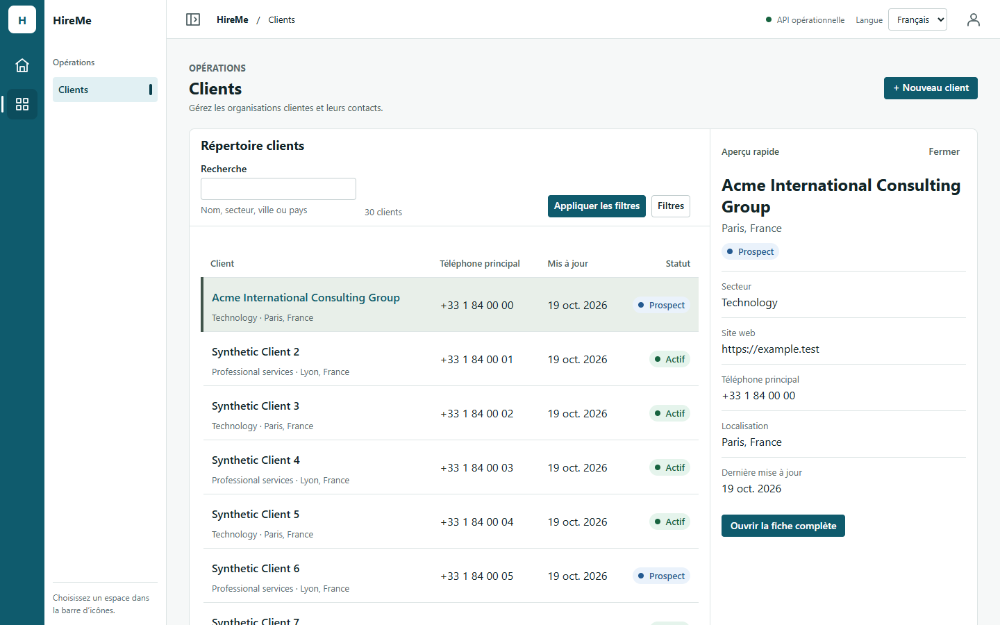
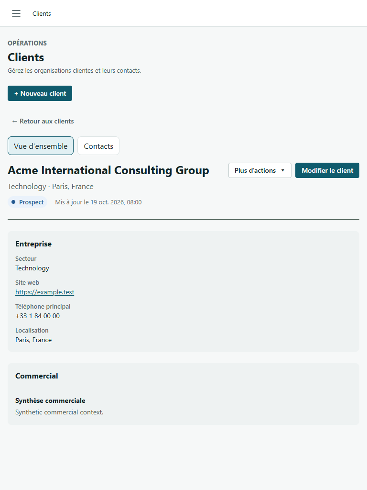
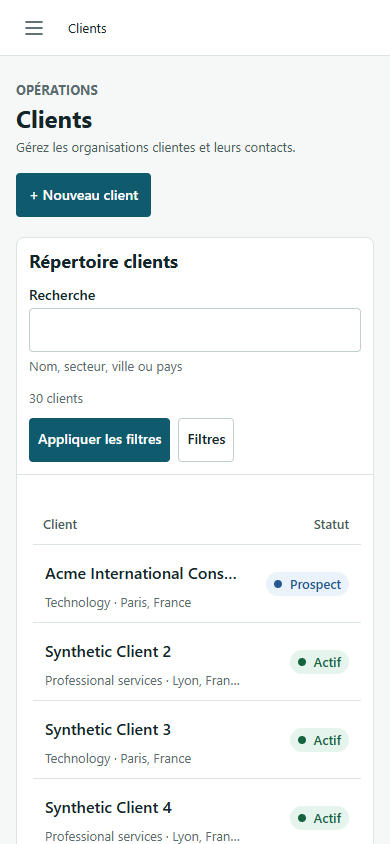
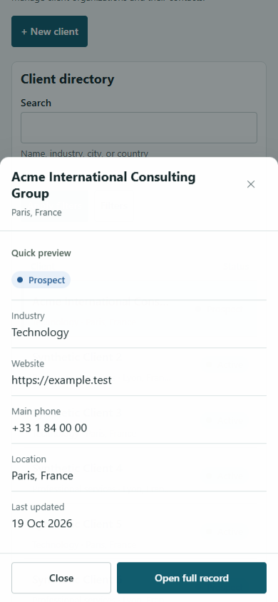
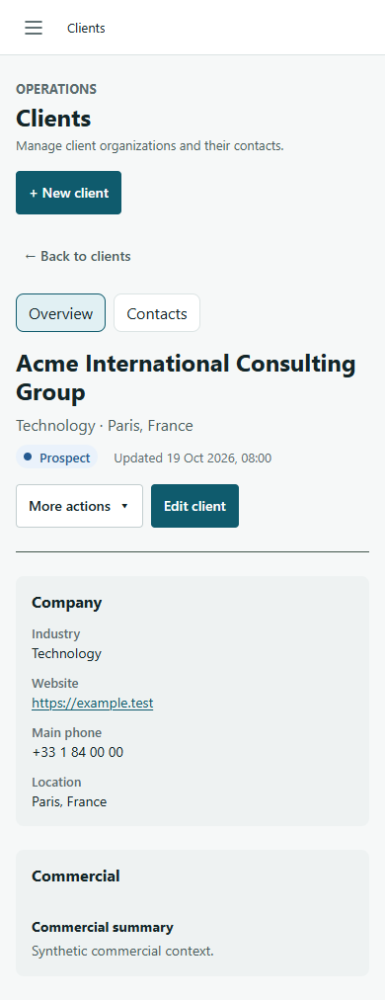

# Clients Workspace v2.1 implementation evidence

Date: 2026-10-19. Draft PR #210. Base `main` `290fa32` (merged PR #218).

## Scope

This implements the reviewed Clients v2.1 proposal without changing API contracts, permissions,
schemas, data scope, route/deep-link behavior, or business workflows.

- Directory and record now consume the shared `DirectoryPage`, `RecordPage`, `FilterToolbar`, and
  `ContextualActions` composition from PR #218.
- The directory count moved into the filter toolbar. The primary row cell now carries client name,
  industry, and location as a two-level scan target; status stays visible and right aligned while
  lower-priority phone and update columns collapse responsively.
- Quick-preview facts use consistent separators and the CRM semantic accent. Preview still uses
  list-row data only, makes zero client-detail requests, remains a side pane at wider sizes, and
  becomes the existing accessible bottom sheet on mobile.
- The full record has a stronger identity band, shared contextual actions, and token-based detail
  surfaces. Contacts, lifecycle, edit/archive gating, leave guards, and deep links are unchanged.
- Added semantic CRM accent tokens for the proposal's `#41554b`; global brand and focus tokens are
  unchanged.

## Installed Google Chrome evidence

Harness: [`scripts/clients-v21-browser-evidence.mjs`](../../scripts/clients-v21-browser-evidence.mjs)  
Machine-readable result: [`report.json`](clients-workspace-v2.1/report.json)

The production build ran in installed Google Chrome
(`C:/Program Files/Google/Chrome/Application/chrome.exe`) with contract-shaped synthetic network
fixtures. Six scenarios passed: EN and FR at 1440×900, 768×1024, and 390×844.

Each scenario verifies:

- one directory/record page shell and one `h1`;
- no horizontal document overflow;
- visible localized client count and responsive columns;
- wheel scrolling moves the active route scroll owner;
- preview selection uses `aria-current` and performs zero `GET /v1/clients/:id` reads;
- side preview on desktop/tablet and bottom sheet on mobile;
- Escape closes preview and returns focus to the opening row;
- full record uses `/clients?client=<uuid>` and exactly one detail read;
- shared contextual actions render; PageDown and Back return to the directory;
- no browser page errors.

| Directory | Quick preview | Full record |
| --- | --- | --- |
|  |  |  |

| Mobile directory | Mobile preview sheet | Mobile record |
| --- | --- | --- |
|  |  |  |

All 18 EN/FR directory, preview, and record screenshots are in
`docs/audit/clients-workspace-v2.1/`.

## Automated validation

- Main preflight: GitHub Actions run `39228727562` on `290fa32` passed all four jobs.
- Focused Clients + page-system tests: 23/23 passed before the new regression; final Clients suite:
  21/21 passed, including the added shared-composition regression.
- `pnpm check:architecture`: passed, including style-token and contrast checks.
- `pnpm format:check`: passed.
- `pnpm lint`: passed (one pre-existing unused-disable warning in `ClientsPanel.test.tsx`).
- `pnpm typecheck`: passed.
- `pnpm build`: passed.
- Installed-Chrome evidence: 6/6 scenarios passed.

An all-web Windows run was also attempted under heavy parallel load. The Clients tests remained
green, while unrelated Tasks, Training, Missions, Commercial, and Accounting tests exceeded their
existing five-second limits; `foundation.test.tsx` also retains its known CRLF-sensitive assertion.
Exact-head Linux CI is the authoritative full-suite gate.

## Remaining review

- Human visual review of PR #210 screenshots.
- Exact-head four-job GitHub Actions must be green before review completion.
- The PR remains draft, unmerged, and undeployed.
