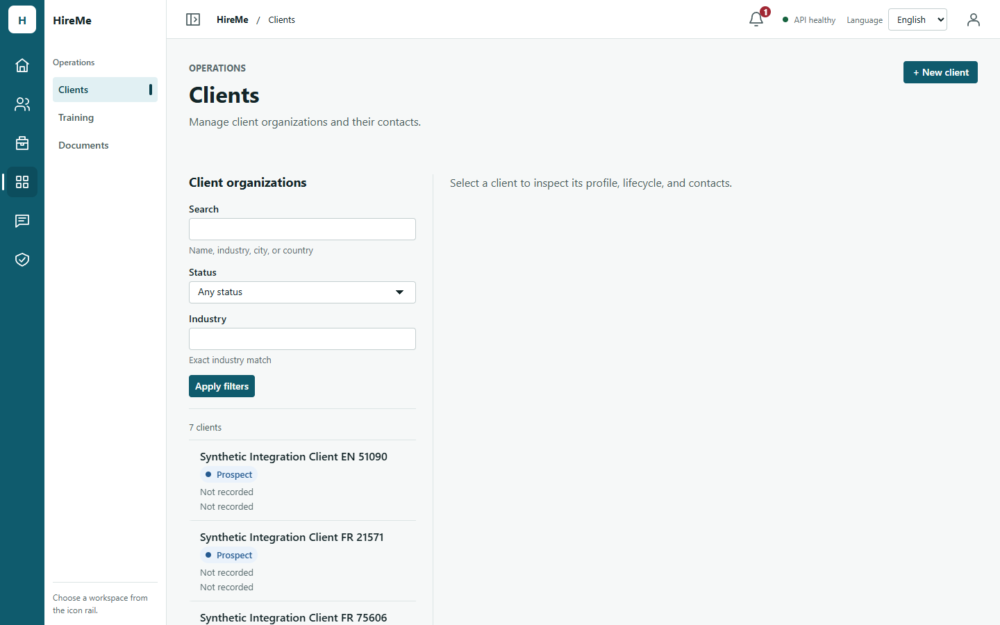
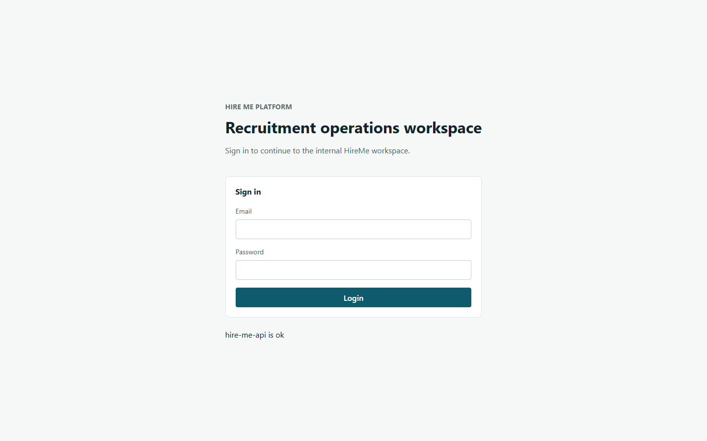

# Issue #202 Scope A — real-API token expiry acceptance (PR #203)

Date: 2026-10-14. Branch `fix/issue-202-web-auth-request-core` after merging integration
`a19647c` (#199 Notification Center, #201 creation drawers, #200 preflight).

## Setup

- Throwaway PostgreSQL 16.4 container (tmpfs, Docker-assigned port), provisioned with
  `pnpm test:db:provision`; never the shared 5432 database. Synthetic users, clients,
  tasks and messages only.
- API from this branch (`tsx src/main.ts`, `NODE_ENV=development`) with
  `ACCESS_TOKEN_TTL_SECONDS=60` (the configured minimum). Server refresh limiter
  (20/min per IP) and proxy settings unchanged.
- Web: Vite dev server (React StrictMode) from this branch, installed Chrome through
  `playwright-core`, 1440×900, EN.
- Tokens expire **naturally**: nothing is forged or edited. While waiting, the tab is
  reported as hidden (`visibilitychange`), as a backgrounded tab would be, so the
  visibility-aware shell polls stay suspended and the expiry is first met by the burst.
  Headless Chrome never reports background tabs as hidden, so the scripts emulate the
  document visibility; application code is untouched. Each wait asserts there was no API
  traffic while hidden.
- Scripts: [`tools/expiry.mjs`](issue-202-auth-expiry/tools/expiry.mjs) (phases A–F) and
  [`tools/expiry-transient.mjs`](issue-202-auth-expiry/tools/expiry-transient.mjs)
  (phase C with a timeline). Raw request logs are in
  [`results/`](issue-202-auth-expiry/results/).

## Results

| Phase | Check | Result |
| --- | --- | --- |
| A — expiry, simultaneous module requests | After 68 s hidden, showing the tab polls the notification list and unread summary while Tasks (5 parallel list requests), Missions and Clients open back to back | Both shell requests got `401`; **exactly one** `POST /auth/refresh` (201); both were replayed and returned 200. Tasks/Missions/Clients requests issued during or after the refresh used the rotated token (no 401). No 401 after the refresh, no sign-out, Clients rendered. |
| A — concurrency (from C) | Two concurrent Missions list requests (StrictMode) after expiry | Both `401`, one refresh (201), both replayed to 200. |
| B — reload | Hard reload after recovery | Session restored without login, **one** refresh (StrictMode double bootstrap shares it). |
| C — transient failure | Refresh answered `503` once (intercepted) | One attempt; the original 401s returned as-is, not replayed; session kept; no automatic retry in the next 10 s. The next user action refreshed once (201) and both Missions requests were replayed to 200. |
| D — revocation | The refresh cookie is replayed outside the browser (rotation), then the tab's own refresh presents the old token | Exactly one refresh (401, reuse detected → session family revoked); returned to sign-in once; no further refresh or module calls; reload stays signed out (one 401). |
| E — missing cookie, dirty drawer | Cookie cleared, mission creation drawer open with input; the shell's own 60 s poll meets the expiry | One refresh (401), signed out; no drawer left and the app is not inert; signing in again works. |
| Page errors | All phases | None |

Phase C in the full run (`results/run-full.txt`) shows two failed checks: that version
counted every refresh in a 3 s window that also contained the next user action, so the
second, successful refresh was misread as a retry. The focused rerun separates the two
waves and passes 7/7. All other full-run checks passed (22/24).

## Not covered here

- Cross-tab refresh: observed in phase F and documented separately in
  [the cross-tab limitation](../design/auth-cross-tab-refresh-limitation.md).
- Refresh `429`: covered by unit tests only; reaching the real limiter would need
  more than 20 refreshes per minute from one IP.
- Production build, other browsers, real devices and reverse-proxy deployments.
