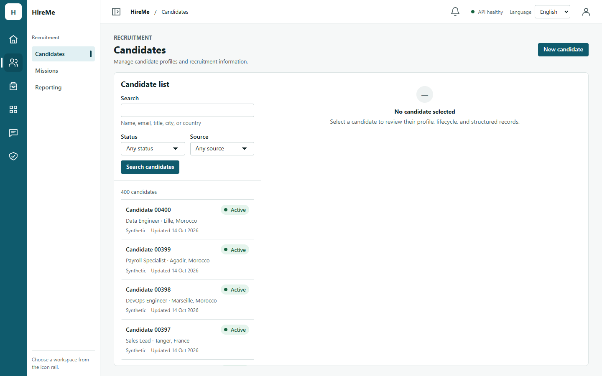
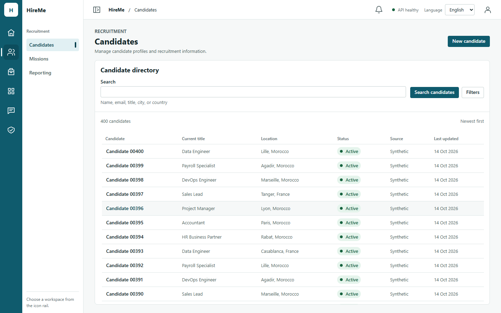
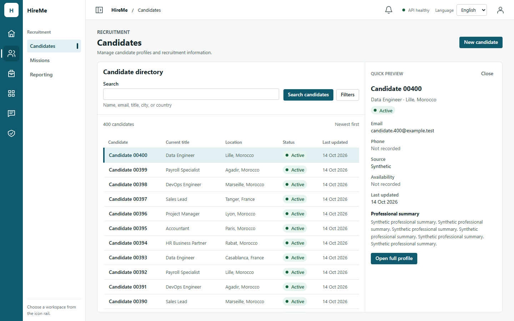
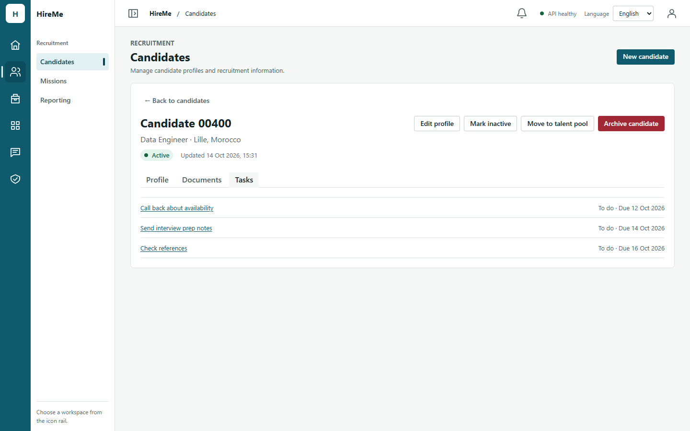
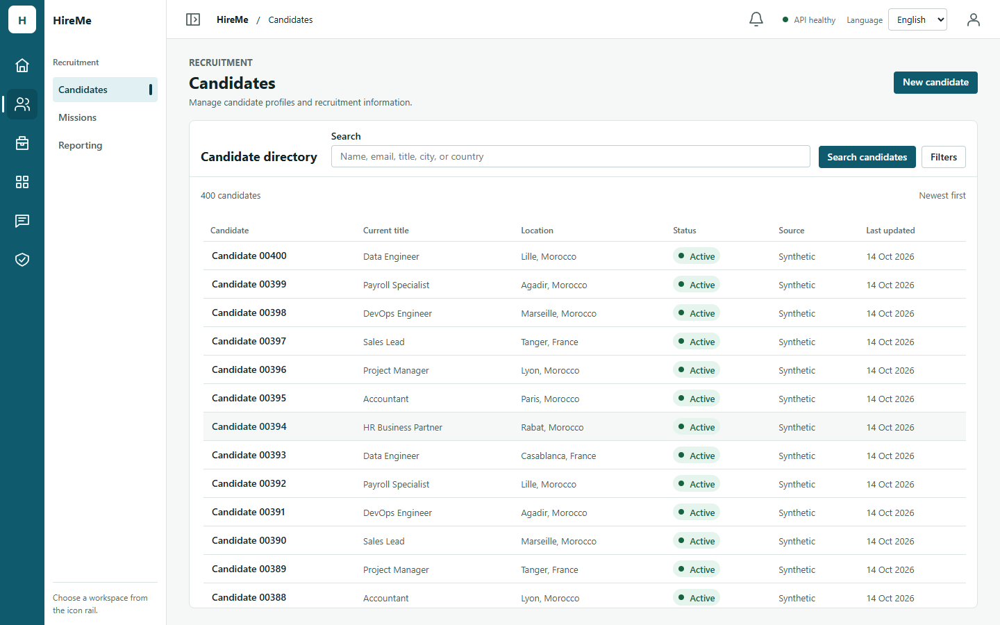
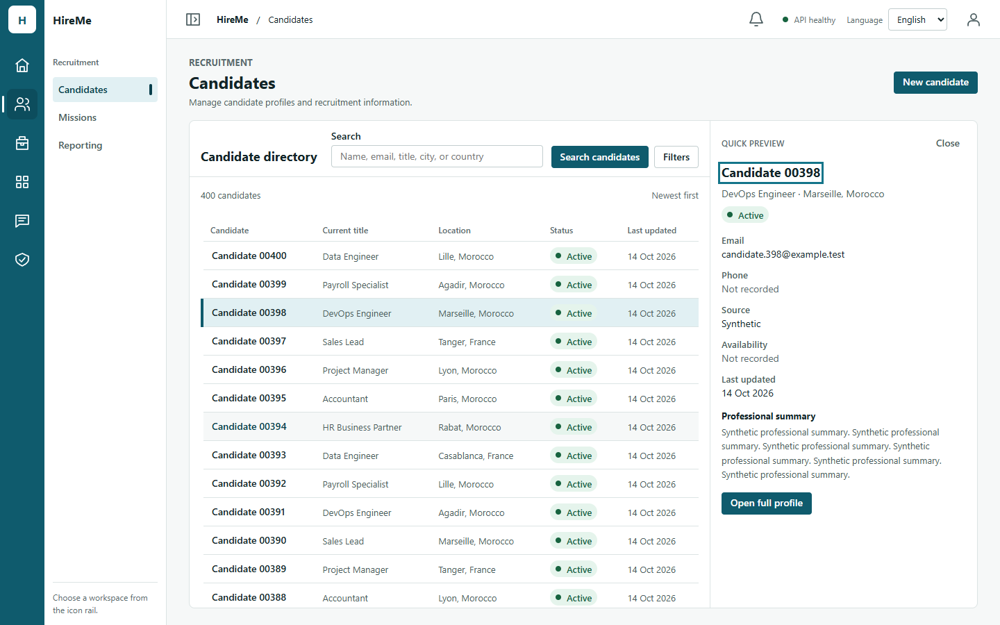
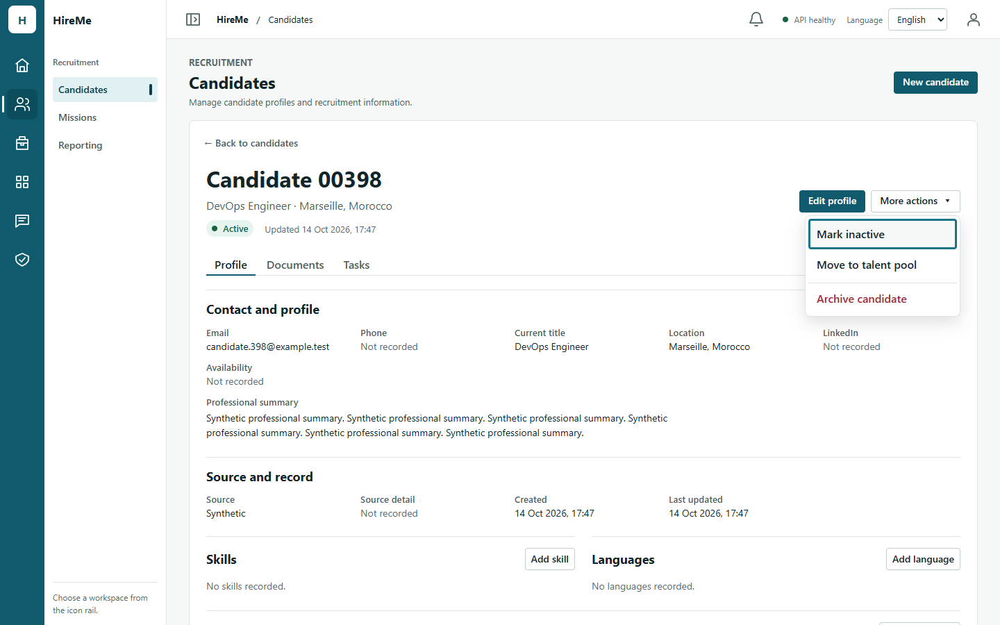
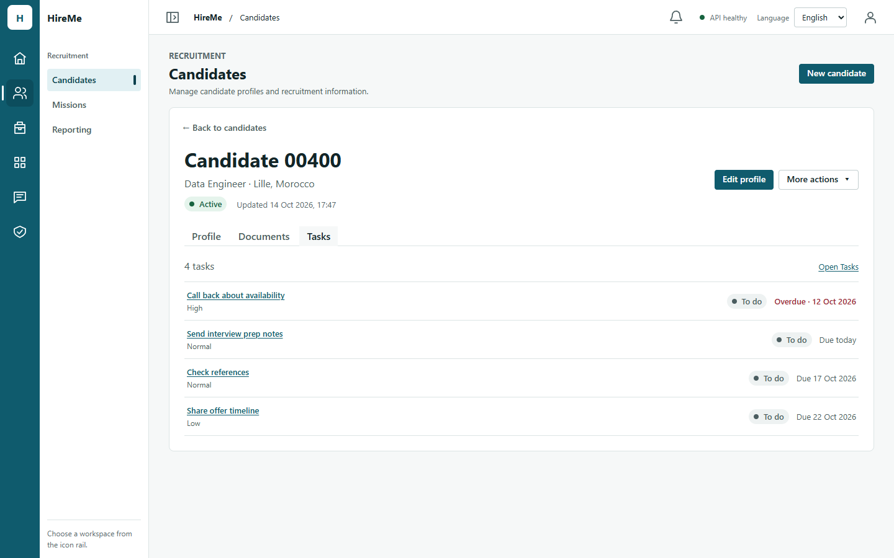
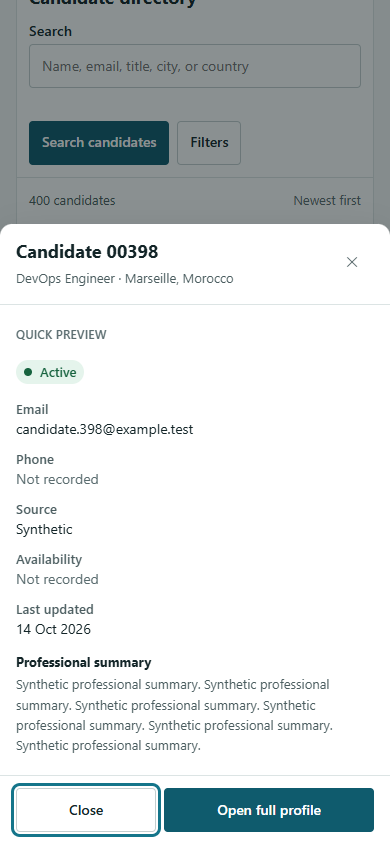
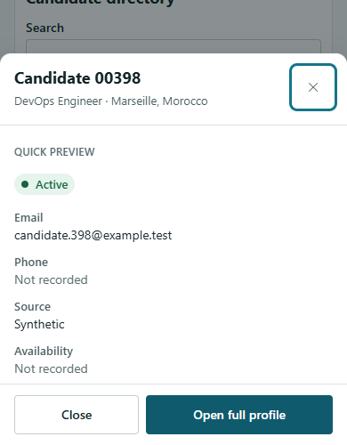

# Issue #204 — Candidates Workspace v2.0 evidence

Date: 2026-10-14. Base `main` `14fc745` (#194 merged). Frontend only: no API, contract,
schema, permission or dependency change. Figma:
[Entity Workspace v2.0](https://www.figma.com/design/t91ZR5WJb86Cyt71r9ElLM), Candidates
frames 01–03 (static concept frames, viewed read-only).

## Existing architecture (Phase 0)

- `CandidatesPanel` owns every read, write, lock, session boundary and permission flag;
  `CandidateWorkspace` is presentation only (the dev review surface in
  `candidate-preview/` renders it with synthetic data). This split is kept.
- The list is one server page (`GET /v1/candidates`, 20 per page, newest first) with
  search, status and source filters. **The list API has no sort parameter.**
- Selecting a row read the full record (`GET /v1/candidates/:id`) into a permanently
  allocated detail pane; with nothing selected that pane showed "No candidate
  selected" ([before](issue-204-candidates-workspace-v2/before-en-directory-1440.png)).
- The deep link `/candidates?candidate=<id>` was a one-shot initial intent, replaced in
  history on every selection; Back never returned from a record to the list.
- Candidate forms are uncontrolled, opened on demand, and had no unsaved-change
  protection. Creation was an inline form above the list.
- Related reads that exist: `GET /v1/documents?candidateId=` (`documents:view`) and
  `GET /v1/tasks?candidateId=` (`tasks:view`). **There is no read of one candidate's
  mission processes across missions** (only per mission).

## Figma vs supported domain (not invented)

| Figma | Decision |
| --- | --- |
| Statuses "Qualified", "Interview" | Not candidate statuses. The real ones are Active, Inactive, Talent pool, Archived. |
| "Experience 6 years", "Owner: Recruitment team" | No such candidate fields. The preview shows email, phone, source, availability, last update and the summary excerpt the row already carries. |
| Sort control | The list API has no sort. The directory states the server order ("Newest first"). |
| Columns / "…" menu | Not built (no requirement beyond presentation); columns adapt to width instead. |
| Applications tab | Not built: no cross-mission read exists. Adding one is a backend decision. |
| Activity tab | No candidate activity feed exists. Tasks linked to the candidate are shown as **Tasks**. |
| "Interviews" destination in the context panel | Not a current route; untouched. |

## What changed

| Area | Change |
| --- | --- |
| `CandidateDirectory.tsx` (replaces `CandidateList.tsx`) | Full-width semantic table: name (row button), current title, location, status, source, last update. Pagination unchanged. |
| `CandidateFilters.tsx` | Search in the toolbar row; status and source behind an on-demand `Filters` disclosure in the same form (count of applied filters on the toggle). Same query and page-1 rule. |
| `CandidateQuickPreview.tsx` (new) | Non-modal preview built from the list row: no request. Focus to its heading; Escape/Close return focus to the row. No compensation, consent or write actions. |
| `CandidateFocusedRecord.tsx`, `CandidateRecordTabs.tsx`, `CandidateRelated.tsx` (new) | Full-width record with Back to candidates and section tabs (Profile, plus Documents and Tasks only with their view permission, each read once on first open, bounded to 20). The profile tab stays mounted. |
| `CandidateDetailView.tsx` | Existing record unchanged; optional `sections` render it as the first tab. |
| `CandidateCreateForm.tsx` | Same seven fields and request, now in the shared `CreationDrawer` (#201). |
| `use-record-leave-guard.ts` (new) | A record form that received input asks before leaving; the browser prompts on reload. No form logic changed. |
| `CandidatesPanel.tsx` | Preview state; record open/close synced with the URL; related loaders. Writes, locks, session reset unchanged. Strict Mode remount re-reads the URL record. |
| `App.tsx` | Candidates take `recordCandidateId` from the URL; opening a record pushes its deep link, Back to candidates pushes `/candidates`. Shell and notification navigation ask through `requestNavigation`. |
| `navigation-guard.ts` | Blockers stack; optional `shouldBlock`; `requestNavigation` for in-app links; a confirmation given before the browser's return trip is replayed after it (fixes a lost Back after a native `confirm`). |
| `ui/Workspace.tsx`, `workspace.css` | `split="preview"`: directory + 18–24rem preview from a 44rem container, only while a preview pane exists. |
| i18n EN/FR | `candidate.directory`, `preview`, `record`, `filters.toggle*`. |

## Screenshots (synthetic data, production build)

| Before | After |
| --- | --- |
|  |  |
| Quick preview | Focused record (Tasks) |
|  |  |

Also in the folder: FR directory/preview/record at 1440, EN preview at 1024 and 768,
EN directory/preview/record and FR preview at 390, and before at 768 (EN) and 390 (FR).

## Functional and accessibility evidence

- **Browser (installed Chrome, production build, real local API, throwaway DB):**
  96/96 checks, EN and FR at 1440×900, 1024×768, 768×1024, 390×844
  ([results](issue-204-candidates-workspace-v2/results/browser-checks.json),
  [script](issue-204-candidates-workspace-v2/tools/evidence-204.mjs)): one full-width
  pane with no empty record pane; no horizontal overflow in any state; preview beside
  the directory from 1024, stacked below at 768 and 390; focus to the preview heading,
  Escape back to the row; Tab reaches Open full profile, Shift+Tab reaches Close;
  record heading focused on open; the URL is the deep link; Back to candidates returns
  focus to the row; browser Back/Forward between directory and record; reload keeps
  the record; a new browser session opens the deep link after sign-in; Back with
  unsaved input asks, stays on dismiss (input kept), leaves on accept; no page errors.
- **Unit/integration (vitest):** 11 new v2 tests (preview sends no request and shows no
  restricted data; focus return; one detail read per open, no list re-read on return;
  URL-owner sync; related sections per permission, read once each with `candidateId`
  and page size 20; safe failure with retry; tab keyboard; unsaved-input prompts and no
  prompt when clean or cancelled; open form survives a tab switch), 5 new guard tests,
  1 App Back/Forward test. Existing candidate suites were updated only where the
  interaction changed (open via preview, creation in the drawer, filters on demand).

## Performance (same harness, CPU 4×, production build, 400 synthetic candidates)

| Measure | Before | After |
| --- | --- | --- |
| JS bundle | 1,245.06 kB (308.14 gzip) | 1,258.09 kB (311.63 gzip), +1.0% |
| CSS | 146.35 kB (19.01 gzip) | 151.58 kB (19.61 gzip) |
| Requests on cold `/candidates` | 5 | 5 |
| Requests to look at a row | 1 (`GET /v1/candidates/:id`) | **0** (preview from the row) |
| Row click → content (median / p95) | 749 / 845 ms (record) | 231 / 602 ms (preview) |
| Open full profile (median / p95) | — | 1,052 / 1,449 ms, 1 request |
| Back to directory (median) | — | 327 ms, **0** requests |
| Deep link requests | 6 | 6 |
| Idle 65 s (preview open) | 2 shell polls | 2 shell polls (no new polling) |
| DOM per interaction, isolated (after GC) | +8 nodes per selection | ~0 per preview, ~+7.5 per record open/close |

Cold loads are highly variable on this shared machine (baseline runs ranged 2.7–18 s).
The first sequential run showed after slower (4.5 s vs 1.7 s median); interleaved
back-to-back runs gave after 2.9 / 4.1 s against before 3.5 / 5.8 s, so no regression
can be attributed to the change. The combined harness's memory series grows faster
after because each "cycle" there contains two or three interactions instead of one;
the isolated runs ([leak.mjs](issue-204-candidates-workspace-v2/tools/leak.mjs)) compare
equal work. The small per-record growth exists before and after (pre-existing).
Raw: [before](issue-204-candidates-workspace-v2/results/perf-before.json),
[after](issue-204-candidates-workspace-v2/results/perf-after.json).

## Security impact

- No new endpoint, payload or permission. Server-side authorization and redaction are
  unchanged and still decide everything shown.
- The preview renders only ordinary summary fields from the list row; compensation and
  consent are never shown in the directory or the preview, whatever the actor's
  access (tested). Restricted areas stay in the record under their own permissions.
- Related sections exist only with `documents:view` / `tasks:view` and use the owning
  module's list with the candidate filter; the server applies document visibility and
  task scope. Failures show a generic message.
- The URL carries only the candidate UUID, as before. Nothing is written to web
  storage. A session switch still discards the previous principal's record and list.

## Refinement after the 14 Oct product review

The desktop directory and side preview were approved in principle. Changes on top of
`6cdbed9`, frontend only, Candidates plus two shared UI adjustments:

| Area | Change |
| --- | --- |
| Mobile preview (P0) | Below a 44rem Candidates workspace (phones, 200% zoom) the preview opens at once as a bottom sheet: the shared `Drawer` with a new `placement="bottom"` (full width, height capped to the dynamic viewport, rounded top, safe areas). Modal: Tab kept inside, Escape/Close/scrim close it, focus returns to the row, the app behind is inert, the directory keeps page, filters and scroll position. Same content as the desktop pane (built from the list row, no request). The desktop side pane is unchanged; the choice follows the measured workspace width (`use-narrow-container.ts`), so 768px tablets with the overlay navigation (≈46rem) keep the side pane. |
| Directory toolbar | Pane heading and search on one row from a 48rem workspace; the search hint is the placeholder and stays the accessible description. Same form, same filters disclosure, same query. 148px → 81px tall at 1440. |
| Record actions | Edit profile is the primary button. Mark active/inactive, Move to talent pool and Archive candidate are in a `More actions` menu button (WAI-ARIA menu: Enter/Space/ArrowDown/ArrowUp to open, arrows/Home/End, Escape returns focus, Tab or outside click closes). Archive is set apart by a rule and its wording. Each item runs the same handler with the same confirmation and permission as before; while a write runs the button shows progress and cannot open. |
| Record hierarchy | Larger candidate name in the focused record, status and update time beside it, actions aligned with the identity. |
| Tasks and Documents | A count line and a link to the owning module above the list; each task shows its title (link to the task), priority, status badge and due wording from the Tasks module's own labels and tones (`Overdue` in words plus danger color, `Due today`, `Due <date>`, `No due date`). Empty states keep the explanation and offer the module link. Still one bounded read per section, on first open. |

Screenshots (synthetic data, production build):

| Desktop directory (compact toolbar) | Desktop quick preview |
| --- | --- |
|  |  |
| **Focused record + More actions** | **Focused Tasks section** |
|  |  |
| **Mobile sheet 390×844** | **Mobile sheet 390×500 (short / keyboard)** |
|  |  |

Also: sheet at 720×450 (1440 at 200% zoom), FR sheet, FR record and Tasks, Tasks at
390, and the previous toolbar (`refined-before-toolbar-en-1440.png`).

Verification:

- Browser: 166/166 checks, EN and FR, at 1440×900, 1024×768, 768×1024, 390×844,
  390×500 and 720×450 ([results](issue-204-candidates-workspace-v2/results/refined-browser-checks.json),
  [script](issue-204-candidates-workspace-v2/tools/evidence-refine.mjs)): no horizontal
  overflow; side pane from 44rem, sheet below; sheet visible at once with actions inside
  the viewport, title focused, app inert, Tab kept inside, content fits or scrolls in
  its own body; Escape and footer Close close it with focus back on the row and the
  list scroll position unchanged; Open full profile from the sheet; record heading
  focused; Edit profile primary; More actions opens by keyboard on its first item
  inside the viewport and Escape returns focus; Tasks shows 4 linked tasks with the
  overdue and due-today wording; Back/Forward, reload, unsaved-input prompt; no page
  errors.
- vitest: 4 new tests (menu keyboard pattern and contents, three mobile-sheet tests);
  existing tests now reach lifecycle and archive actions through the menu.

Performance against the PR head build (`6cdbed9`), same harness:

| | PR head | Refined |
| --- | --- | --- |
| JS | 1,258.15 kB (311.64 gzip) | 1,262.47 kB (312.87 gzip), +0.3% |
| CSS | 151.58 kB (19.61 gzip) | 155.13 kB (20.04 gzip) |
| Requests: cold, deep link, preview, open record, back | 5, 6, 0, 1, 0 | 5, 6, 0, 1, 0 |
| Row → preview (median / p95) | 175 / 429 ms | 251 / 366 ms |
| Open full profile (median / p95) | 939 / 1,425 ms | 975 / 1,204 ms |
| Idle 65 s | 2 shell polls | 2 shell polls |
| DOM nodes / heap after 40 cycles | 15,991 / 18.59 MB | 15,973 / 18.61 MB |

Interaction timings move within run-to-run noise; cold loads stay inconclusive on this
machine (interleaved medians 3.5 s and 1.2 s for the PR head, 1.5 s and 1.4 s refined),
so no speed claim is made. Raw: [PR head](issue-204-candidates-workspace-v2/results/refined-perf-pr-head.json),
[refined](issue-204-candidates-workspace-v2/results/refined-perf-new.json).

## Remaining limitations

- Human visual sign-off of the refinements (desktop and 390px sheet).
- No Applications section (deferred by product decision; needs a cross-mission backend
  read) and no sort (API).
- Unsaved-input protection covers the focused record and the creation drawer, not
  the directory's typed but unapplied search.
- Chromium only; no screen-reader or physical-device pass (the on-screen keyboard was
  approximated with a 390×500 viewport; there are no inputs in the sheet).
