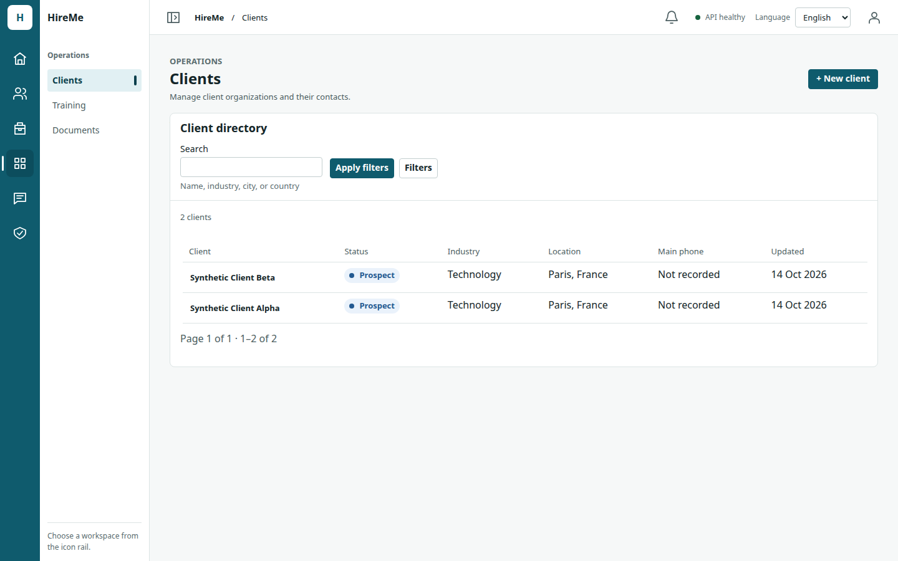
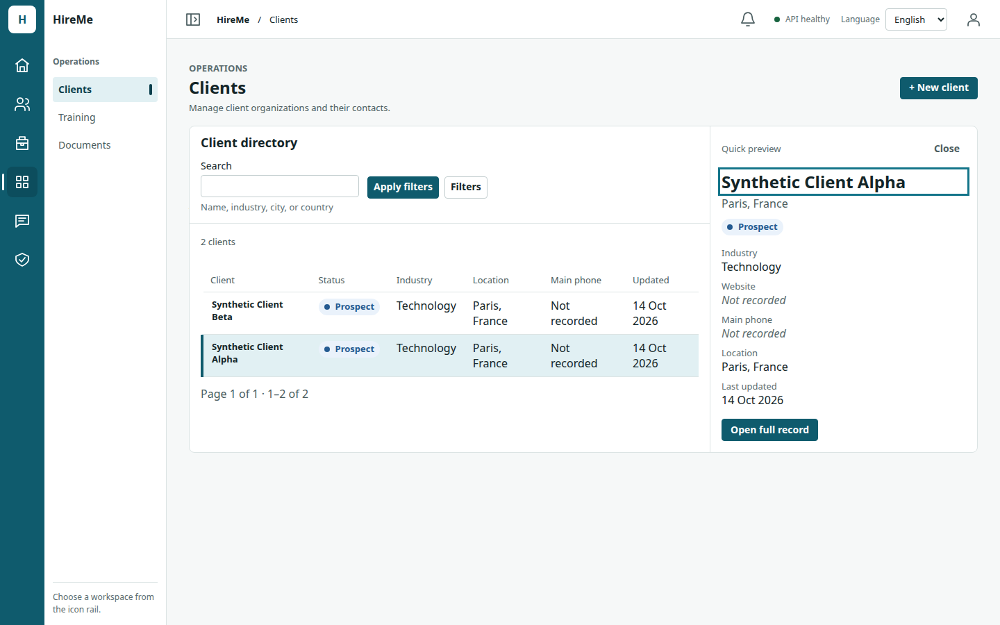
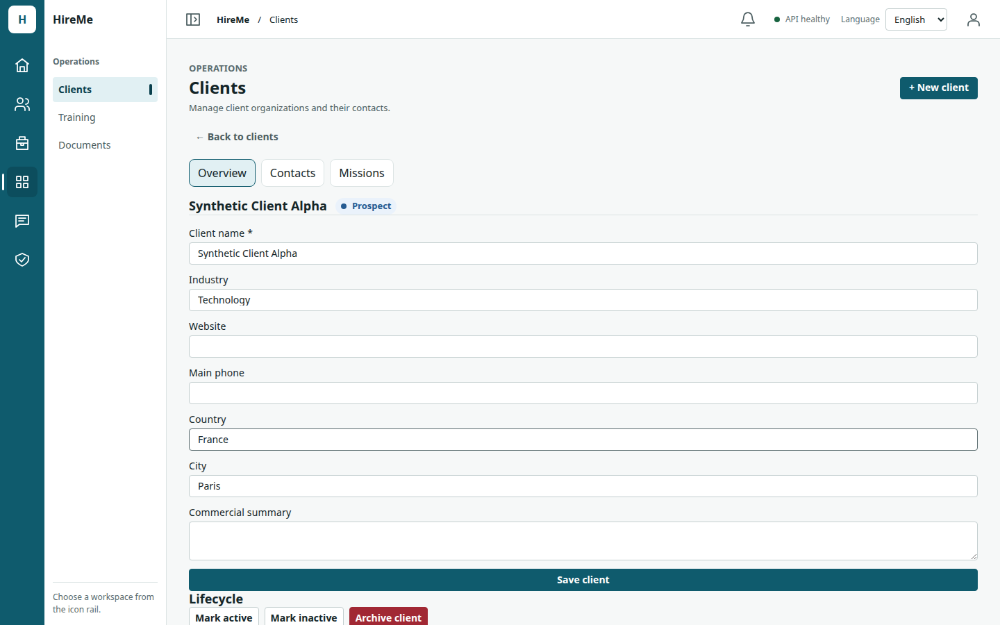
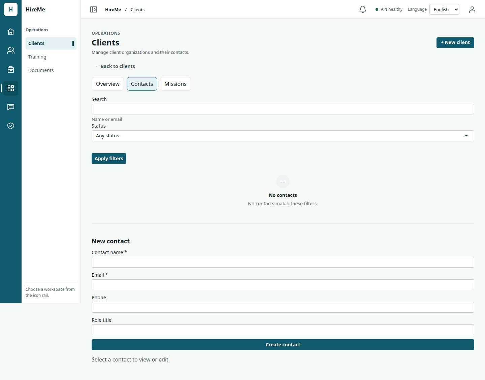
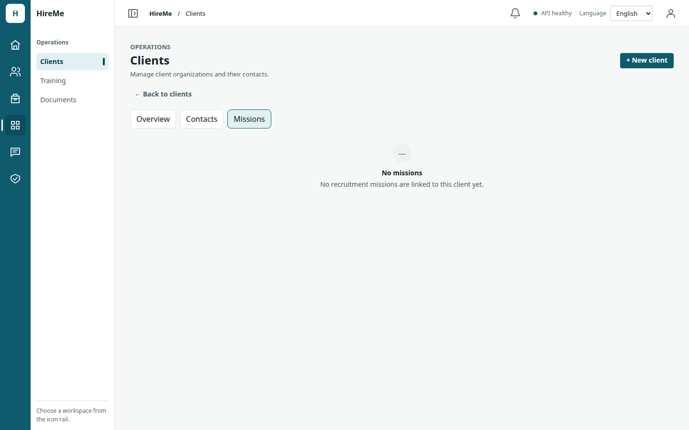
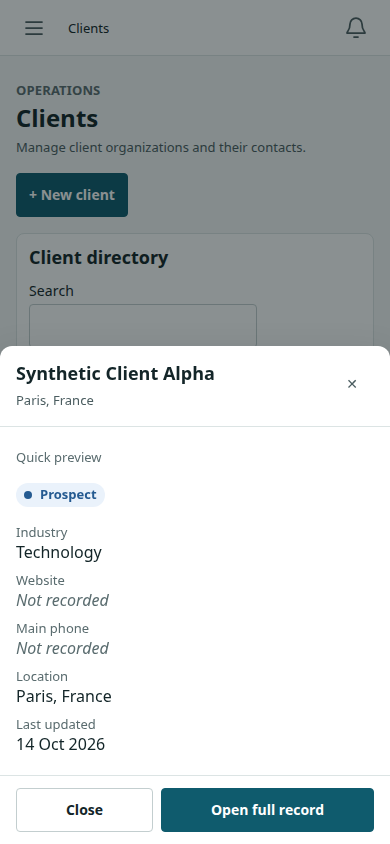
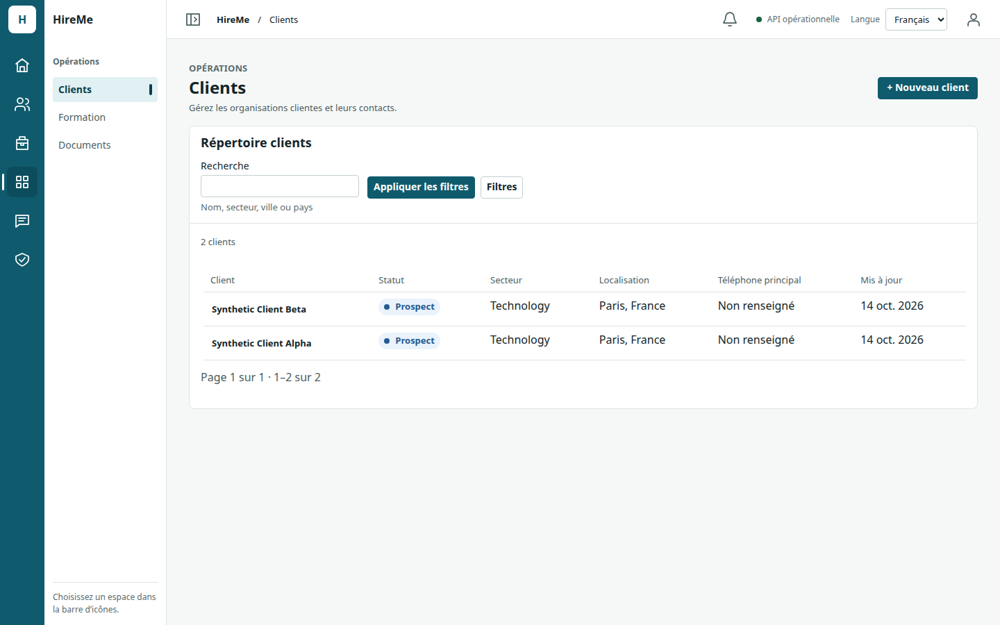
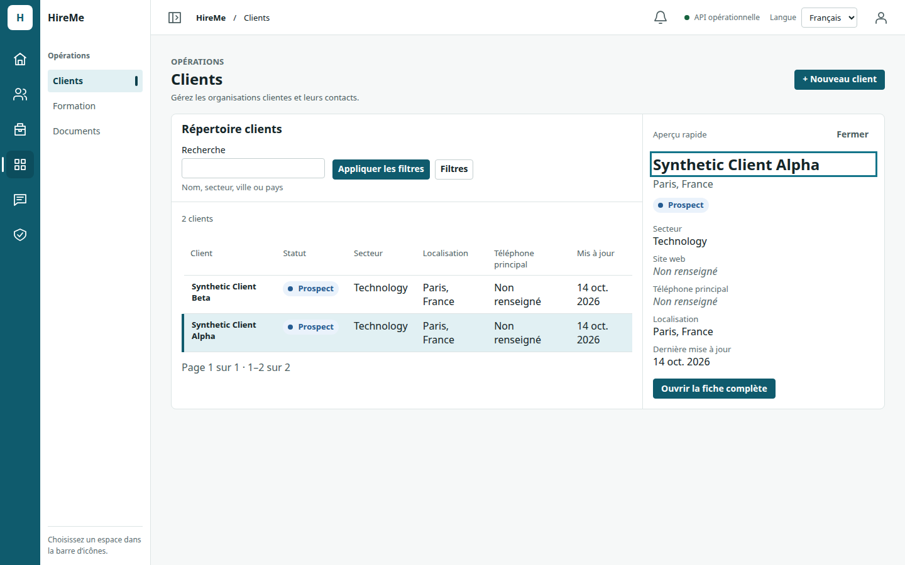

# Issue #204 — Clients Workspace v2.0 evidence

Date: 2026-10-14. Base `main` `4890f9b` (#206 Missions v2.0 merged). Frontend only:
no API, contract, schema, or permission change. Reuses the Entity Workspace v2.0
interaction model from Candidates (#205) and Missions (#206).

## What changed

| Area | Change |
| --- | --- |
| `ClientDirectory.tsx` (replaces `ClientList.tsx`) | Full-width table: client, status, industry, location, phone, updated. Row opens quick preview only (no detail read). |
| `ClientQuickPreview.tsx` | List-row data only; **no commercial summary** in preview. Side pane or bottom sheet. |
| `ClientFocusedRecord.tsx` | Overview (profile + lifecycle), Contacts, optional Missions tab (`missions:view`, first page via existing `listMissions` + `clientId`). Leave guard for unsaved forms. |
| `ClientsWorkspace.tsx` | Directory + preview + record; creation drawer unchanged. |
| `ClientsPanel.tsx` | Preview state; record open/close with URL `/clients?client=<id>`; detail and contacts load only when the record opens. |
| `ClientFilters.tsx` | Compact toolbar: search inline; status and industry in Filters disclosure. |
| `App.tsx` / `record-deep-links.ts` | `clientDeepLink`, `recordIntent.clientId`. |

## Screenshots (synthetic data, production build, Chrome headless)

| Directory (1440) | Quick preview (1440) |
| --- | --- |
|  |  |

| Focused record | Contacts | Related missions |
| --- | --- | --- |
|  |  |  |

| Mobile sheet (390×844) | FR directory (1440) | FR preview (1440) |
| --- | --- | --- |
|  |  |  |

Additional viewport captures live under `issue-204-clients-workspace-v2/results/`.

## Build size (local `pnpm --filter @hire-me/web build`, PR validation head)

| Asset | Gzip |
| --- | --- |
| `index-*.js` | 410.03 KB |
| `index-*.css` | 20.76 KB |

Same single-bundle shape as pre-change Clients (no new lazy route). JS gzip reflects current monolith size on this branch, not a Clients-only delta.

## Browser validation (Chrome, production `vite preview`, local API, synthetic fixtures)

Harness: `docs/audit/issue-204-clients-workspace-v2/tools/evidence-clients.mjs`  
Results: `issue-204-clients-workspace-v2/results/browser-checks.json` — **104/104** checks passed (EN + FR).

Viewports: 1440×900, 1024×768, 768×1024, 390×844, 390×500, 720×450 (200% zoom).

Verified:

- Full-width directory only until preview/record; no horizontal overflow.
- Preview from list row: **zero** `GET /v1/clients/:id` (network listener).
- Side preview ≥44rem workspace; bottom sheet below; Escape + scroll preservation on sheet sizes.
- Open full record → `/clients?client=<uuid>`; browser Back/Forward; unsaved-form guard on Back.
- Contacts and Missions tabs on focused record; missions list renders when tab opened.
- No page errors in either locale.

## Unit / integration (local)

- `pnpm check:architecture` — pass (CSS comment uses `Issue 204` without `#` hex false positive).
- `pnpm format:check`, `pnpm exec turbo run lint typecheck test --filter=@hire-me/web` — pass (1010 tests).
- `ClientsPanel.test.tsx`: preview without detail GET; record flow; back + leave guard.

## Security

- Preview never renders `commercialSummary` or other commercial fields from list rows (commercial on record still gated by `commercial_data:access`).
- Record reads and writes unchanged; server authorization unchanged.
- Missions tab uses the same scoped `listMissions` API as elsewhere.

## Known limitations

- Missions tab shows the first page only; no new cross-module aggregate APIs.
- Figma-only fields without list/record data remain omitted.
- Full missions performance harness (`measure-missions.mjs` equivalent) not re-run for Clients; behavioral regression covered by preview GET accounting and existing panel tests.
