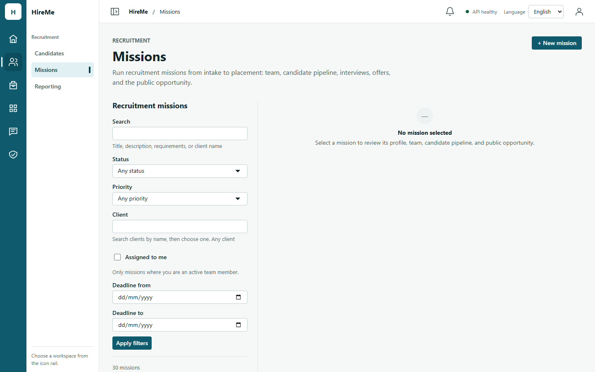
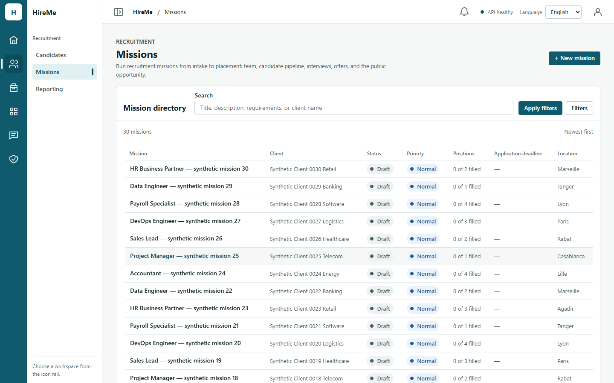
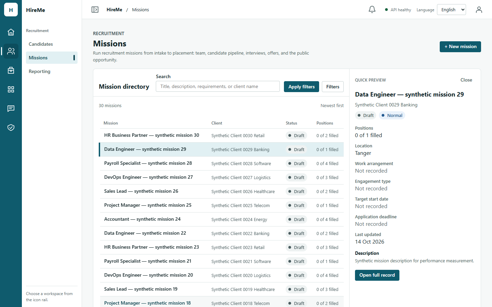
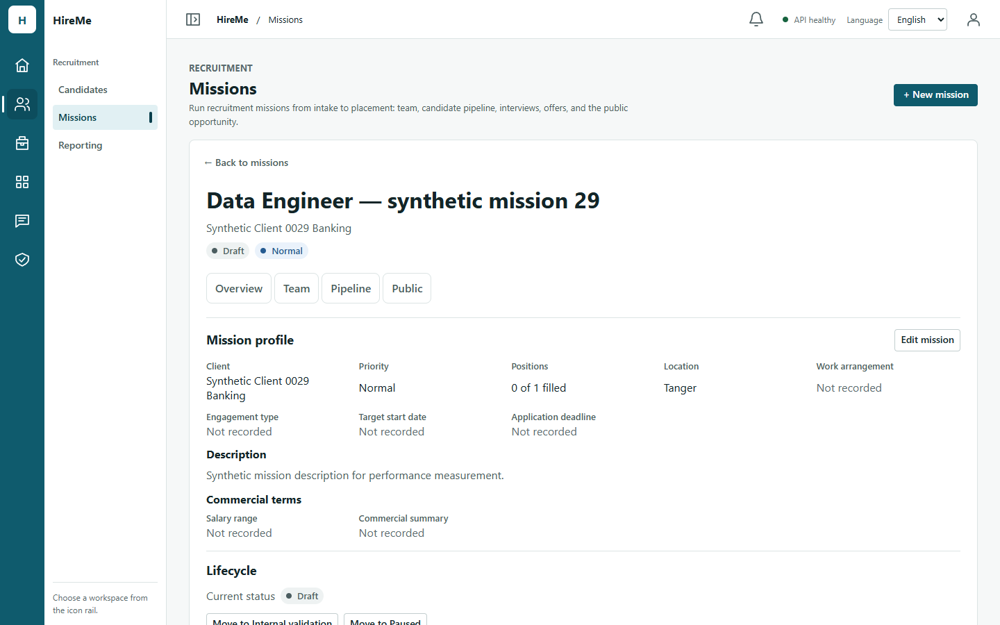
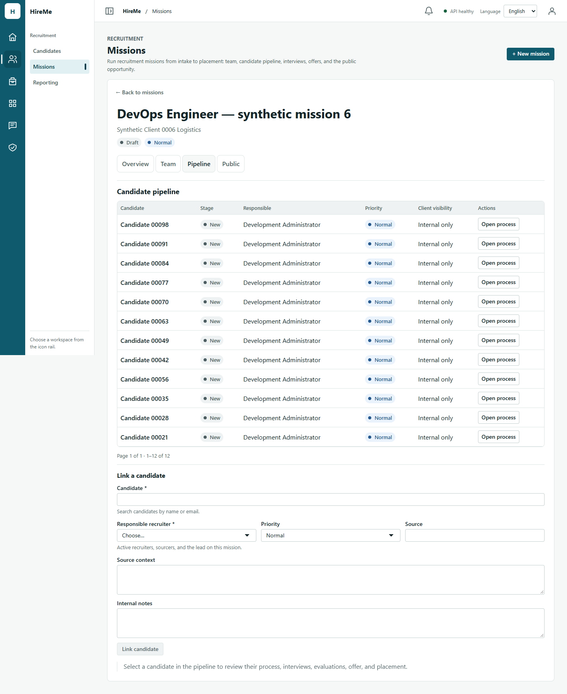
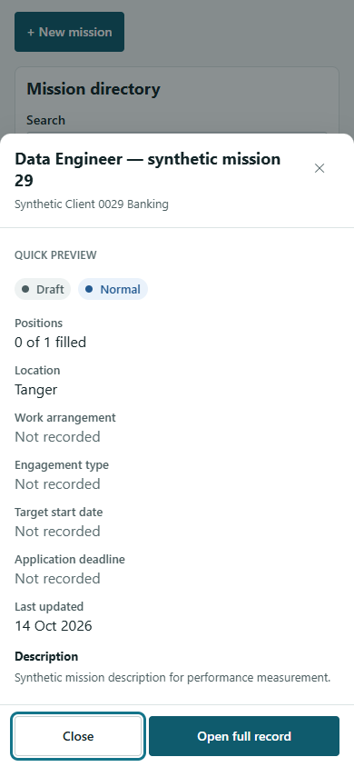

# Issue #204 — Missions Workspace v2.0 evidence

Date: 2026-10-14. Base `main` `e2ff257` (#205 Candidates v2.0 merged). Frontend only:
no API, contract, schema, permission or dependency change. Figma:
[Entity Workspace v2.0](https://www.figma.com/design/t91ZR5WJb86Cyt71r9ElLM), Missions
frames 01–03 (static concept frames, viewed read-only).

## Existing architecture

- `MissionsPanel` owns every read, write, lock, session boundary and permission flag;
  `MissionsWorkspace` is presentation. This split is kept.
- The list is one server page (`GET /v1/missions`, newest first) with search, state,
  priority, client, deadline range and "assigned to me" filters. **The list API has no
  sort parameter.**
- Selecting a row opened the full record in a permanently allocated detail pane and
  started a 5-request chain (mission, assignments, pipeline candidates, public
  opportunity, applications) for every row looked at.
- The deep link `/missions?mission=<id>` (plus process and interview intents) was a
  one-shot initial intent, replaced in history on selection; Back did not return from
  a record to the list.
- The record already has Overview, Team, Pipeline and Public sections gated by
  permission, with its own forms, lifecycle actions and placement confirmations.
  Creation already uses the shared `CreationDrawer`.

## Figma vs supported domain (not invented)

| Figma | Decision |
| --- | --- |
| Statuses "New", "In progress", "Interviewing" | Not mission states. The real lifecycle states are shown (Draft, Internal validation, Active, …) with priority as a separate badge. |
| "Owner" column (recruiter initials) | The list row carries no assignee. Team stays in the record (Team section); the directory has "Assigned to me" as a filter, as before. |
| Preview counts "Candidates 14", "Interviews 4" | Not in the list row; computing them would need the pipeline reads this change removes from a row click. The preview shows positions (filled / total), location, work arrangement, engagement, target start, deadline and update time, all from the row. |
| Sort and Columns controls | No sort in the API; the directory states the server order ("Newest first"). Columns adapt to width instead. |
| Record tabs Overview / Pipeline / Candidates / Activity | The existing sections are kept: Overview, Team, Pipeline, Public (each only with its permission). There is no mission activity feed. |
| Record subtitle "client · city · priority", Edit | Kept from real fields: client, state and priority badges; editing stays in the Overview section's existing form. |

## What changed

| Area | Change |
| --- | --- |
| `MissionDirectory.tsx` (replaces `MissionList.tsx`) | Full-width semantic table: mission (row button), client, status, priority, positions, application deadline, location. Columns drop by workspace width; cards below 30rem. Pagination unchanged. |
| `MissionFilters.tsx` | Search in the toolbar row; state, priority, client, deadline range and "assigned to me" behind an on-demand `Filters` disclosure in the same form (count of applied filters on the toggle; an invalid date range opens it). Same query and page-1 rule. |
| `MissionQuickPreview.tsx` (new) | Built from the list row: no request. Side pane from a 44rem workspace (focus to its heading, Escape/Close return focus to the row); bottom sheet below (shared `Drawer placement="bottom"`). **Commercial terms are never shown**, whatever the actor's access. |
| `MissionsWorkspace.tsx` | Directory view or focused record. The record wraps the existing `MissionDetailPane` (sections, forms, lifecycle, placement, public opportunity unchanged) with "Back to missions" and a leave guard. |
| `MissionsPanel.tsx` | Preview state; record open/close owned by the URL; the 5 record reads now happen only when the record opens. Writes, locks, deep-link process/interview intents and session reset unchanged. |
| `App.tsx` | Missions take `recordMissionId` from the URL; opening a record pushes its deep link, Back to missions pushes `/missions`. |
| Shared: `navigation/use-record-leave-guard.ts`, `layout/use-narrow-container.ts` | Moved from `candidates/` (Candidates changed imports only). The guard ignores search forms and gained `clearOnSubmit` and a failure signal for record forms that stay open after saving. |
| Shared: `ui/Drawer.tsx` | `closeDisabled`: the creation drawer cannot be closed by Escape, ✕ or the scrim while its own create is submitting (Codex P2 on #205). |
| i18n EN/FR | `missions.directory`, `preview`, `record`, `filters.toggle*`. |

## Screenshots (synthetic data, production build)

| Before | After: directory |
| --- | --- |
|  |  |
| **Quick preview** | **Focused record** |
|  |  |
| **Focused record, Pipeline** | **Mobile sheet 390×844** |
|  |  |

Also in the folder: sheet at 390×500 and 720×450 (1440 at 200% zoom), record and
pipeline at 390, FR directory/preview/sheet/pipeline, and before at 390.

## Functional and accessibility evidence

- **Browser (installed Chrome, production build, real local API, throwaway DB):**
  152/152 checks, EN and FR at 1440×900, 1024×768, 768×1024, 390×844, 390×500 and
  720×450 ([results](issue-204-missions-workspace-v2/results/browser-checks.json),
  [script](issue-204-missions-workspace-v2/tools/evidence-missions.mjs)): one
  full-width directory, toolbar under 120px; no horizontal overflow; side preview from
  44rem, sheet below with title focused, app inert, Tab kept inside, Escape/Close back
  to the row; no commercial terms in the preview; Open full record focuses the record
  heading and sets the deep link; Back to missions returns focus to the row; browser
  Back/Forward and reload; pipeline and process deep links; unsaved input asks before
  leaving; no page errors.
- **vitest:** 4 new Missions v2 tests (preview sends no request and shows no
  commercial terms; one record read per open and no list re-read on Back; bottom sheet
  on a narrow workspace; leave guard asks when unsaved or after a failed save, stays
  quiet after a successful save), 1 Drawer test (no close while submitting), 1 App
  Back/Forward test. Existing mission suites (169 tests) were updated only where the
  interaction changed (open through the preview, filters on demand).

## Performance (same harness, CPU 4×, production build)

| Measure | Before (`main`) | After |
| --- | --- | --- |
| JS bundle | 1,262.47 kB (312.87 gzip) | 1,270.42 kB (315.05 gzip), +0.6% |
| CSS | 155.13 kB (20.04 gzip) | 159.57 kB (20.62 gzip) |
| Requests on cold `/missions` | 5 | 5 |
| Requests to look at a row | **5** (mission, team, pipeline, public, applications) | **0** (preview from the row) |
| Row click → content (median / p95) | 1,194 / 1,383 ms (record) | 207 / 371 ms (preview) |
| Open full record (median / p95) | — | 1,381 / 1,637 ms, 5 requests |
| Back to directory (median) | — | 187 ms, **0** requests |
| Deep link requests | 10 | 10 |
| Idle 65 s | 2 shell polls | 2 shell polls (no new polling) |
| DOM per interaction, isolated | ~+29 nodes per selection | ~+1 per preview, ~+27 per record open/close |

Cold loads are noisy on this shared machine; interleaved runs gave after 1.68 / 1.73 s
against before 1.66 / 2.00 s (first-row median), so no speed claim is made either way
([raw](issue-204-missions-workspace-v2/results/cold-interleaved.json)). The combined
harness's memory series grows faster after because each "cycle" contains a preview and
a record open instead of one selection; the isolated run
([leak-missions.mjs](issue-204-missions-workspace-v2/tools/leak-missions.mjs)) compares
equal work. Raw: [before](issue-204-missions-workspace-v2/results/perf-m-before.json),
[after](issue-204-missions-workspace-v2/results/perf-m-after.json).

## Security impact

- No new endpoint, payload or permission. Server-side authorization and redaction are
  unchanged and still decide everything shown.
- The preview renders only ordinary fields from the list row; commercial terms are
  never rendered in the directory or the preview (tested), and stay in the record under
  their existing permission.
- The URL carries only the mission UUID (and process/interview UUIDs), as before.
  Nothing is written to web storage. A session switch still discards the previous
  principal's record and list.

## Remaining limitations

- Human visual sign-off (desktop and 390px sheet).
- No pipeline counts or owner in the directory or preview (not in the list row), no
  sort (API), no activity feed.
- Unsaved-input protection covers the focused record and the creation drawer, not the
  directory's typed but unapplied search.
- Chromium only; no screen-reader or physical-device pass.
