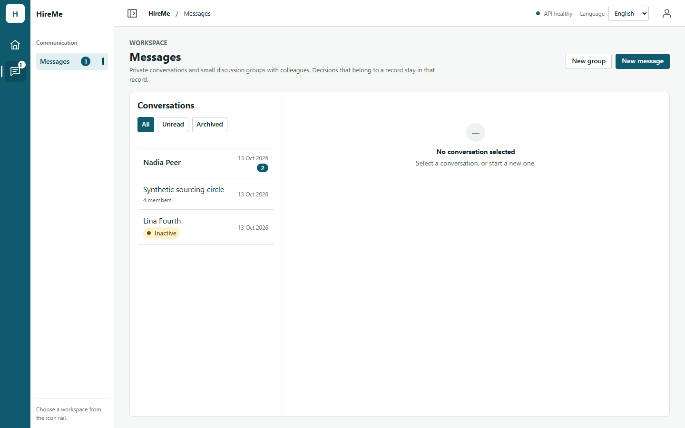
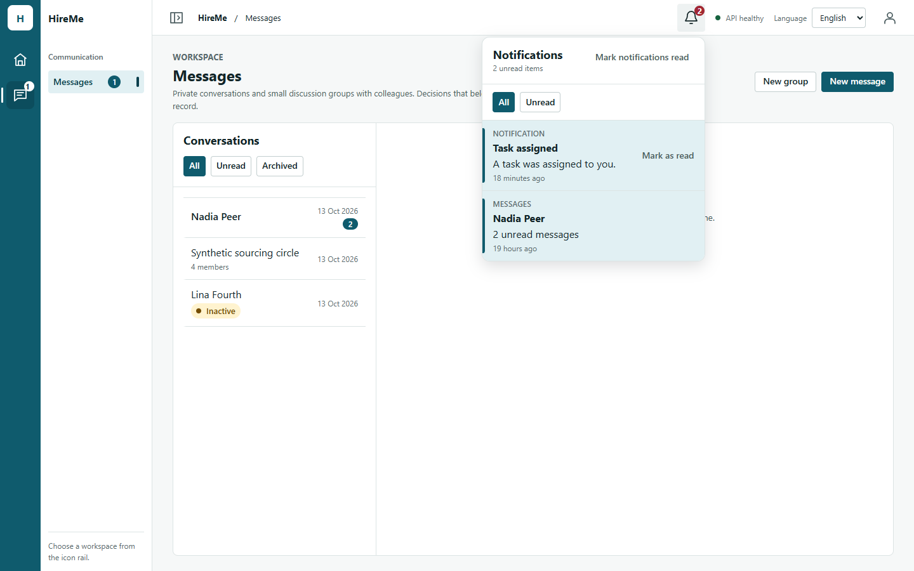
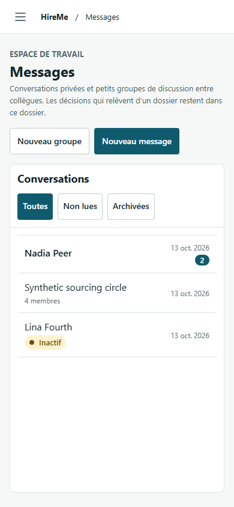
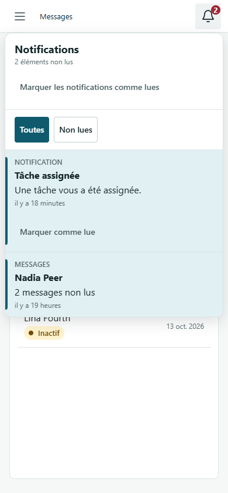

# Notification Center Phase 1 visual evidence

Synthetic records only. The baseline is integration head `bd46f59`; the after set
is the Issue #196 branch with the popover open. Automated measurements in
[`before-results.json`](./notification-center-phase-1/before-results.json) and
[`after-results.json`](./notification-center-phase-1/after-results.json) found no
document-level horizontal overflow or browser page errors at any captured size.

## Primary comparisons

| View | Before | After |
| --- | --- | --- |
| EN 1440 |  |  |
| FR 390 |  |  |

## Coverage matrix

| Locale | 1440 | 1024 | 768 | 390 |
| --- | --- | --- | --- | --- |
| EN before | [image](./notification-center-phase-1/before/messages-en-1440.png) | [image](./notification-center-phase-1/before/messages-en-1024.png) | [image](./notification-center-phase-1/before/messages-en-768.png) | [image](./notification-center-phase-1/before/messages-en-390.png) |
| EN after | [image](./notification-center-phase-1/after/messages-en-1440.png) | [image](./notification-center-phase-1/after/messages-en-1024.png) | [image](./notification-center-phase-1/after/messages-en-768.png) | [image](./notification-center-phase-1/after/messages-en-390.png) |
| FR before | [image](./notification-center-phase-1/before/messages-fr-1440.png) | [image](./notification-center-phase-1/before/messages-fr-1024.png) | [image](./notification-center-phase-1/before/messages-fr-768.png) | [image](./notification-center-phase-1/before/messages-fr-390.png) |
| FR after | [image](./notification-center-phase-1/after/messages-fr-1440.png) | [image](./notification-center-phase-1/after/messages-fr-1024.png) | [image](./notification-center-phase-1/after/messages-fr-768.png) | [image](./notification-center-phase-1/after/messages-fr-390.png) |

The desktop panel measures 352px. At 768px and 390px it uses eight-pixel viewport
insets and remains inside the viewport. The 390px layout stacks long French bulk and
row actions so neither text nor controls clip.
