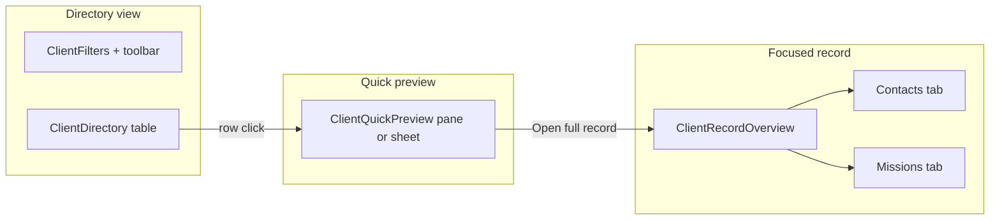

# Clients Workspace v2.1 — design improvement proposal

Status: **proposal only** (no implementation).  
Date: 2026-10-15.  
Baseline: **Clients Workspace v2.0** merged on `main` (`bdfbf5f`, PR #207).  
Brand anchor: **#41554b** (Hire Me green — proposed accent; see §2).

This document proposes visual and interaction refinements within the existing Entity Workspace v2.0 model (directory → quick preview → focused record). It does **not** change API contracts, permissions, or data scope.

## 1. Current implementation (v2.0) — source of truth

| Layer | Primary files | Role |
| --- | --- | --- |
| Container / data | `apps/web/src/clients/ClientsPanel.tsx` | List, preview, and record state; URL `/clients?client=<id>`; loads detail only on record open. |
| Layout shell | `apps/web/src/clients/ClientsWorkspace.tsx` | `PageHeader`, `WorkspaceSurface` (`split="preview"`), directory pane, `ClientQuickPreview` side pane or `Drawer` sheet, `ClientFocusedRecord`. |
| Directory | `apps/web/src/clients/ClientDirectory.tsx` | Full-width table; row → preview; `data-previewed` row chrome. |
| Preview | `apps/web/src/clients/ClientQuickPreview.tsx` | List-row data only; **Open full record** primary path. |
| Record | `apps/web/src/clients/ClientFocusedRecord.tsx`, `ClientRecordOverview.tsx`, `ClientRecordTabs.tsx` | Overview + Contacts + Missions; edit on demand; **More actions** for lifecycle. |
| Filters | `apps/web/src/clients/ClientFilters.tsx`, `ContactFilters.tsx` | Toolbar search; advanced filters in disclosure. |
| Styles | `apps/web/src/clients/client.css` | Container queries, table selection (`--color-brand` inline bar), preview/record spacing. |
| Shared UI | `apps/web/src/ui/workspace.css`, `WorkspaceSurface`, `WorkspaceToolbar`, `CreationDrawer` | Cross-workspace primitives (Candidates/Missions parity). |

**Evidence captures (production build, synthetic data):**  
[`docs/audit/issue-204-clients-workspace-v2.md`](../audit/issue-204-clients-workspace-v2.md) — directory, preview, record, contacts, missions, mobile sheet, EN/FR.

### What v2.0 already does well

- Clear **three-tier** navigation with zero extra GET on preview (performance + privacy).
- **Responsive split**: side preview ≥ `WORKSPACE_SPLIT_MIN_REM.preview` (44rem); bottom sheet below (`useNarrowContainer` in `ClientsWorkspace.tsx`).
- **Action discipline**: create in `CreationDrawer`; destructive/lifecycle in menus; commercial fields gated in `ClientProfileRead` / access flags.
- **Token-driven** styling via `client.css` and shared `--space-*`, `--color-*` semantics.

### Pain points observed in code + audit (v2.1 targets)

1. **Information hierarchy** — Directory columns carry equal visual weight (`client-directory__table`); status badge competes with client name. Record overview mixes identity, metadata, and actions in one vertical stack without a strong “hero” band.
2. **Whitespace** — `.clients { gap: var(--space-4) }` and table cell `--space-2`/`--space-3` are compact (internal-compact density). Long directory sessions feel dense; preview pane lacks a defined content rhythm between eyebrow, badge, and fields.
3. **Action placement** — Primary **Edit client** vs **More actions** vs tab-level **New contact** follow Candidate patterns but Clients lacks a sticky record action strip; sheet footer is only Close + Open record (no secondary “Copy link” / “View missions”).
4. **Responsive** — Toolbar wraps (`client-filters__bar`) but filter actions align to a calculated padding offset; at ~768px the directory + side preview can feel cramped before sheet mode.
5. **Brand presence** — Selection uses `--color-brand` (today mapped to teal `--brand-700` in `tokens.css`). Hire Me marketing green **#41554b** is not yet a semantic token; CRM workspaces could use a dedicated accent without breaking global shell brand.

---

## 2. Design system alignment and brand color #41554b

**Today:** `apps/web/src/styles/tokens.css` defines `--color-brand: var(--brand-700)` (`#0f5b6d` teal family). Components consume **semantic** tokens only (`DesignSystemPreview.tsx` documents the contract).

**Proposal (tokens only in a future ADR/PR — not this doc):**

| Token (proposed) | Value | Use in Clients v2.1 |
| --- | --- | --- |
| `--hire-me-green-700` | `#41554b` | CRM accent: directory selection bar, preview eyebrow, record section dividers |
| `--hire-me-green-100` | `#e8efe9` (derived ~12% tint) | Subtle row hover/selected background alternative to `--color-table-selected` |
| `--color-crm-accent` | `var(--hire-me-green-700)` | Module-scoped alias; **do not** replace global `--color-brand` for shell/focus |

**Rules:**

- Keep **focus rings** on `--color-focus` (`--brand-600`) for WCAG consistency across the app.
- Use **#41554b** for non-interactive emphasis and secondary buttons in Clients only until a platform-wide brand realignment is approved.
- Reuse existing components: `StatusBadge`, `Button` variants, `PageHeader`, `WorkspaceToolbar`, `InlineMessage`, `Skeleton` — no new button primitives.

---

## 3. Proposed v2.1 improvements (design only)

### 3.1 Directory — information hierarchy

**Goal:** Scan client name → status → location in one fixation; defer phone/industry.

| Change | Implementation hint (future) | Files touched |
| --- | --- | --- |
| **Primary column** — client name `font-size-4` / `--font-weight-semibold`; single-line ellipsis with tooltip | Extend `ClientDirectory` name cell class | `ClientDirectory.tsx`, `client.css` |
| **Secondary line** — industry + location as `--color-text-muted` subline under name (phone moves to tertiary or preview only) | Reduce table columns on `<lg` via container query `@container clients (max-width: 48rem)` | `client.css` |
| **Status** — right-align badge column; consistent width | Already uses `StatusBadge`; add column min-width | `ClientDirectory.tsx` |
| **Selection** — keep inline-start bar; tint with `--color-crm-accent` when token exists | `data-previewed` row | `client.css` |

### 3.2 Whitespace and rhythm

| Area | v2.0 | v2.1 proposal |
| --- | --- | --- |
| Page header → toolbar | `--space-4` grid gap | Add `--space-5` between `PageHeader` and first `WorkspacePane` on directory view only |
| Table rows | `--space-2` vertical padding | `--space-3` for body rows; keep header compact |
| Preview pane | Mixed gaps in `.client-preview` | Standardize on `--space-4` sections with `--color-border` hairline separators |
| Record overview | Stacked sections | **Hero band** (name, status, headline) with `--space-6` padding-bottom; detail sections in `--color-surface-subtle` cards |

All spacing must remain **token-only** (`--space-*`); no magic pixels.

### 3.3 Action placement

| Context | v2.0 | v2.1 proposal |
| --- | --- | --- |
| Directory toolbar | Search + Filters + New client | Keep; add **visible client count** adjacent to filters (already `client-directory__count` — move into toolbar trailing cluster) |
| Preview pane | Close (secondary) + Open full record (primary) | Add tertiary **Open in new tab** (same URL) as `Button variant="quiet"`; optional **View missions** when `missions:view` |
| Record | Edit primary; lifecycle in `CandidateActionMenu` | Introduce **`RecordActionBar`** pattern (shared with Candidates/Missions): sticky subheader under record title with Edit + More actions; tab actions (New contact) stay tab-local |
| Mobile sheet | Footer two-button | Match pane actions; ensure 44px min touch targets (`--control-height-comfortable`) |

No new permissions; actions remain gated by existing `ClientAccess` / `resolveClientAccess`.

### 3.4 Responsive layout

| Breakpoint | Behavior (unchanged model) | v2.1 tweak |
| --- | --- | --- |
| ≥ 44rem workspace | Directory + side preview | Preview min-width 22rem; directory flex-grow; prevent double scroll (directory scrolls, preview internal scroll) |
| < 44rem | Bottom sheet preview | Sheet max-height 85vh; drag handle affordance (reuse `Drawer` token) |
| Record open | Full-width record | Collapse shell contextual nav to icons-only **already AppShell**; ensure record back link remains first focusable |

Reference: `WORKSPACE_SPLIT_MIN_REM.preview` in `ClientsWorkspace.tsx`; `useNarrowContainer`.

### 3.5 Reusable components (shared extraction)

Propose extracting **presentation-only** building blocks to `apps/web/src/ui/workspace/` (or `layout/`) for Candidates/Missions/Clients parity:

1. **`DirectoryTableRow`** — selected bar, hover, focus-visible, `aria-current` for previewed row.
2. **`RecordHero`** — title, status badge, metadata line, action slot (used in `ClientRecordOverview` and aligned with candidate/mission records).
3. **`FilterToolbar`** — search + disclosure filters + trailing actions (Clients `ClientFilters` + Missions/Candidates filters converge).

Clients v2.1 would **consume** these; v2.0 file names stay until a follow-up implementation issue.

---

## 4. Accessibility and i18n (unchanged constraints)

- All strings remain in `apps/web/src/i18n/messages/{en,fr}.ts`; no hard-coded copy.
- Preview/record titles stay programmatic (`clientHeadingRef`, `useRecordLeaveGuard` in `ClientFocusedRecord.tsx`).
- Color contrast for **#41554b** on `--color-canvas` / `--color-surface`: verify ≥ 4.5:1 for text (use existing `check-web-contrast.mjs` gate when tokens land).

---

## 5. Out of scope for v2.1

- New API fields, pipeline widgets, activity feeds, or Figma-only columns without backend support.
- Commercial field changes (still `commercial_data:access`).
- Lazy-route / Console tabs (Issue #198).
- Replacing global teal brand across the entire shell without a platform ADR.

---

## 6. Suggested implementation sequencing (future issues)

1. **Token ADR** — `--hire-me-green-*` + optional `--color-crm-accent`; contrast CI update.
2. **UI primitives** — `RecordHero`, `DirectoryTableRow`, `FilterToolbar` (presentation-only).
3. **Clients v2.1** — CSS + component wiring behind no feature flag (visual-only PR).
4. **Evidence** — Extend `evidence-clients.mjs` viewports; before/after screenshots; no API regression.

---

## 7. Acceptance criteria (when implemented)

- Directory, preview, and record match this hierarchy on 1440, 768, and 390 widths.
- EN/FR parity; no new untranslated strings.
- Preview still performs **zero** detail GET; permissions unchanged.
- `pnpm check:styles` / contrast scripts pass with new CRM accent tokens.

---

## References

- Merged v2.0 evidence: [`docs/audit/issue-204-clients-workspace-v2.md`](../audit/issue-204-clients-workspace-v2.md)
- UI-DNA / workspace patterns: Candidates v2 (`apps/web/src/candidates/`), Missions v2 (`apps/web/src/missions/`)
- Semantic tokens: `apps/web/src/styles/tokens.css`
- Clients styles: `apps/web/src/clients/client.css`
