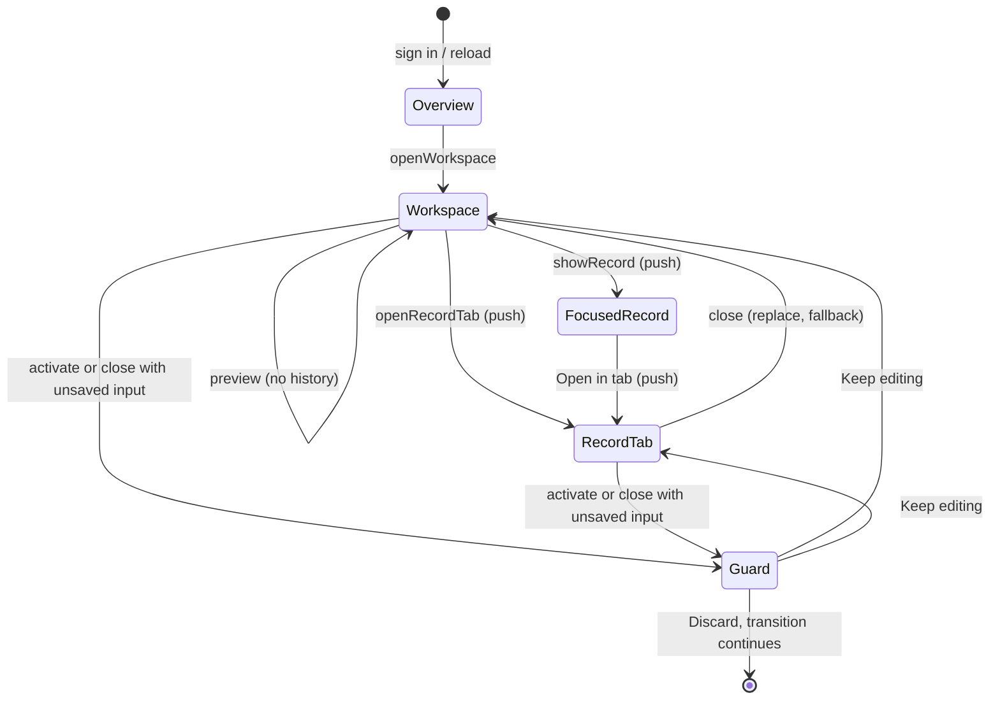

# Console Workspace tabs — Phase A preflight on `main` (Issue #228)

Status: **Phase A approved with two refinements (RV1, RV2) (maintainer review of PR #229, 2026-10-19).**
Documentation and measurement only; no application code, contract, schema, permission, dependency
or sidebar change.

## Phase A review outcome

Approved: the Console Workspace direction and amendments A1–A7; the utility-bar tab strip at
≥ 900px (with responsive and accessibility evidence); active-only rendering with
confirm-before-switch; **no `sessionStorage` restoration and no response cache in v1.0**; recorded
browser interaction evidence (screenshots/video of desktop, mobile, overflow, keyboard and dirty
transitions) instead of a separate Figma prototype. Next steps: B0′ as a dedicated draft PR, then
B1 as a separate draft PR after B0′ review. B2 implementation, merges, deployment, sidebar redesign
and unrelated fixes each need later explicit approval.

Refinements, now part of the design:

- **RV1 — Tab identity in `history.state`** (refines A1, §3.7). Record URLs stay unchanged. When
  several console contexts could show the same URL, the router entry records which tab it belongs
  to, inside the `history.state` object the existing router already writes. URL-only resolution
  remains the fallback for closed tabs and clean sessions. `navigation-guard.ts` stays the only
  history authority; no second listener or history model.
- **RV2 — B0′ guard semantics** (refines A6, §5). A form is protected only while it holds genuinely
  unsaved input: values that differ from the form's state when editing began. Unchanged forms
  (including input typed and then reverted), saved forms and search/filter forms never ask. Tests
  and browser evidence must show save and reset clearing the state, and Back and reload asking only
  while input is unsaved.

Issue #228 implements the browser-style console designed in Issue #198. The #198 Phase 0/A
documents were written on the integration branch at `bd46f59` (2026-10-14). Since then the
integration branch reached `main` (#194) and the request core, cross-tab refresh, lazy routes,
Workspace v2 directories and the Unified Page System all landed. This preflight re-audits current
`main`, reconciles the proposed D-089 design with what now exists, and fixes the remaining open
questions as concrete proposals. It does not replace the #198 documents; it amends them.

| Document | Role |
| --- | --- |
| This file | Current-state audit, D-089 amendments, tab architecture, safeguards, PR sequence and gates |
| [Interaction matrix (revised for #228)](./console-workspace-v1-interaction-matrix.md) | Behaviour per trigger, history, devices, EN/FR, keyboard, refresh, clean-session links |
| [Baseline and test plan (#228)](../audit/issue-228-console-tabs-preflight.md) | Measurements on `main` `cfe6be6`, budgets, regression strategy |
| [ADR proposal D-089](./console-workspace-v1-adr-proposed.md) | Original tab-manager proposal (amendments listed there and below) |
| [#198 preflight](./console-workspace-v1-preflight.md) / [#198 baseline](../audit/console-workspace-v1-baseline.md) | Historical assessment at `bd46f59` |

## Base checked

- `main` at `cfe6be6` (PR #227 merged, 2026-10-19). No open pull requests at the time of the audit.
- Merged since the #198 preflight: #194 (integration → `main`), #203 request core, #209 cross-tab
  refresh (D-090), #208 lazy routes, #205/#206/#207 Workspace v2 (Candidates, Missions, Clients),
  #218 Unified Page System (D-091), #210 Clients v2.1, #220/#222/#225/#226 page-system migrations,
  #213/#215/#217 scroll hotfixes, #227 Notification Center hardening.
- Figma `lntkJMsl2twVkeZ9Dt9dvV` was not re-opened; the #198 observations (static frames, no
  prototype links, an empty reserved subtab row) still stand. No interaction prototype exists yet.

## 1. Current-state audit

### 1.1 Existing tab implementation

**There is no console, workspace-tab, tab-manager or tab-strip code on `main`.** Searches for
`ConsoleProvider`, `openWorkspace`, `openRecord`, tab descriptors or strip components return nothing.

Three components use `role="tablist"`, all for **sections inside one record**, not for open
workspaces: `candidates/CandidateRecordTabs.tsx`, `clients/ClientRecordTabs.tsx` and
`missions/MissionDetailNav.tsx`. They must stay as they are. Consequences for the console:

- Vocabulary: the console strip is **"open tabs"** (workspace tab, record tab). The existing
  in-record controls are **"record sections"**. Code and strings must not call both "tabs".
- Accessibility: a record tab can contain a record-sections tablist. The console strip needs its
  own accessible name ("Open tabs" / « Onglets ouverts ») so screen readers can tell the two apart,
  and keyboard handling must stay local to each tablist (no global arrow-key capture).

### 1.2 AppShell and Unified Page System

- `ui/shell/AppShell.tsx` (v1.2): icon rail + context panel (sidebar, **out of scope**), a 56px
  utility bar (`.app-shell__utility-bar`: breadcrumb, Notification Center, API status, language,
  account) and `main.app-shell__main`. On route change it closes mobile navigation, resets
  `main.scrollTop` and focuses `main` (`preventScroll`). Mobile navigation below `56.25rem`
  (900px) is a modal panel that makes `main` inert while open.
- Unified Page System (D-091): `PageShell`, `DirectoryPage`, `RecordPage`, `FilterToolbar`,
  `ContextualActions`, `PageState`. Primitives take caller-owned content and never own domain state,
  permissions or a viewport scroll owner. Console code must follow the same rule: the console owns
  tab descriptors only; modules keep their data and forms.
- Measured layout (§ baseline): at 1440/1024px the breadcrumb slot in the utility bar is the only
  horizontal space that adds no height. At 768/390px and at short heights the document scrolls as a
  whole (`main` has `overflow: visible`), so any sticky console chrome must be placed outside the
  scrolled content or be part of the existing utility bar. No horizontal overflow was found in EN or
  FR at 1440, 1024, 768, 390 or 1280×400.

### 1.3 Routing, history and deep links

- Still no router library. `App.tsx` keeps `{ route, search }`, exact-match `pathToRoute`, one
  `popstate` listener, and renders exactly one lazily loaded module (`switch (route)` inside
  `RouteModuleBoundary`).
- `navigation/navigation-guard.ts` (from #201, extended in #204): every router entry carries
  `hiremeHistoryIndex`; a blocker stack decides; `requestNavigation(proceed)` asks before in-app
  moves; a guarded Back/Forward is undone with `history.go(-delta)` and replayed after
  confirmation. **This is the single history/guard authority the console must reuse.** A second
  `popstate` listener or a parallel history model is not acceptable.
- `navigation/record-deep-links.ts`: validated single-value UUID intents for `candidate`, `client`
  (new since #198), `mission`, `process`, `interview`, `task`, `meeting`, `program`, `session`,
  `conversation`; malformed or duplicate values are ignored before any read.

| Module | Directory / preview | Focused record URL | History when opening the record | Guarded forms |
| --- | --- | --- | --- | --- |
| Candidates | Directory + quick preview from the list row (local state, no request, **not in the URL**) | `/candidates?candidate=<id>` | `push` ("Open full profile"); close record = `push` back to `/candidates` | Focused record (`useRecordLeaveGuard`), creation drawer |
| Clients | Same pattern | `/clients?client=<id>` | `push` | Focused record, creation drawer |
| Missions | Same pattern; process/interview sub-intents | `/missions?mission=<id>` (+ `process`, `interview`) | `push` | Missions workspace (`clearOnSubmit`), creation drawer |
| Training | Program/session selection | `/training?program=&session=` | `replace` on selection | **None** (12 forms) |
| Tasks | Board + detail | `?task=` initial only | — | **None** (10 forms) |
| Messages | Conversation list + pane | `?conversation=` initial only | — | **None** (composer) |
| Meetings | Deep-link-only route | `?meeting=` | — | — |
| Commercial, Accounting, Documents, Admin | Module-local | none | — | **None** (3 / 9 / 4 / 4 forms) |
| Overview, Agenda, Reporting | — | none | Agenda and Reporting drill-downs `push` other modules | — |

Important change since #198: the **quick preview is no longer a URL state**, and the URL query now
means "focused record". D-089 §4 assumed the opposite (`?candidate=` = preview). See amendment A1.

Contextual related-record entry points that exist today and leave the current module:
`clients/ClientRelatedMissions.tsx` (a `<button>`, so Ctrl/middle-click does not open a browser
tab), `candidates/CandidateRelated.tsx` (a real `<a href>` that keeps native modified clicks),
`reporting/ReportingDrilldown.tsx` (links to missions/candidates), Agenda item deep links and the
Notification Center (`/messages?conversation=`, task destinations).

### 1.4 Data, caching and polling

- Request core (#203) and cross-tab coordination (#209, D-090) are on `main`:
  `auth/authenticated-request.ts` sends the latest rotated token, refreshes single-flight per
  session epoch, replays once, and broadcasts the outcome across browser tabs. `App.tsx` keeps the
  initial `accessToken` as a prop, so token rotation does not re-run `[accessToken]` effects.
  **D-089's B0 prerequisite is done.**
- There is still **no response cache or request de-duplication**. Every activation refetches. The
  new baseline shows revisits are now fast without one (median paint 60 ms, settled 91 ms at 4×
  CPU), so a cache is no longer a Phase B prerequisite (amendment A2).
- Pollers (all `useVisibleInterval`, suspended while the document is hidden):

| Poller | Interval | Owner | Runs when |
| --- | --- | --- | --- |
| Messages unread summary | 60 s | `AppRoutes` (`use-unread-summary.ts`) | signed in + `messages:view` |
| Notification unread count | 60 s | `NotificationCenter` in AppShell | signed in |
| Conversation list | 30 s | `MessagesPanel` | Messages mounted |
| Open conversation | 15 s | `ConversationPane` | a conversation is open |

  Module pollers only run while their module is mounted, so active-only rendering keeps "no
  polling from inactive tabs" automatically. Tasks also reads notifications on every activation
  (7 GETs per visit), which is unrelated to tabs but shows in every switch measurement.

### 1.5 Authentication, authorization and session isolation

- The MVP serves **one internal organization** (`docs/product-scope.md`); there is no tenant model.
  "Tenant/session isolation" for the console means: per user, per permission set, per session and
  per browser tab.
- Client route gate `canAccessInternalRoute` (permission any-of) is evaluated on every render of
  `AppRoutes`; the denial renders `PageState kind="permission-denied"` (D-091). Every API operation
  is enforced server-side.
- `subscribeAuthSession` delivers `ended` (sign-out, terminal refresh failure, cross-tab sign-out)
  and `user` updates (permission changes after refresh or the account-menu refresh). On `ended`,
  `AppRoutes` clears user and token and every module unmounts.
- Storage: `localStorage` holds only the locale, `hireme.navigation.expanded` and the non-secret
  cross-tab auth coordination marker. No `sessionStorage`, IndexedDB or draft persistence exists.

### 1.6 Form lifecycle

- About 80 `<form>` elements across 12 modules. Protected today: the shared `Drawer` (creation),
  Candidates and Clients focused records, and the Missions workspace (`useRecordLeaveGuard`, which
  watches `input`/`change` inside a container, ignores `role="search"` forms, and registers both a
  navigation blocker and `beforeunload`).
- **Unprotected:** Tasks, Training, Accounting, Commercial, Documents, Admin and the Messages
  composer. Today a shell click or Back silently discards their input. A console makes tab switching
  and closing routine, so this gap must close before closable tabs ship (prerequisite PR B0′).
- `useRecordLeaveGuard` is effect-based: its blocker and `beforeunload` listener exist only while
  the component's effects are mounted. This decides amendment A3.

### 1.7 Bundle

Production `vite build` at `cfe6be6`: entry chunk 668.5 KB raw / **179.5 KB gzip** (302.8 KB at
`bd46f59`; the B1 target was ≤ 190 KB), 26 async chunks, CSS 19.7 KB gzip. Entry attribution:
i18n dictionaries 34 %, react-dom 27 %, contracts 12 %, zod 10 %, `api.ts` 6 %. Per-locale/per-module
dictionaries remain the next entry-size lever; console chrome must stay small (≤ 8 KB gzip).

## 2. Reconciliation with D-089 (proposed)

| D-089 item | State on `main` | #228 position |
| --- | --- | --- |
| B0 shared request core, single-flight refresh, token getter | Done (#203, #209) | Keep; console adds no refresh path |
| B1 lazy routes | Done (#208); locale split not done | Keep; locale split stays a separate optional PR |
| §1 active-only rendering | — | **Keep** |
| §1 up to 2 dirty tabs hidden under `<Activity>` | — | **Drop for v1** (A3) |
| §2 one dependency-free `ConsoleProvider`, operations table | — | Keep, with A4 for principal changes |
| §3 identities `ws:<module>`, `rec:<type>:<uuid>`, flat siblings, no reparenting | — | **Keep** |
| §4 URL grammar `?…&tab=record`, `?candidate=` = preview | Superseded by Workspace v2 | **Replace** (A1) |
| §5 response cache | Not built | **Defer** (A2) |
| §5 one shell poll registry | Two 60 s shell polls exist | Keep as optional Phase D item |
| §6 draft registry + dialog | Guard stack exists for 4 surfaces | Reuse `navigation-guard`; extend coverage first (A6) |
| §7 re-check route on activation, API authority | Gate runs every render | Keep |
| §8 lazy chunks, no preload | Done | Keep; idle prefetch only for focused/hovered tab |
| §9 limits 8/10, one strip row, mobile switcher < 900px | — | Keep; strip placement A5 |
| `?client=` prerequisite | Done (#207) | — |

### Amendments proposed by this preflight

- **A1 — The URL describes the active view; tab membership is session state.** Keep today's URLs
  exactly: `/candidates` (directory; preview not in the URL), `/candidates?candidate=<id>` (focused
  record). A record tab and the in-workspace focused record render the same `*FocusedRecord`
  component; whether that view sits in a record tab or in the workspace tab is console state, not a
  URL parameter. Only a **cross-module contextual** record tab adds one parameter:
  `/missions?mission=<id>&in=clients` (validated against the registry and the user's permissions,
  ignored otherwise). Consequences: every existing deep link, bookmark and test keeps working; no
  `tab=record`; a pasted URL never needs to know about tabs; Back to an entry whose tab was closed
  simply shows that record in its workspace tab.
- **A2 — No response cache in Phase B.** Revisit paint is already below the 100 ms median target
  without one (§ baseline); a cache adds a principal-leak surface for little gain. Revisit only if
  Phase B evidence misses the p95 budget, as an in-memory, principal-keyed, GET-only map (TanStack
  Query still needs explicit approval as a new dependency).
- **A3 — Confirm-only drafts in v1; no hidden `<Activity>` trees.** Hidden Activity destroys
  effects, which would silently release `useRecordLeaveGuard`'s blocker and `beforeunload` listener
  while the draft still lives in memory: a reload or sign-out would then lose it without a prompt.
  v1 therefore asks before deactivating or closing a tab with unsaved input (same native
  confirmation as today), and keeps exactly one module mounted.
- **A4 — Principal changes prune; identity or session changes reset.** A different user id, a
  session `ended` event or a new session epoch remounts the console (`key` on the provider): all
  tabs and snapshots are dropped. A permission-only change keeps tabs whose route is still allowed
  and removes the others; if the active tab loses access it shows the existing permission-denied
  state with a Close action. Nothing is cached, so nothing can leak between principals.
- **A5 — Desktop strip lives in the utility bar's breadcrumb slot.** At ≥ 56.25rem the strip
  replaces the breadcrumb (the active tab already states where the user is), adding no vertical
  space and avoiding the empty second row seen in Figma. Record tabs of the active workspace follow
  their workspace tab in the same row; overflow goes to a "More tabs" menu. Below 56.25rem there is
  no strip: a "Tabs" button in the utility bar opens a list dialog. The sidebar is not changed.
- **A6 — One guard authority, wider coverage first.** Tab activation, tab close, sidebar navigation,
  Back/Forward and in-app links all go through `requestNavigation` / `acceptHistoryTraversal`.
  Before closable tabs ship, the unprotected modules adopt the existing container guard (PR B0′).
- **A7 — Workspace snapshots are small, versioned and optional.** A workspace tab may store applied
  query, page, preview row id, active record section and scroll position (no names, no record
  content). A module that does not adopt snapshots simply reopens fresh, which is today's behaviour.

## 3. Tab architecture (for sign-off)

### 3.1 Identity

| Kind | Canonical id | Cardinality | Parent |
| --- | --- | --- | --- |
| Primary workspace tab | `ws:<route>` (e.g. `ws:clients`) | at most one per route | — |
| Record tab | `rec:<recordType>:<uuid>` (`client`, `mission`, `candidate`) | at most one per record in the console | a workspace tab id (presentation only) |

- Ids hold no names or labels; labels are resolved from loaded data at render time and held in
  memory only. Record ids are validated with the same UUID rules as `record-deep-links.ts`.
- Opening an already open record from anywhere focuses its existing tab; it is never duplicated
  or re-parented. A record opened from a record tab becomes a sibling under the same workspace.
- Utility destinations (Overview, Agenda, Meetings) and public pages are not console tabs. Overview
  is the permanent floor tab and cannot be closed. Messages, Tasks and the other modules get
  ordinary workspace tabs; Messages conversations and Tasks items stay selections inside their
  workspace tab (no record tabs in v1).

### 3.2 Operations (only way to change tabs)

| Operation | Effect | History |
| --- | --- | --- |
| `openWorkspace(route)` | Focus `ws:<route>`, creating it if absent (sidebar, mobile switcher) | push |
| `previewRecord(row)` | Unchanged module-local preview inside the active workspace tab | — |
| `showRecord(record)` | Today's "Open full profile": focused record inside the current workspace tab, unless a record tab for it exists, then focus that tab | push |
| `openRecordTab(record, { from })` | Explicit "Open in tab" or a contextual related link: focus or create `rec:…` under `from`'s workspace | push |
| `activate(id)` | Ask the guard; re-check route permission; snapshot outgoing tab; mount incoming | push |
| `close(id)` | Ask the guard if it holds unsaved input; remove; activate fallback | replace |
| `prune(permissions)` / remount | A4 | replace / — |

### 3.3 Activation and rendering

- Exactly one module is mounted: the active tab's. Inactive tabs are descriptors plus an optional
  A7 snapshot. Lazy route chunks already downloaded are reused by `React.lazy`; first activation
  shows the existing `RouteModuleBoundary` skeleton.
- Activation by pointer or from the tab list keeps today's AppShell behaviour (focus `main`, scroll
  reset, or the A7 snapshot scroll). Activation by keyboard inside the strip keeps focus on the tab
  (WAI-ARIA tabs pattern, manual activation with Enter/Space). After a close, focus moves to the
  newly active tab in the strip.
- Because AppShell reacts to `currentRoute` changes only, switching between two tabs of the same
  route (workspace tab ↔ its focused record or a record tab) must apply the same scroll/focus rule
  explicitly; B2 adds that.

### 3.4 Close behaviour

- Fallback order: most recently active remaining tab in the same workspace group, then that
  workspace tab, then the most recently active tab overall, then Overview.
- Closing a workspace tab that has record tabs closes the group after one confirmation listing the
  count; any member with unsaved input triggers the guard first.
- Closing never resurrects anything: Back to a closed tab's URL renders that view fresh in its
  workspace tab (A1).

### 3.5 Limits and overflow

- Soft limit 8 open tabs (polite notice), hard limit 10 including Overview. At the hard limit an
  open action offers "Replace the least recently used tab" (never one with unsaved input) or opens
  the tab list to close tabs. Users are never trapped.
- "More tabs" menu and the mobile dialog list every tab grouped by workspace, with filter-as-you-
  type above 6 tabs, per-tab close buttons and unsaved markers.

### 3.6 Persistence

- **Phase B: none.** Reload restores the active view from the URL only (today's behaviour).
- Optional later step (separate approval and security review): `sessionStorage` list of tab ids and
  order only, keyed by user id and session epoch, cleared on sign-out, principal change and refresh
  failure. Never labels, record content, snapshots with free text, drafts or tokens.

### 3.7 Deep links and browser history

- Push only on tab activation and on `showRecord`/`openRecordTab`; replace for close, filter, page
  and preview changes; preview itself writes nothing (today's behaviour).
- **Tab identity in `history.state` (RV1).** Every entry written by `pushHistoryPath` /
  `replaceHistoryPath` already carries `{ hiremeHistoryIndex }`. B2 adds one optional field to the
  same object, `hiremeConsoleTab: { console: <console instance id>, tab: <canonical tab id> }`,
  written by the same two functions (an optional argument), never by a separate `pushState`. The
  console instance id is a random value created when the console mounts (new user, new session or
  reload), so entries written by an earlier console never match a current tab.
- **Deterministic Back/Forward resolution** for the URL's view, in order:
  1. `history.state.hiremeConsoleTab` belongs to this console instance, names an open tab, and that
     tab can show the URL's view → activate that tab (snapshot from B3);
  2. otherwise, a canonical record tab for the URL's record is open → activate it (dedupe invariant);
  3. otherwise (closed tab, older console, unindexed entry, clean session) → **URL-only fallback**:
     show the view in its route's workspace tab, creating that tab if needed, plus `in=` handling.
  Guarded traversal keeps using the existing undo/replay mechanism: the guard decides before the
  console resolves anything, and a held traversal never changes tabs.
- `history.state` holds only the index and canonical ids (route names and record UUIDs that are
  already in the URL): no labels, names or snapshots. It survives a reload but is ignored by rule 1
  because the console instance id changes.
- Clean session (new browser tab, pasted link, after login): only the linked view opens, as today;
  `in=<route>` additionally creates that workspace tab as the parent without fetching its data.
- Modified clicks (Ctrl/Cmd/middle) on real links keep native browser behaviour; a new browser tab
  starts its own independent console. Related-record buttons that should support this become links
  in Phase C (`ClientRelatedMissions`).

## 4. Safeguards

| Area | Safeguard | Verified by |
| --- | --- | --- |
| Unsaved forms | All transitions through the guard stack; B0′ coverage for every module with forms; dirty = differs from the editing baseline (RV2); `beforeunload` only while dirty; no draft persistence | U3, B0′ module tests, browser D-rows |
| User/session isolation | Provider keyed by user id + session epoch; `ended` remounts; cross-tab sign-out (D-090) arrives as `ended` | U4, browser S-rows |
| Revoked permissions | Prune on permission change; gate on every render; denied state for the active tab; API remains the authority | U4, T8 |
| Inactive polling | Active-only rendering; no new pollers in console code; shell keeps its two 60 s polls | T5 poll-count test |
| Bounded memory | One mounted module; ≤ 10 descriptors; snapshot schema with size cap (≤ 2 KB serialized per tab, dropped if larger) | T4 heap/DOM curve |
| Privacy | Ids without names; no storage in Phase B; labels in memory only | Review checklist |

## 5. Implementation sequence and acceptance gates

Every step is its own draft PR from latest `main`, with exact-head CI, focused tests and browser
evidence from the #228 harness. No step merges without explicit approval.

| PR | Scope (and nothing else) | Acceptance gate |
| --- | --- | --- |
| **A** (PR #229) | Audit, amendments A1–A7, matrix, baseline, test plan | **Approved 2026-10-19 with RV1, RV2** |
| **B0′ Draft guard coverage** | RV2 dirty detection (differs from the editing baseline) in the shared guard; apply it to Tasks, Training, Accounting, Commercial, Documents, Admin and the Messages composer; no tab code | Per-module tests: changed input + shell link / Back / reload asks; unchanged, reverted, saved, reset and search/filter forms never ask; browser evidence of save/reset clearing and Back/reload. No API or form behaviour change |
| **B1 Console state core** | Pure reducer, descriptor types, identity/URL codec, RV1 history-state codec and resolution order, fallback and limit rules; unit tests; not yet rendered | U1, U2, U6 green; no bundle change in the entry chunk beyond the module (tree-shaken until B2) |
| **B2 Primary workspace tabs** | `ConsoleProvider` in `AppRoutes`, desktop strip in the utility bar, mobile tab dialog, open/focus/close, limits, guard integration, A4 prune/reset, EN/FR strings, a11y | Matrix N1–N2, D1–D10, H1–H6, S1–S4, A1–A5, R1–R4, L1 pass in browser; T2–T6, T9, T10 within budget; console chrome ≤ 8 KB gzip in entry |
| **B3 Workspace snapshots** | A7 snapshots for Clients, Candidates, Missions directories | Return to a workspace tab restores query/page/preview/scroll; T2 p95 within budget |
| **C1 Record tabs** | "Open in tab" on preview and focused-record headers (Clients, Candidates, Missions); dedupe; unavailable state for 403/404 | N3–N7, H7 pass; one tab per record; preview stays the default row action |
| **C2 Contextual related records** | `ClientRelatedMissions` (to links), `CandidateRelated`, Reporting drill-down open sibling record tabs; `in=` parameter | N5, N7, N8 pass; clean-session `in=` link; modified clicks native |
| **D1 Notifications and Messages** | Notification Center / Messages / Agenda destinations call `openWorkspace`/`showRecord`; no backend or poll change | N10, N11; T5 unchanged |
| **D2 (optional)** | One shell poll registry for the two 60 s polls | Idle request rate ≤ baseline |

Deferred: sessionStorage restoration, response cache, drag-reorder, pinning, keyboard shortcuts
beyond the tablist pattern, cross-browser-tab sync, sidebar redesign (next UX milestone).

## 6. Findings, blockers and open questions for review

Findings that change the #198 plan:

1. B0 and B1 are already on `main`; the console can start from `main` directly (no integration
   branch).
2. The quick preview is local state and the record query is a pushed focused view, which makes the
   proposed `tab=record` grammar unnecessary (A1).
3. Hidden `<Activity>` retention would disable the existing effect-based guard (A3).
4. Seven modules with forms have no unsaved-input protection; tabs would make that loss routine (B0′).
5. Revisits are already fast without a cache (A2); Tasks' 7 requests per visit are the slowest case.
6. The harness from #198 under-measures first visits on a lazy-route build; the #228 copy fixes it.

Blockers: **none.** Phase A is approved; B2 and later still need explicit approval.

Open questions as proposed, with the review answers:

1. A1 URL model with `in=` only for cross-module record tabs — accept? (Alternative: path segments.)
2. A3 confirm-only drafts in v1 — accept? (Alternative: an in-memory draft registry independent of
   effects, which is new infrastructure.)
3. A5 strip replaces the breadcrumb at ≥ 900px — accept? This is the only shell-chrome change and
   is outside the sidebar.
4. Is B0′ (guard coverage) accepted as a prerequisite PR, or should B2 initially exclude unguarded
   modules from closable tabs?
5. Does v1.0 need any multi-tab restoration after reload (§3.6), or is URL-only restoration enough?
6. The clickable interaction prototype required by #198 is still missing. Proposal: treat the B2
   draft PR's browser evidence (recorded flows per matrix row) as that evidence instead of a separate
   Figma prototype. Needs the maintainer's agreement.

Answers (2026-10-19): 1 accepted with RV1; 2 accepted (confirm-before-switch); 3 accepted with
responsive/a11y evidence; 4 accepted, B0′ first with RV2; 5 no restoration in v1.0; 6 accepted —
recorded screenshots/video of desktop, mobile, overflow, keyboard and dirty transitions.

## Non-goals

No sidebar or visual redesign, no dark mode, no backend/API/schema/permission change, no new
dependency, no iframes or multiple app roots, no hidden mounted module trees, no window manager,
no deployment and no merge from this PR.
