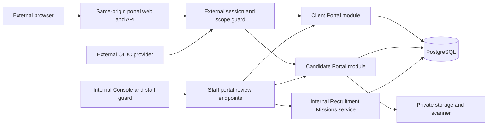
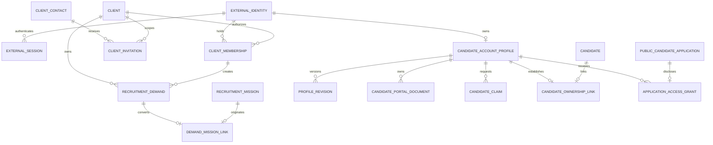
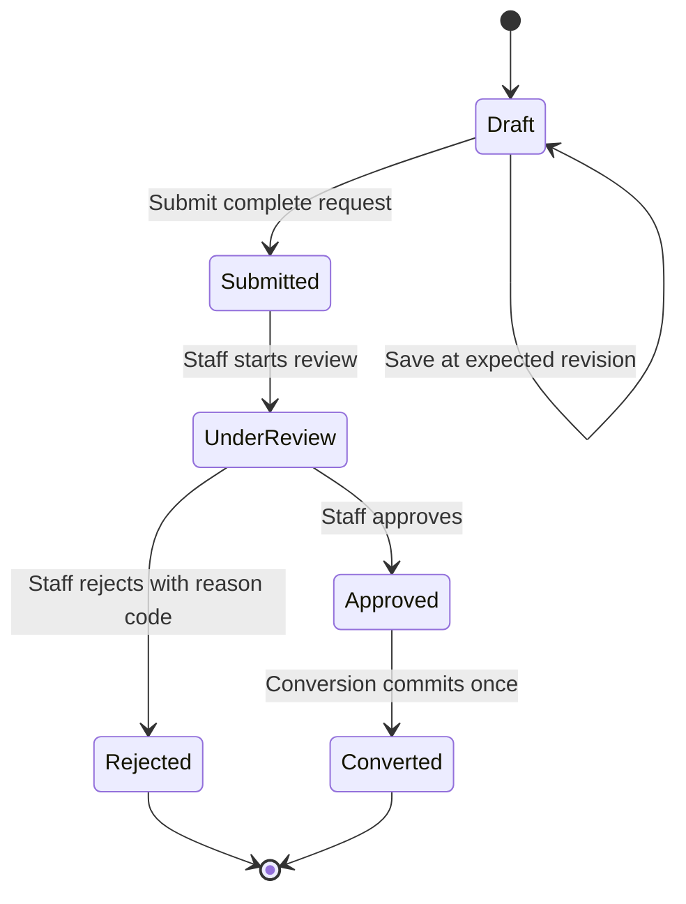

# Portal architecture and contracts

All names, routes and schemas below are proposed. Client V1 is the first vertical slice. Candidate contracts use the same isolation principles and advance independently. See the [approval matrix](README.md).

## Application boundaries

Add `ExternalIdentity`, `ClientPortal` and `CandidatePortal` Nest modules and portal-specific Zod contracts in `packages/contracts`. Use a separate React/Vite portal entry served on the portal origin with same-origin `/v1/portal/` routing. The existing Nest modular monolith, PostgreSQL, storage abstraction and internal recruitment service remain the integration points. Reuse infrastructure and mission validation. Keep serializers, session lookup and guards for external requests separate from the internal controllers. An external identity is never an internal `User`, has no `UserRole`, and cannot authenticate to staff endpoints. `CLIENT_USER`, `ClientContact.userId`, `portalStatus`, `clientVisible`, and `CLIENT_SHARED` convey no portal authority. A portal request cannot attach an internal candidate or mission by selecting an ID.

## Data model and migration plan

**Common tables.** UUID primary keys, timestamps and explicit `RESTRICT` foreign keys for retained business history. `ExternalIdentity` has persona, status (`ACTIVE`, `SUSPENDED`, `CLOSED`), issuer and provider subject with unique `(persona, issuer, subject)`, verified contact address and version. Email is a contact channel, with a unique normalized active address per persona for enrolment collision handling. It is never a relational identity key. `ExternalSession` stores hashed opaque session identifier, identity and persona, optional client membership, inactivity and absolute expiry, assurance time and revocation. Nullable client membership is allowed only for candidate sessions. A composite identity/membership foreign key prevents binding a client session to another identity's membership. `PortalAuditEvent` stores a policy-controlled actor reference (staff FK, external FK, or system), action, resource UUID, optional organization, result, timestamps and correlation ID. Use an append-only application interface and transaction-aware writer. Store challenge/job payloads separately from audit. Privacy-approved erasure can remove personal attributes and files while preserving a minimally attributable lawful audit record.

**Client tables.** `ClientInvitation` links staff approver, `Client`, and active `ClientContact` under that same client, with verified target email snapshot, token digest, status, expiry, attempt count and consumed identity. A partial unique index permits one pending invitation per contact. Reissue invalidates the old credential. `ClientMembership` binds a client, contact and client identity, tracks status and reason, and has partial unique indexes for one active organization per identity and one active identity per contact. A revoked row is terminal; any re-admission requires a new reviewed invitation. Composite FKs tie membership/invite contacts to the same client and demand creators to the owning client. Guards require an active membership and usable client and contact. Recommended pilot admission is `Client.status=ACTIVE` plus an active, non-archived contact. Verify the lock used by existing CRM status and archive paths. External writes recheck scope in the transaction, in order client, contact, membership, then demand. Identity/session revocation commits before its acknowledgement. Never acquire a client lock after holding a demand lock.

`RecruitmentDemand` owns the client ID, creator membership, request fields, lifecycle state, integer revision, submitted and decided timestamps, and proposed diagnostic notes and reason codes with separate public and staff storage. Index `(clientId, updatedAt, id)` for lists, `(clientId, status, updatedAt, id)` for filtered lists and `(status, submittedAt, id)` for the staff queue. `DemandMissionLink` has unique demand and mission IDs, client ID, converting staff actor and creation time. Composite FKs against `(id, clientId)` of both demand and mission fail closed if clients differ. Status history is append-only. Unsubmitted drafts are scoped to their creator membership. Submitted requests remain organizational records after the creator leaves.

**Candidate tables.** One `CandidateAccountProfile` per candidate identity. `ProfileRevision` stores version, editable values, state and reviewer, with a unique `(profileId, revision)` key. An editable draft can be submitted at its expected revision. A submitted revision is immutable and can be approved, rejected or returned for changes. Changes start a new draft referencing the previous revision. Show the latest approved revision and the caller's draft separately. `CandidateOwnershipLink` is separate from the email and holds verified staff approval for one active profile-to-master-candidate mapping, with unique active indexes on both sides. `CandidateClaim` holds the requested record kind, private case reference and reviewer decision. Evidence uses a separate restricted store and retention policy. `ApplicationAccessGrant` directly links a profile and `PublicCandidateApplication`, with approval and revocation data and one active owner per application. A candidate-master link does not create application grants. Store approved application milestones on the grant with immutable publishing history, actor and version. Candidate reads project only the latest published milestone from an active grant. Pending, rejected and revoked claims are not enumerable through public-facing APIs. `CandidatePortalDocument` stores owner, logical document ID, version, checksum, scan state, unique object key and timestamps for the private upload. Use a unique `(profileId, logicalDocumentId, version)` key and require the same owner for all versions. Staff acceptance links a screened revision or file to an internal record only by explicit approval. Candidate withdrawal or changes do not overwrite existing internal versions or recruitment history.

After signoff, add schema in ordered migrations: external identity/session, challenge and audit tables; client membership/invite and scoped indexes; demand/history and mission-link constraints with the conversion slice; candidate profile/ownership, then files and application grant/status tables with their slices. Add prerequisite unique composite indexes to existing tables only when required for FKs. Use reviewed SQL partial indexes, checks and persona-aware checks or composite constraints where Prisma cannot express an invariant. No automatic backfill from current contacts, users, candidate records or emails. Keep the database compatible with the prior app build during a flag-off rollout. Validate full migration chain in fresh and representative upgraded disposable databases and test concurrency and FK violations. [Rollback gates](security.md#rollout-and-rollback)

## Demand lifecycle and mission conversion

Drafts start empty and are shown only to the creator. Submitting requires a title (1–180), need summary (1–4,000) and number of positions (1–500), with optional location (up to 160) and target start date (`YYYY-MM-DD`). Omitted optional values are distinct from explicit `null` to clear a draft field. Product approves these bounds and date semantics. Treat the target date as a calendar date in the demand. For conversion, map via a reviewed date-to-instant rule, pending approval, default proposed as midnight UTC with date-only display. Freeze the submitted snapshot. No client withdrawal or post-submission edits in V1. If a submission needs changes under the default workflow, reject it with an approved public reason and let the client submit a new draft. Staff-only decision notes stay internal. A failed conversion leaves the request `APPROVED` and retryable.

Conversion requires `portal:demands:convert` and the existing `missions:create`, plus staff authorization for the specific client. Use an explicit staff client scope, defaulting to the existing global CRM capability only for designated staff, with no fallback for unresolved scoped roles. Keep mission creation and archived-client checks in the Recruitment Missions domain. Extract a transaction-aware entry point under its existing invariants and reuse it from conversion. Calling the current public service method from an outer transaction would leave a separate commit and audit boundary. In one transaction, lock client and demand, re-read `APPROVED` or an existing link, map the approved customer data explicitly to the `DRAFT` mission fields, set filled placements to zero, write the same-client link, change status, and append the internal mission audit and portal transition audit. No automatic publication, salary, commercial commitments or assignments. A duplicate or response-lost retry returns the existing staff result and creates no additional mission or audit mutation. Assert unique link constraints as a second line of defense.

## Proposed REST contracts

External API prefix `/v1/portal`; staff prefix `/v1/internal/portal`. All JSON DTOs use strict allowlists and reject extraneous input. Server derives organization and candidate ownership from the current session; external caller cannot choose `clientId`, `candidateId`, actor or status. UUID routes return the same scoped `404` for absent and invisible records, `401` for invalid sessions, `403` for unavailable actions on the caller's legitimate scope, `409` for stale revisions or disallowed transitions, `422` for semantic field errors and `429` for limits. Return `{error:{code,message,fieldErrors?,requestId}}` with allowlisted codes and localized frontend messages. GET lists use bounded cursor pagination (default 20, max 50), deterministic order and cursor bound to scope and filters. Responses and counts are filtered before pagination; counts cannot disclose other tenants. All portal responses containing private data use `Cache-Control: no-store`.

| Method and suffix | Gate | Request and result |
| --- | --- | --- |
| `POST /auth/client/invitations/exchange`, `GET /auth/:persona/start`, `GET /auth/:persona/callback` | Expiring invitation for first client enrolment; state-bound OIDC for either persona | Exchange one invitation into an expiring enrolment transaction with no membership yet. Atomically consume invitation and create identity/membership only after verified email and MFA. A candidate start with `intent=register` uses the approved provider registration policy and creates a fresh profile only after verification. Repeat login uses the existing active binding. Callback sets a portal cookie and redirects only to a fixed portal path. |
| `POST /auth/:persona/recovery` | Exact Origin and pre-auth rate limits | Accept contact address and return a generic `202` with the same copy for known and unknown addresses. Begin approved provider recovery or an assisted case, without returning an identity or membership. Staff-assisted approval is restricted to a case-scoped `portal:identity:recover` operator after independent verification. |
| `GET /session`, `DELETE /session`, `DELETE /sessions` | Portal session | Read persona, locale, safe capabilities and a session-bound CSRF token or revoke the session or all caller sessions. Return `204` for revocation. |
| `GET /client/dashboard`, `GET /client/organization` | Active client membership | Scoped counts by portal status and up to five recent demands. Organization DTO is display name, industry, website, city and country. No contact directory, audit or commercial data. |
| `GET /client/demands`, `GET /client/demands/:id` | `client.demands.read` and scoped predicates | `{items,nextCursor}` and `{demand}` with opaque demand ID, title, status, revision, timestamps, and allowlisted detail. `CONVERTED` projects as `APPROVED` in V1. No internal notes, IDs, mission links or staff identities. |
| `POST /client/demands`, `PATCH /client/demands/:id`, `POST /client/demands/:id/submit` | `client.demands.draft` or `client.demands.submit`, creator and active membership | Create with a caller-generated idempotency key scoped to membership; repeated key with different input returns `409`. Update/submit require `expectedRevision`. Repeating a successful submit revision returns the same submitted state; other stale revisions return `409`. |
| `POST /client/invitations`, `POST /client/invitations/:id/revoke`, `POST /client/memberships/:id/revoke` (staff) | `portal:clients:invite` or `portal:clients:revoke`, client scope | Create with `contactId`, using authoritative email and client; return issuance metadata only. Revoke invitation or membership with a reason code. Revoke membership sessions in the same transaction. |
| `GET /client/demands`, `GET /client/demands/:id` (staff) | `portal:demands:review`, client scope | Scoped review queue or detail, including submitted snapshot, staff status, history and safe client reference. |
| `POST /client/demands/:id/start-review`, `…/approve`, `…/reject`, `…/convert` (staff) | `portal:demands:review` or `portal:demands:convert` plus `missions:create` for convert | Require `expectedRevision`. Reject takes public `reasonCode` and optional private notes. Conversion returns `{demandId,missionId,status}` to staff only. |
| `GET /candidate/profile`, `POST /candidate/profile/revisions`, `PATCH /candidate/profile/revisions/:id`, `POST /candidate/profile/revisions/:id/submit` | `candidate.profile.own` | Read own approved and draft views, create/alter a versioned draft, and submit to staff review. Start with display name, phone, city and professional summary. No login email edits in this flow. Approved internal changes use an allowlisted diff with staff preview, explicit consent and conflict checks. Roll new revisions forward rather than replacing history. |
| `POST /candidate/claims`, `GET /candidate/claims/:id` | `candidate.claims.own` | Submit a claim case and receive an opaque ticket with neutral status. A private staff queue with `portal:candidates:claims:review` records proof and writes ownership/application grants after review. Claim responses never confirm whether the supplied historical record exists. |
| `GET /candidate/documents`, `POST /candidate/documents`, `GET /candidate/documents/:id/download`, `DELETE /candidate/documents/:id` | `candidate.documents.own` and clean-file checks for download | Multipart upload returns `202` and a pending record. Lists show typed, sanitized metadata. Downloads are authenticated and streamed after ownership and scan checks. Delete withdraws portal access and schedules disposition under retention rules. |
| `GET /candidate/applications`, `GET /candidate/applications/:id` | `candidate.applications.own` and an active access grant | Own application reference, safe role title, submission date and published milestone only. Proposed milestones `RECEIVED`, `IN_REVIEW`, `CLOSED` are deliberately published through a `portal:candidates:status:publish` staff action. No offer, evaluation, compensation, rejection rationale, or internal process history. |

Client/candidate capability names above are portal policy concepts issued by server-side rules, with no role seeding. Staff permissions are separate proposed grants for explicitly approved operators. Candidate review staff functions use scoped endpoints in their own slice under `/v1/internal/portal`. Grants require a staff permission for the action and independently authorized case or record scope. A review decision records an immutable outcome, and an ownership conflict returns `409` for staff while the candidate sees neutral case status. Past or new applications remain hidden until explicitly linked, including anonymous applications handled by the existing public intake service.

| Staff endpoint suffix | Required grant and outcome |
| --- | --- |
| `GET /identity/recovery-cases`, `POST /identity/recovery-cases/:id/decide` | `portal:identity:recover` and approved case scope. Accept decision code and internal evidence reference, return safe case state, revoke sessions on approved recovery and send a notification through the approved channel. |
| `GET /candidate/claims`, `POST /candidate/claims/:id/decide` | `portal:candidates:claims:review` plus case scope and authorization for the claimed record. A positive decision grants only the specific reviewed resource. |
| `POST /candidate/ownership-links/:id/revoke`, `POST /candidate/application-grants/:id/revoke` | `portal:candidates:claims:revoke` and record scope. Revoke the specified grant and visibility derived from it, with an auditable reason. A candidate-master link never silently grants or revokes separately approved application ownership. |
| `GET /candidate/profile-revisions`, `POST /candidate/profile-revisions/:id/decide` | `portal:candidates:profiles:review` and profile scope. Any propagation additionally checks the existing candidate write permission and its scope. |
| `POST /candidate/applications/:id/publish-status` | `portal:candidates:status:publish`, record scope and active application grant. Accept an allowlisted milestone and `expectedRevision`, append publication history and return the staff projection. |
