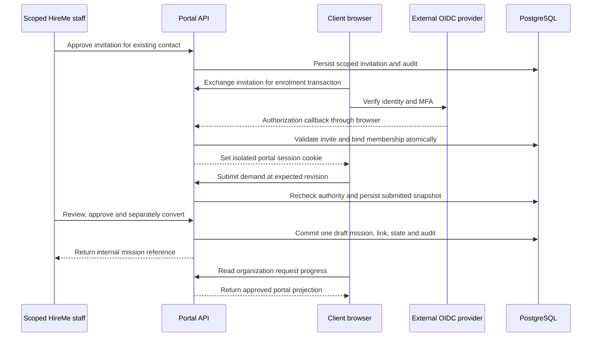

# External portal security design

These defaults require the approvals in the [decision register](README.md). Staff Console and public anonymous applications have their own authentication and data contracts. External portal authorization is independent even if the same person uses both surfaces.

## Identity, invitation and recovery

- **Client invitation.** A scoped staff operator confirms a named contact and the destination through an approved channel before issuance. The request accepts a contact ID and resolves the organization and email server-side. Use a cryptographically random, single-use credential, store only its digest, expire after 24 hours, and allow explicit revocation or replacement. Send through an approved mail adapter. Keep the secret outside sent audit events and retry logs. An outbox entry may hold an encrypted short-lived delivery payload accessible to the worker only, with the payload removed when delivered or expired. A browser fragment may carry the one-time secret to the enrolment page and be cleared before a same-origin POST. A mail scanner GET never consumes it. The enrolment transaction survives cancelled login for up to ten minutes, is tied to the browser, and requires a still-valid invitation at callback. Admit only after the verified provider address matches the current authorized contact and expected invitation address and the configured MFA assurance is met. Atomically consume the invitation and bind the provider subject. Competing verification, revocation or duplicate enrolment must produce at most one membership and never reactivate a revoked row.
- **External sign-in.** Prefer a managed OIDC issuer with client and candidate registration policies separated. Use authorization code with PKCE, state, nonce, exact redirect URLs and issuer/audience/signature/expiry validation. Establish identity using the immutable `(persona, issuer, subject)` and provider-asserted verified email at enrolment. Subsequent email or provider-subject changes require an explicit reviewed relinking operation, with session invalidation. Require phishing-resistant MFA for client pilot users via a user-verified WebAuthn passkey or security key and an approved provider assurance claim. Apply the same proposed default to candidates unless security approves a documented alternative. Email verifies mailbox control. SMS and email alone are excluded as MFA or sole recovery proof. Prefer a pre-enrolled second authenticator or provider-issued one-time recovery codes with independent verification. A staffed fallback uses a known client organization contact or approved claimant evidence, independent checks by the operator, notification to existing verified channels, an auditable case and revocation of all application sessions and prior provider authenticators as appropriate. No support impersonation, automatic contact reassignment or reuse of staff/Admin credentials. [NIST authentication and authenticator management](https://pages.nist.gov/800-63-4/sp800-63b.html)
- **Candidate enrolment and ownership.** Verified self-registration creates an empty portal profile, even when intake already matched a historical candidate internally. Accept optional opaque claim references and repeat verification through a private case. Proposed evidence for a specific application is a verifiable prior submission receipt plus an independent staff-approved check using the existing contact channel or documented alternative. Historical records without adequate proof stay unlinked. Never reveal whether an account, applicant or candidate exists in registration, recovery or claim messages. Only designated staff may resolve duplicate or conflicting claims after corroboration. Lock claim, profile and target under a consistent order, enforce unique active ownership and record the decision. Ambiguous matches, shared inboxes and a reassigned email cannot be self-claimed. Existing internal evaluations, notes, consent decisions and application records are insulated from candidate edits.

## Session and authorization lifecycle

Issue a separate high-entropy opaque session token in a `__Host-` cookie (`HttpOnly`, `Secure`, `SameSite=Strict`, `Path=/`, no `Domain`). Store the keyed digest only. Keep OIDC tokens server-side only for the minimum required flow and omit them from browser responses. Use a separately scoped short-lived OIDC transaction cookie with `SameSite=Lax` for a top-level GET callback, then remove it. On unsafe methods enforce exact Origin and a session-bound CSRF token. Apply CSP and `Referrer-Policy: no-referrer` to enrolment pages, omit third-party scripts, configure no cross-origin credentials on portal routes and exclude cookies and callback query strings from logs. Use generic authentication errors and rate-limit by credential/challenge, identity and ingress-aware source. [NIST session management](https://pages.nist.gov/800-63-4/sp800-63b/session/) · [OWASP session management](https://cheatsheetseries.owasp.org/cheatsheets/Session_Management_Cheat_Sheet.html)

Proposed idle timeout is 30 minutes and absolute expiry eight hours. Rotate the session on login and assurance changes and require fresh MFA within ten minutes for enrolment-sensitive and recovery operations. Every protected request checks the authoritative session, identity, membership/contact/organization or candidate ownership and current feature eligibility. This design uses online session revocation and avoids the staff JWT expiry window. No permission decision uses a client-provided tenant, account identifier or unverified OIDC profile claim. Revocation, suspension, archive, change of account linkage, recovery and logout-all invalidate affected sessions. Mutations lock or conditionally fence current authority in their write transaction. A concurrent write may complete before revocation commits; no new write may succeed after it commits. Code must define and test lock order across authorization and domain mutations. Already delivered response bytes cannot be recalled. All new document downloads recheck authority near streaming, and revocation stops future access. Audit any emergency suspension.

Portal staff offboarding revokes application authority directly. A provider-side suspension or factor reset must also reach application revocation via an authenticated, replay-safe provider event or a documented staff offboarding procedure that revokes the app session first. Product and security must approve the provider, alert path and maximum propagation delay before launch. Do not infer application revocation from an IdP logout redirect.

## Threat model and privacy controls

Trust boundaries are the public browser and mail link, external provider, external-to-monolith ingress, internal staff API, database, storage/scanner and released read projections. Protected assets are session and invitation credentials, organization requests, CRM associations, candidate identity and history, CVs, review evidence and audit records.

| Threat or failure | Required controls and acceptance evidence | Residual risk and owner |
| --- | --- | --- |
| Tenant or candidate cross-read through route, list, count, cursor or mutation | Scoped database predicates and composite FKs. Separate DTOs with negative payload assertions. Identical absent/hidden behavior. Confirm A/B and persona matrices. | Indirect inference from operations remains possible. Security reviews parity and telemetry. |
| Invite forwarding, account takeover and identity-claim fraud | Email plus separately verified named contact or claim proof, MFA, short single-use challenges, generic errors, concurrent consume tests, recovery notification and live revocation. | Inbox, authenticator or support process compromise. Security and operations own recovery drill and alerts. |
| Portal session accepted by staff API, forged role or confused-deputy review | Separate cookies, token stores and realm. Staff routes require staff principal, explicit action permission and record scope. Mission creation rechecks existing capability. Verify rejections in both directions. | Misconfigured ingress or provider audience. Security owns deployment configuration tests. |
| CSRF, browser token leakage and replay | Origin/CSRF validation, isolated host cookies, PKCE/state/nonce, no-store, rate limits, redacted callback logs and generic auth errors. Concurrent replay and stale authority cases are release gates. | Compromised endpoint can act as the user. Security owns account response. |
| Malicious/oversized CV or file copied to wrong owner | Private quarantine, capacity/size limits and file signature checks. Proposed default PDF only, 10 MiB maximum, attachment disposition, generated storage keys, no public listing or shared signed URL. Require a concrete malware scanner and fail closed if unavailable. Clean state and current owner are checked on download and staff review. | Scanning has false negatives. Security approves scanner and safe preview policy. [Existing storage extension](../../../apps/api/src/storage/upload-malware-scan.provider.ts) |
| Staff publishes sensitive values, embeds identifiers or exposes internal notes | Field-level allowlists, approved reason and status codes, distinct staff/public fields, safe logs. No original candidate document through the client portal. Any later dossier publication needs separate redaction and security approval. | Determining purpose, retention and indirect identification stays with product/privacy. |
| Duplicate action or partial conversion after retry/race | Expected revisions, uniqueness, locking, transaction-aware audit, no mail send inside domain transaction, and recovery of the same result on retry. Inject a transactional audit failure in disposable tests. | Stuck queue or webhook delays. Operations monitors status and retry outcomes. |
| Excessive storage of proof, documents or logs | Minimize intake, store claim evidence separately under restricted access, use classified retention schedules, redact or erase approved data and honor legal holds. No detailed payloads in logs, audit, analytics, email or URLs. | Privacy approves legal basis, retention, exports and deletion workflow for applicable jurisdictions before launch. |

## Audit and alerts

Record invitation approved, issued, replaced, consumed, expired and revoked; login success/failure categories, factor changes, recovery requests and outcomes; membership granted/revoked, online session revoked, claim opened and decided, ownership/application grant created/revoked, profile revision decided, status published, document upload/scanned/downloaded/withdrawn, demand submitted, started, approved, rejected and converted. Attribute a staff, external or system actor, opaque subject reference, decision code, organization where applicable, timestamp and request correlation. Use safe summaries only. Keep event types and privacy controls separate from user-facing progress. Record successful privileged business transitions in the same transaction. Aggregate and rate-limit high-volume denials and alert on repeated cross-scope refusals, invitation/recovery spikes, quarantine backlog and duplicate conversion conflicts. Audit readers need explicit rights and read access is itself recorded. Never log credentials, CV bytes, PII-rich case evidence, complete request bodies, or provider payloads.

## Rollout and rollback

Required sequence after approval is synthetic staging, fresh and upgrade migration checks, skipped/failed-provider and scanner tests, signoff on the first pilot organizations, permission diff, reviewed security evidence, and an approved release/change window. Keep external ingress, provider callbacks and separate Client/Candidate enable flags fail-closed. Per-organization or pilot eligibility must be server-side. Use deliberate enablement and test disabled mode for old and new app versions. Verify backups and rehearse emergency revoke before any release.

On an incident, turn off the affected persona and organization where possible, disable enrolment and mutations, revoke active sessions and pending invitations and disable provider callbacks/clients if needed. Verify disappearance of data routes and new downloads, invalidate relevant scoped secrets and preserve audits. Allow staff to keep handling existing requests through the internal review path only if security explicitly clears it. Roll back application code to the last compatible version with portal disabled. Retain additive schema and history. Already converted missions are authoritative and stay linked. Do not reverse conversion by deleting missions, restoring a stale database over live operations or reusing consumed invites. Use a reviewed corrective migration or forward repair, then reissue fresh invitations only after security signoff. [Repository migration guidance](../../runbooks/disposable-test-database.md)
