# Issue #254 — controlled pre-merge staging releases

## Decision boundary

Issue #254 extends D-094 for one staging-only case: an explicitly selected commit from an open,
same-repository pull request may be built and deployed before merge. It does not change the normal
`main` release workflow, production, automatic deployment, or invoice-issuance policy.

The workflow definition itself always comes from `main`. A feature branch cannot supply or modify the
code that authorizes, attests, or deploys its own release. The GitHub `staging` Environment therefore
keeps its existing `main`-only branch policy; no branch wildcard is required.

## Trust boundaries

| Boundary | Trusted input | Untrusted or review-required input | Control |
| --- | --- | --- | --- |
| Dispatch | Workflow from `main`, GitHub context | Operator-entered PR and SHA | Exact confirmation includes PR and full SHA; workflow ref and Git ref must be `main` |
| PR selection | GitHub REST response | Feature code | Open, same-repository PR targeting `main`; selected SHA must still be its current head |
| CI evidence | GitHub Actions API | PR workflow result | Exact SHA, associated PR, completed successful CI, and all six required job names must pass |
| Release controls | Files from trusted `main` | PR diff | Refuse `.github/`, `deploy/`, Dockerfile, `.dockerignore`, and release-gate changes |
| Image build | Trusted Dockerfiles and workflow | Application source and dependencies | Checkout has no persisted credentials; publish job has no staging secrets; dedicated GitHub-hosted runner |
| Artifact identity | GitHub OIDC certificate and GHCR digest | Mutable registry tag | Resolve digest, verify SLSA provenance, and verify a custom attestation binding repository, PR, SHA, and CI run |
| Deployment | Main-owned workflow, pinned host key, restricted wrapper | Attested image contents | Protected Environment, digest-only images, non-root deploy identity, wrapper allow-list, backup, migration, health gates |
| Runtime | Isolated staging stack | Review-authorized feature behavior | Internal PostgreSQL network, staging-only secrets/data, issuance remains disabled unless separately approved |

## Workflow

```mermaid
flowchart LR
  A[Manual dispatch from main\nPR + exact SHA + confirmation] --> B[staging Environment review]
  B --> C[Validate same-repo PR\nprotected paths + exact CI]
  C --> D[Build API and web\nwithout staging secrets]
  D --> E[Push SHA tags]
  E --> F[Sign provenance + PR binding\nwith GitHub OIDC]
  F --> G[Resolve immutable digests\nand verify both attestations]
  G --> H[Pinned SSH to restricted wrapper]
  H --> I[Quiesced paired backup]
  I --> J[Prisma migrate deploy]
  J --> K[Healthy API/web + public smoke]
```

The repository-wide `hireme-staging` concurrency key serializes this workflow with the existing main
deployment workflow. A newer run never cancels an in-progress staging operation.

## Artifact policy

Images use the existing commit-specific tags:

- `ghcr.io/cyberdr1ft3r/hire-me-platform-api:<release-sha>`
- `ghcr.io/cyberdr1ft3r/hire-me-platform-web:<release-sha>`

The workflow never overwrites an existing tag. It may reuse one only after both attestations verify:

1. SLSA build provenance signed by `.github/workflows/deploy-pr-staging.yml` from `main` on a
   GitHub-hosted runner.
2. `https://hire-me.dr1ft3r.dev/attestations/premerge-staging/v1`, binding the image digest to the
   repository, PR number, exact release SHA, and successful CI run ID.

The deploy job resolves tags to digests and repeats both verifications immediately before SSH. The
VPS receives digest references only.

If image publication succeeds but attestation fails, the workflow stops. The existing unverified tag
is deliberately not overwritten on retry; a maintainer must investigate and remove that package
version through separately reviewed package administration before retrying.

## Security review

### High-impact attack paths and controls

| Attack path | Result without controls | Mitigation | Residual status |
| --- | --- | --- | --- |
| Fork submits code and requests staging | External code reaches staging secrets/data | Same-repository head check; Environment review; no fork accepted | Mitigated |
| PR advances after approval or CI | Untested code is deployed | Input SHA must equal current head; checkout and attest exact immutable SHA | Mitigated |
| PR weakens CI/deploy/Dockerfile | Self-approved checks or credential theft | Protected-path refusal; trusted workflow checkout from `main` | Mitigated for this path |
| Malicious build reads SSH or staging secrets | Host/database compromise | Publish job has no Environment secrets; target checkout persists no credentials; SSH exists only in trusted deploy job | Mitigated |
| Registry tag is replaced | Different bytes deploy under approved SHA label | Digest resolution plus signer/source/custom-attestation verification before deployment | Mitigated unless repository Actions authority is compromised |
| Unsafe migration breaks staging or rollback | Outage or incompatible previous API | Exact CI migration suite, human migration review, paired backup, forward-only migration policy, digest-pinned rollback | Medium residual risk |
| Authorized feature code exfiltrates staging data at runtime | Confidential staging data disclosure | Human Environment approval, same-repository restriction, synthetic isolated staging, no production credentials | Medium residual risk; authorization is intentionally powerful |

### Review assessment

- Security posture for guarded staging: **8/10**.
- Residual risk: **Medium**.
- Release readiness: ready for guarded staging after Issue #254 is merged and its exact-head CI passes.
- Production readiness: not implied. This workflow cannot address production and receives no
  production credentials.

The largest residual risk is the purpose of the mechanism itself: approved pre-merge application code
will run with staging database and application-secret access. Environment review must therefore include
the PR diff and every migration. The current single-owner Environment permits self-review; Issue #254
does not silently change that policy. Adding an independent reviewer and enabling prevent-self-review
would improve assurance when a second trusted operator is available.

## Non-goals

- No automatic PR deployment, preview environment, fork deployment, or branch wildcard.
- No merge, readiness transition, or PR mutation.
- No production release path.
- No change to automatic-main deployment switches.
- No staging issuance enablement or legal/business approval.
- No down-migration. Rollback remains application-first with forward-compatible schema.
