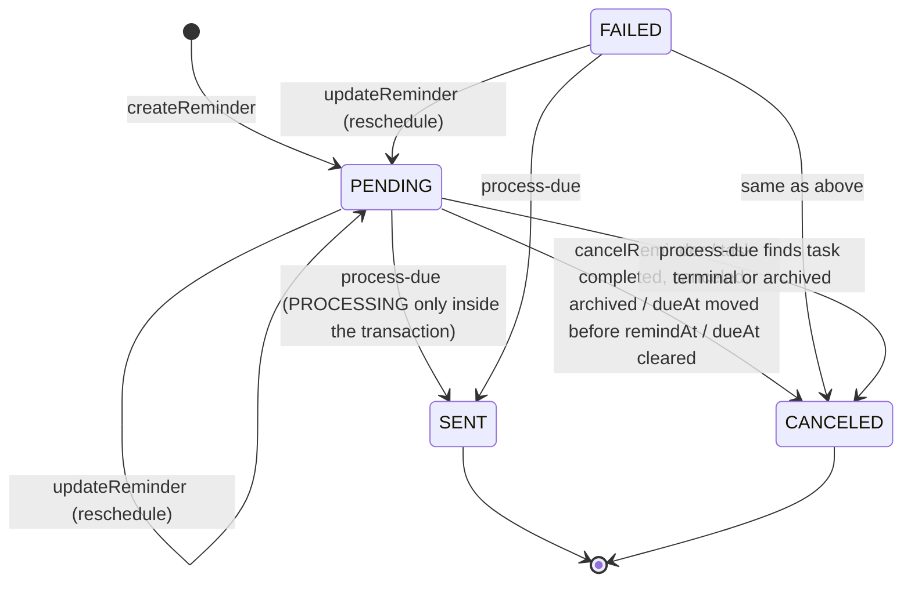

# R-036 — Automatic Task reminder delivery: scheduler preflight

Date: 2026-10-12. Base: `main` @ `6cf0e52d091744c3201019a8820c91da8ac5ae92`.
Scope: design only. No production code, schema, or migration changes in this preflight.
Decision record: D-088 (Accepted). PR A (Issue #169) implements sections 5–8; see the note in section 13.

## 1. Summary

Task reminders (Issue #31) are durable rows that become in-app `Notification` rows when someone calls
`POST /v1/tasks/reminders/process-due`. Nothing calls it automatically (R-036).

**Recommendation:** run delivery from a **standalone one-shot CLI job** outside the HTTP API, started every
minute by the host scheduler (systemd timer preferred). PostgreSQL is the only coordination mechanism:
each reminder is delivered in **its own short transaction** that takes the parent `Task` row lock with
`FOR UPDATE SKIP LOCKED`, re-checks the reminder under lock, and commits the `Notification`, the `SENT` status
and the `TaskEvent` together. No Redis, no queue library, no in-memory mutex, no new HTTP endpoint.

**Schema/migration required: NO.** Bounded retry with backoff fits the existing `attemptCount`,
`claimedAt`, and `failureReason` columns (section 6). The existing processor does need behavior fixes before
anything runs it unattended (section 3). Those fixes go in implementation PR A.

## 2. Current implementation (audit)

### 2.1 Model

`TaskReminder` (`apps/api/prisma/schema.prisma`, migration `20260814120000_task_management`):

| Column | Meaning today |
| --- | --- |
| `remindAt` `TIMESTAMP(3)` | Instant the reminder is due. Prisma writes UTC wall-clock values; the column has no time zone. |
| `status` | `PENDING`, `PROCESSING`, `SENT`, `CANCELED`, `FAILED` |
| `idempotencyKey` | Creation idempotency. Unique on `(taskId, recipientUserId, idempotencyKey)`. |
| `processingToken`, `claimedAt` | Written during processing. The token is cleared in the same transaction. |
| `attemptCount` | Incremented on each processing attempt. Never reset. |
| `deliveredAt`, `canceledAt`, `canceledByUserId`, `failureReason` | Outcome fields |
| `archivedAt` | Excluded from processing. No code path sets it. |

Indexes: `(status, remindAt)`, `taskId`, `recipientUserId`, `createdAt`.
`Notification.idempotencyKey` is globally unique (nullable).

### 2.2 Exact current lifecycle



- **Create** (`TasksService.createReminder`): requires `tasks:reminders:manage`. Locks the task and re-resolves
  the actor's access under the lock. The recipient must be an active internal user who can view the task.
  The call is idempotent on `(taskId, recipientUserId, idempotencyKey)`. The default key is
  `task:{taskId}:reminder:{recipient}:{remindAt}`. Writes a `REMINDER_CREATED` TaskEvent and an AuditLog row.
- **Reschedule** (`updateReminder`): allowed only from `PENDING` or `FAILED`, with the task then the reminder locked.
  Sets the new `remindAt` and `PENDING` and clears the cancel and failure fields. It does **not** reset
  `attemptCount` or `claimedAt`, and it does **not** re-check the recipient's access.
- **Cancel** (`cancelReminder`): allowed only from `PENDING` or `FAILED`, under the same locks. Canceling an already-`CANCELED` reminder is a no-op.
- **Task side effects:** completing, canceling, or archiving a task cancels all its `PENDING` and `FAILED` reminders. Changing
  `dueAt` cancels reminders whose `remindAt` is after the new due date. Clearing `dueAt` (`null`) cancels
  **all** of them (`cancelRemindersAfterDueDate` drops the `remindAt` filter). Removing an assignment does **not**
  cancel that user's reminders.
- **Delivery** (`processDueReminders`): the `@Post('reminders/process-due')` endpoint requires only
  `tasks:reminders:manage` on the server. The web UI also requires `tasks:view_all` (D-062).
  Body `{ limit: 1..100, default 25 }`. All of the following runs in **one** interactive transaction:
  1. Unlocked raw select: `status IN ('pending','failed') AND "remindAt" <= NOW() AND "archivedAt" IS NULL ORDER BY "remindAt" LIMIT n`.
  2. For each row: `SELECT … FROM "Task" … FOR UPDATE`, then `SELECT … FROM "TaskReminder" … FOR UPDATE`.
     Re-check the status, `remindAt > new Date()` (application clock), and `archivedAt`.
  3. If the task is terminal or archived: set the reminder `CANCELED` with `canceledByUserId` = the calling manager.
  4. Otherwise: set `PROCESSING` with a random token, `claimedAt`, and `attemptCount + 1`. Upsert a `Notification` with key
     `task-reminder:{reminderId}`, generic title "Task reminder", body "A task reminder is due.", and actor = the reminder
     creator. Set `SENT`, `deliveredAt`, and clear the token. Write a `REMINDER_DELIVERED` TaskEvent with actor = the calling manager.
  5. Then `processOverdueTasks` runs in the same transaction: `findMany` overdue non-terminal tasks, `take: 100`, no `orderBy`.
     For the owner and each active assignee it upserts a `task-overdue:{taskId}:{userId}` notification with actor = the calling manager,
     plus one `OVERDUE_NOTIFICATION_SENT` TaskEvent when something new was created.
  6. Returns `{ remindersDelivered, remindersFailed: 0 (constant), overdueNotificationsCreated }`. No AuditLog row is written.
- **Existing idempotency:** the notification idempotency key is unique. The post-lock status re-check makes a second concurrent caller
  wait on the task lock and then skip. Integration tests cover two parallel `process-due` calls and processing running alongside update and cancel.
- **Retry today:** `FAILED` rows are picked up again on every run with no limit and no backoff. No code writes `FAILED`.
  Only tests set it synthetically.

### 2.3 Manual-delivery behavior (unchanged by this preflight)

Managers with `tasks:reminders:manage` and `tasks:view_all` see a collapsed diagnostic in the Task Pipeline. It calls
`processDueTaskReminders` (`apps/web/src/api.ts`) → `POST /v1/tasks/reminders/process-due`. The endpoint processes
**every** due reminder in the system, not only the reminders the caller can see. The calling manager becomes the
TaskEvent actor for deliveries and overdue notices, and becomes `canceledByUserId` for automatic cancellations.

## 3. Defects that matter once a scheduler runs the processor

| ID | Finding | Consequence under automation | Fix (PR A) |
| --- | --- | --- | --- |
| F1 | The whole batch, including overdue processing, is one transaction. Any error rolls everything back. `FAILED` is never written. | A single bad reminder (poison row) at the head of the `remindAt` order blocks **every** delivery on every run, forever. Unrelated reminders block each other. | One transaction per reminder. Record failures in a separate short transaction. |
| F2 | One transaction holds up to 100 `Task` row locks, plus the overdue scan. | Users' task edits wait on the batch, and the stall gets longer as volume grows. | Per-reminder transaction with `SKIP LOCKED` on the task. |
| F3 | `FAILED` is selected for redelivery with no attempt limit and no backoff. | An unbounded hot loop once failures are recorded. | Only `PENDING` is eligible. `FAILED` is terminal for automation. Backoff applies. |
| F4 | `"remindAt" <= NOW()` compares `timestamp(3)` with `timestamptz`, so the result depends on the DB session `TimeZone`. The re-check uses a second clock (`new Date()`). | On a non-UTC database (for example `Africa/Casablanca`), reminders fire early or late by the zone offset. | Do the eligibility comparison through Prisma `DateTime` parameters using one injected `now`. |
| F5 | The overdue scan is `take: 100` with no `orderBy` and does not exclude tasks already notified. | Once more than 100 active tasks are overdue, later ones may **never** get an overdue notice. | Select only (task, recipient) pairs that have no notification yet, ordered by `dueAt, id`, in bounded pages. |
| F6 | System work is attributed to whichever manager clicked. | Misleading audit trail. A scheduler has no user to use. | Actor is `null` (system) for scheduler runs and the triggering manager for manual runs. |
| F7 | Delivery does not re-check that the recipient is still active or can still view the task. Reschedule does not either. Assignment removal leaves the reminder in place. | A user who was removed or deactivated still gets a generic notification naming the task ID. Reads stay gated and IDs are redacted on read, so the impact is low. | Re-check at delivery. If the recipient is inactive or no longer authorized, cancel the reminder as a system/domain cancellation (null actor); do not classify lost eligibility as a delivery failure. |
| F8 | No AuditLog row per run. The server requires only `tasks:reminders:manage`, while the UI also requires `view_all`. | Weak operational evidence. A minor mismatch between server and UI gates. | Per-run summary log and AuditLog (section 10). Tighten the server gate to require both `tasks:reminders:manage` and `tasks:view_all`, matching the UI and the endpoint's system-wide effect. |
| F9 | Reschedule does not reset `attemptCount` or `claimedAt`. | A manual retry after `FAILED` would start already in backoff, or at the limit. | Reset both on reschedule. |
| F10 | `PROCESSING` and `processingToken` are never observable after commit. | Dead state, with no correctness impact. | Leave unused (do not remove; that would need a migration). Reserve for future external channels (section 5.4). |

Observation, not in R-036 scope: clearing `dueAt` cancels every pending reminder (section 2.2). It is recorded for the
maintainer and not changed here.

## 4. Scheduling architecture options

| Criterion | A. Host scheduler (cron / systemd timer) runs a one-shot CLI | B. Long-running worker process (loop) | C. Interval inside the API process | D. DB-polling worker with lease and claim columns |
| --- | --- | --- | --- | --- |
| Reliability | High. Each run is a fresh process, so leaks and stuck state do not carry over. A missed tick is caught by the next one. | High if supervised. A hung loop needs a liveness check. | Low to medium. Tied to API lifetime, restarts, and scale-to-zero, and duplicated per API replica. | High, but only with lease expiry and reaper logic. |
| Deployment complexity | Low. One timer unit plus one service unit, or one crontab line. | Medium. Another always-on service with restart policy and health. | Lowest to ship, highest hidden coupling. | Medium to high: schema, reaper, worker. |
| Multi-instance behavior | Safe when each host or replica runs it: correctness comes from the DB. | Safe with DB locking. | Every API replica runs the timer, so N times the work. Correct only because of the DB. | Designed for it. |
| Locking | Row locks plus `SKIP LOCKED`, already the codebase pattern (D-015, D-018, D-020). | Same | Same | Lease columns plus `SKIP LOCKED` |
| Retries | Next tick, with backoff from DB columns | Same | Same | Same |
| Observability | Exit code and journal per run. Easy to alert on failed units. | Logs, plus a liveness signal is required | Mixed into API logs | Same as B |
| Horizontal scaling | Not needed at current volume. More hosts work safely. | More workers work safely. | Scales with the API whether wanted or not | Yes |
| Graceful shutdown | Each reminder is atomic, so SIGTERM or SIGKILL at any point is safe. Stop taking new rows on SIGTERM. | Same, but the loop must handle signals | Must hook Nest shutdown. Partial batches are interrupted when the API restarts. | Lease expiry covers crashes |
| Testing | Test the tick function directly with injected time. The CLI is a thin shell around it. | Same tick function | Harder: timers inside the app module | Most test surface |
| Delivery depends on browser or API uptime | No | No | Depends on the API process | No |

**Rejected:** C couples reminder delivery to API process lifetime and replica count, against the core requirement.
A full D-style lease and reaper is unnecessary: in-app delivery is a single DB transaction, so there is no
gap between "claimed" and "delivered" that a lease would need to protect (section 5.3). B is kept as an
optional runtime mode of the same entrypoint for container hosts that have no scheduler.

**Recommended:** **A, with DB-row claiming.** One command, `reminders:run-due`, runs a single bounded tick and exits.
In staging and production a systemd timer starts it every minute; plain cron or a platform scheduler is an equivalent
replacement. The same entrypoint accepts `--loop --interval-seconds=60` for deployments that can only run
long-lived containers (option B). Both modes call one `runDueTick({ now, trigger, actorUserId })` service method,
so correctness never depends on how the job is triggered.

No Redis or BullMQ: the platform has one PostgreSQL database, one job type, and low volume. A broker would add
a stateful dependency without improving any of the required guarantees.

## 5. Claiming and locking

### 5.1 Lock order invariant (existing, keep it)

Every writer of a reminder already holds the parent `Task` row lock first: create, reschedule, cancel, task
transitions, `cancelRemindersAfterDueDate`, and processing. **The `Task` row lock is the mutex for that task's reminders.**
The worker must take locks in the same order, Task first and then the reminder, or a worker and a user request can deadlock.
That is why `SKIP LOCKED` goes on the **Task** lock, not on the reminder select.

### 5.2 Per-reminder delivery unit

```text
tick(now):
  candidates = prisma.taskReminder.findMany({                    -- no lock, DateTime params (UTC-safe)
      where: { status: PENDING, archivedAt: null, remindAt <= now, <backoff predicate, section 7> },
      orderBy: [remindAt asc, id asc], take: BATCH, select: { id, taskId } })
  for each candidate (until budget exhausted or SIGTERM):
    try:
      $transaction (READ COMMITTED, timeout ~10s):
        locked = SELECT id FROM "Task" WHERE id = $taskId FOR UPDATE SKIP LOCKED
        if none: result = SKIPPED_LOCKED; return            -- another worker or a user holds it; next tick
        r = SELECT … FROM "TaskReminder" WHERE id = $id AND "taskId" = $taskId FOR UPDATE; re-read with task
        if r.status != PENDING or r.archivedAt or r.remindAt > now or backoff not elapsed: return SKIPPED_STALE
        if task terminal or archived: r → CANCELED (canceledByUserId = actor or null); return CANCELED
        if recipient inactive or cannot view task: r → CANCELED (canceledByUserId = null); REMINDER_CANCELED event with fixed safe summary; return CANCELED_INELIGIBLE
        upsert Notification key "task-reminder:{r.id}"           -- unchanged key and content
        r → SENT, deliveredAt = now, attemptCount + 1, claimedAt = now, failureReason = null
        TaskEvent REMINDER_DELIVERED (actor = actorUserId | null)
    catch err:
      recordAttemptFailure(r.id, observedAttemptCount, classify(err), now)   -- separate short transaction
```

`recordAttemptFailure` runs one guarded statement:
`UPDATE "TaskReminder" SET attemptCount = attemptCount + 1, claimedAt = now, failureReason = <code>,
status = CASE WHEN attemptCount + 1 >= MAX THEN 'failed' ELSE 'pending' END WHERE id = $id AND status = 'pending'
AND attemptCount = $observed`. It is written through Prisma `updateMany`, with the status decided in application code.
The update locks only the reminder row and never asks for the Task lock, so it cannot deadlock with a user transaction.
If a user rescheduled or canceled in between, the guard matches nothing and the failure is dropped. This is correct:
the user's action replaced that attempt.

Overdue notices use the same pattern, one transaction per task: `Task … FOR UPDATE SKIP LOCKED`, then upsert the
missing `task-overdue:{taskId}:{userId}` notifications. Candidate pairs are selected where no notification with that
key exists yet, ordered by `dueAt, id`, with `LIMIT` (fixes F5).

### 5.3 Why no PROCESSING lease is needed

For in-app notifications the side effect *is* a row in the same database. The `Notification` insert, the `SENT` status,
and the TaskEvent commit atomically or not at all. There is never a committed "claimed but not delivered" state, so there
is nothing for a lease to expire and nothing for a reaper to recover. `PROCESSING` and `processingToken` stay in the
schema, unused (F10).

### 5.4 Future external channels (out of scope)

Email or WhatsApp delivery (architecture "Background Jobs") would create an external side effect outside the transaction.
That will need an outbox: commit an outbound-message row with its own idempotency key in the same transaction, then send
it with provider-level idempotency. Only then do a lease and `PROCESSING` become necessary. This is a separate issue and is
not required for R-036.

## 6. Idempotency invariant

> **For one `TaskReminder` row there is at most one `Notification`, with key `task-reminder:{id}`, and it exists if and
> only if the reminder is `SENT`.**

The unique index on `Notification.idempotencyKey` enforces the first half. The single delivery transaction enforces
the second half. `SENT` is terminal (reschedule and cancel refuse it), so a reminder row is delivered at most once.

| Scenario | Outcome |
| --- | --- |
| Worker crashes after selecting candidates | Nothing was locked or written. The next tick selects them again. |
| Worker crashes inside the delivery transaction | PostgreSQL rolls back and releases the locks. The reminder stays `PENDING` and is delivered on the next tick. `attemptCount` is unchanged because a process crash is not a reminder fault. |
| Notification created but reminder state not committed | Impossible: same transaction. If code ever split them, the upsert on `task-reminder:{id}` would reuse the existing row and still produce one notification. |
| Process restart or deploy mid-run | Same as a crash. On SIGTERM the runner finishes the current transaction, takes no new rows, disconnects, and exits 0. |
| Two workers poll at the same moment | Both may select the same candidate. One gets the Task lock and the other's `SKIP LOCKED` returns nothing (skip). If the second arrives after the first commits, the re-check sees `SENT` and skips. The unique key is the final backstop. |
| DB transaction retried (P2034 serialization or deadlock, connection loss) | Counted as a transient failure. The next tick re-runs from scratch, and the re-check plus upsert keep it idempotent. No in-process retry loop. |
| Manual `process-due` while the scheduler runs | PR A makes the endpoint call the same `runDueTick` with `trigger = manual` and the manager as actor. Same locks, so the same guarantees apply. Existing concurrency tests keep passing. |
| Reminder canceled or rescheduled during a tick | The user transaction holds the Task lock, so the worker skips, or the worker finishes first and the user sees `SENT` (409 as today). After the user commits, the worker's post-lock re-check sees `CANCELED` or a future `remindAt`. |

## 7. Retry and failure policy

| Class | Examples | Handling |
| --- | --- | --- |
| Transient | Prisma `P1001`, `P1002`, `P1008`, `P1017`, `P2024`, `P2028`, `P2034`; driver timeouts; any unclassified error | `attemptCount + 1`, `claimedAt = now`, `failureReason = <code>`, stay `PENDING` with backoff. At `MAX_ATTEMPTS` → `FAILED`. |
| Domain cancellation | Recipient no longer active/internal or can no longer view the task | Straight to `CANCELED`, `canceledByUserId = null`, plus a fixed-summary `REMINDER_CANCELED` TaskEvent. No retry and no `failureReason`: lost eligibility is not a delivery failure. |
| Not a failure | Task terminal or archived | `CANCELED`, as today |
| Process crash | Kill, OOM, deploy | No state change. Retried next tick. |

- `MAX_ATTEMPTS = 5`. Backoff after the failed attempt *n*: 1, 5, 15, 60 minutes. The fifth failure goes to `FAILED`.
- Eligibility predicate, written in Prisma with `DateTime` parameters and no raw time SQL:
  `attemptCount = 0 OR (attemptCount = 1 AND claimedAt <= now − 1m) OR … (attemptCount = 4 AND claimedAt <= now − 60m)`.
  Rows in backoff are excluded **in the query**, so they never fill the batch or block unrelated reminders.
- **Legacy rows:** a `PENDING` reminder with `attemptCount ≥ MAX` and `claimedAt` set (possible only after the old
  FAILED→reschedule path, F9) matches no clause. PR A's change to reschedule removes the cause. PR A also includes a
  one-off check for such rows in its verification; no production deployment exists, so none are expected.
- `failureReason` stores only a fixed code such as `DB_UNAVAILABLE`, `TX_CONFLICT`, `TIMEOUT`, `UNEXPECTED`, `RECIPIENT_NO_ACCESS`, or `RECIPIENT_INACTIVE`.
  It never stores `error.message`.
- **Manual retry:** the existing reschedule endpoint (`FAILED` → `PENDING`), with `attemptCount` and `claimedAt` reset (F9).
  No new endpoint is needed.
- **No hot loop:** the scheduler cadence is bounded at one tick per minute, each row has bounded attempts and backoff, and
  `FAILED` is never selected automatically.

## 8. Time semantics

- **Storage:** `TIMESTAMP(3)` without time zone, holding UTC wall-clock values. Prisma serializes `DateTime` as UTC. The API
  accepts `z.string().datetime()` (ISO-8601 UTC, `Z`). `Task.timezone` is display metadata only.
- **Comparison:** one `now` per tick comes from an injected `Clock` (`SystemClock` in production, a fixed clock in tests).
  It is passed to Prisma as a `DateTime` parameter. Every due check is `remindAt <= now`, never exact equality.
  A reminder due exactly at `now` is delivered.
  Raw SQL `NOW()` and `CURRENT_TIMESTAMP` are removed from the delivery path (F4). Any raw time comparison that remains must
  bind `now.toISOString()` as text and cast it `::timestamp(3)`; the trailing `Z` is ignored for `timestamp`, so the
  comparison does not depend on the session time zone.
- **Daylight saving:** not applicable to UTC instants. A reminder set by a user in Europe/Paris or Africa/Casablanca keeps
  its absolute instant across a DST change, which is the existing D-062 behavior: the web sends the stored instant unchanged.
- **Clock skew:** only the worker host's clock matters for a tick. With NTP, skew of a few seconds only shifts delivery by
  that much. Nothing is compared across hosts. Each tick re-reads all state, so skew can never cause a duplicate.
- **Operational setting:** the runbook (PR C) recommends `timezone = 'UTC'` on the database role or server. After F4 is fixed,
  correctness no longer depends on that setting.

## 9. Security and trust boundary

- The worker runs as a **trusted internal process with database credentials**, the same trust level as
  `prisma migrate deploy`. It is not an HTTP principal. It needs no user session or JWT, never impersonates `SUPER_ADMIN`,
  and does not use the permission guard.
- Its actor is **system**: `actorUserId = null` on TaskEvents and AuditLog rows, `canceledByUserId = null` on automatic
  cancellations. Notification `actorUserId` stays the reminder creator, as today.
- **No new HTTP endpoint and no shared secret.** The existing `process-due` endpoint stays for the manager diagnostic and
  keeps its permission check.
- **Least privilege:** the CLI boots a Nest *application context* (`NestFactory.createApplicationContext`) with only the
  Prisma and Task delivery providers, and a narrow `loadWorkerEnvironment` (`DATABASE_URL`, `NODE_ENV`, worker knobs).
  It does **not** need `AUTH_ACCESS_TOKEN_SECRET`, the refresh pepper, CORS, or storage settings.
  A dedicated PostgreSQL worker role is deferred until the exact query footprint is implemented and tested. It cannot be limited to only Task/Notification/AuditLog: recipient visibility checks require read access to RBAC/user, task-assignment, and task-context relations. Any future role should grant the minimum reads needed for authorization plus writes only to reminder/notification/event/audit state.
- Authorization semantics are preserved: recipient eligibility is re-checked at delivery (F7; maintainer decision in section 14). The notification still
  carries only a generic title and body and the task's linked IDs, and opening it goes through the normal task read.

## 10. Observability

One structured JSON log line per tick (stdout, which goes to the journal or the container log):

```json
{"event":"task_reminders.tick","runId":"<uuid>","trigger":"scheduler|manual","startedAt":"…Z","durationMs":412,
 "candidates":12,"delivered":10,"skippedLocked":1,"skippedStale":0,"canceledTerminalTask":1,
 "failedTransient":0,"failedPermanent":0,"movedToFailed":0,"overdueCreated":3,
 "backlogDue":0,"oldestDueAgeSeconds":0,"budgetExhausted":false}
```

- **Per-failure line:** `{event:"task_reminders.attempt_failed", runId, reminderId, attempt, code}`. It contains IDs and fixed codes only.
  There are no task titles, bodies, emails, names, or `error.message`. Stack traces go to the log only at debug level and only in non-production.
- **Lag signal, which needs no new state:** `backlogDue` (count of eligible `PENDING`) and `oldestDueAgeSeconds` are computed
  per tick. The alerting rule is `oldestDueAgeSeconds > 600` or a failed systemd unit. Either means the scheduler is not running or is failing.
- **AuditLog:** one `tasks.reminders_processed` row per tick that changed anything. `actorUserId` is null for scheduler runs
  and the manager for manual runs. `metadataSummary` holds counts only. Idle ticks write nothing, so the table does not get one row per minute.
- **Exit code:** 0 when the tick completed, even if some reminders failed (those are recorded per row). Non-zero when the
  database is unreachable or the environment is invalid, so systemd `OnFailure=` and alerts fire.
- The manual endpoint response gains no new fields, so the contract stays stable. `remindersFailed` starts reporting real counts.

## 11. Deployment model

The repository has no production deployment design yet (architecture.md "No production deployment design"). There is no
Dockerfile and no Kubernetes. This design adds nothing that presumes one.

| Environment | How it runs |
| --- | --- |
| Local development | `pnpm --filter @hire-me/api reminders:run-due` on demand, or `… -- --loop --interval-seconds=30` in a terminal. The manager diagnostic button keeps working. |
| CI | No scheduler runs. Integration tests call `runDueTick` directly with a fixed clock on the D-071 disposable database. One smoke test spawns the built CLI once (`--once`) against the same database and checks the exit code and the JSON summary. |
| Staging / production (VM, the default direction) | A `hire-me-reminders.service` (`Type=oneshot`, `ExecStart=node apps/api/dist/jobs/run-due-reminders.js`, `EnvironmentFile=`, `TimeoutStartSec=55`, `OnFailure=` alert unit), started by `hire-me-reminders.timer` with `OnCalendar=*-*-* *:*:00` and `AccuracySec=1s`. systemd never starts a second copy of a oneshot unit that is still running. Running the timer on several hosts is still safe because of the DB locks. |
| Container-only host (if chosen later) | A separate worker container with the same image and `--loop`, `restart: unless-stopped`, and a liveness check based on the last tick timestamp written to a file. Kubernetes CronJob only if the project actually adopts Kubernetes. |
| Plain cron (fallback) | `* * * * * flock -n /run/hire-me-reminders.lock node …/run-due-reminders.js`. `flock` only saves wasted work; correctness comes from the DB. |

Process supervision requirements: start after the database is reachable. Run `prisma migrate deploy` before the first tick
of a new release. Keep the worker on the same release as the API, because both use the same Prisma client.

## 12. Test matrix (implementation PRs)

All tests use an injected fixed `Clock` and create reminders through Prisma with `remindAt` relative to that clock.
**No test sleeps on real time.** Concurrency tests use explicit transaction barriers (a held `Task` lock in a test-owned
transaction), not timing.

| # | Behavior | Layer | Method |
| --- | --- | --- | --- |
| 1 | Future reminder (`remindAt = now + 1ms`) is not delivered | DB integration | Tick at `now`: status stays `PENDING`, no notification |
| 2 | Due reminder (`remindAt = now`) is delivered exactly once | DB integration | Two sequential ticks: one notification, `SENT`, one TaskEvent |
| 3 | Overdue reminder (`now − 3 days`) is delivered | DB integration | One tick |
| 4 | Two concurrent workers deliver once | DB integration | `Promise.all` of two ticks over 20 due reminders: 20 notifications, each key once. Plus a deterministic case: the test holds the Task lock, worker A reports `skippedLocked = 1`, the test releases, worker B delivers. |
| 5 | Retry after a transient failure | DB integration | A fault hook throws `P2034` once: `attemptCount = 1`, `PENDING`, not eligible at `now + 59s`, delivered at `now + 60s` |
| 6 | Permanent failure reaches a bounded state | DB integration | The fault hook always throws: `FAILED` after 5 transient attempts under an advancing fake clock, never selected again. Recipient deactivated → `CANCELED` immediately with null actor and a fixed-safe cancellation event. |
| 7 | Crash or restart does not lose delivery | DB integration | The fault hook throws after the notification upsert inside the transaction: rollback, no notification row, still `PENDING`. The next eligible tick delivers exactly once. A variant terminates the worker's backend with `pg_terminate_backend` while the test holds a barrier, and the outcome is the same. |
| 8 | Manual delivery and the scheduler cannot duplicate | DB integration | `POST process-due` in parallel with `runDueTick`: one notification. The existing Issue #31 tests stay green. |
| 9 | Canceled or rescheduled reminder is not delivered | DB integration | Cancel while the worker waits behind the test-held lock: the worker's re-check skips it. Reschedule into the future: skipped. Reschedule of `FAILED` resets the attempt fields. |
| 10 | Archived or hidden task semantics | DB integration | Archived or completed task → `CANCELED`, actor null. Recipient assignment removed so task visibility is lost → `CANCELED`, not delivered. Notification read is still gated by task visibility. |
| 11 | Unrelated reminders do not block each other | DB integration | A poison reminder at the head of the order plus 5 healthy ones: 5 delivered in the same tick. The poison row is excluded during backoff, and batch size 1 still progresses. |
| 12 | No real-clock sleeping | Unit + lint | `Clock` interface. Backoff and eligibility unit-tested as pure functions. A grep guard in review rejects `setTimeout` or `sleep` in reminder tests. |
| + | Time-zone independence | DB integration | Run a tick inside a session with `SET TIME ZONE 'Africa/Casablanca'`: same results as UTC (F4 regression). |
| + | Overdue starvation | DB integration | 150 overdue tasks: all owners notified across two ticks with page size 100 (F5 regression). |
| + | CLI contract | Smoke | `--once` exits 0 with a summary line. A bad `DATABASE_URL` exits non-zero. The logs contain no task titles. |

## 13. Implementation split

| PR | Content | Schema | Notes |
| --- | --- | --- | --- |
| **A** — delivery domain | Extract `TaskReminderDeliveryService` (`runDueTick`), `Clock`, per-reminder transactions, `SKIP LOCKED`, bounded backoff, failure recording, recipient eligibility re-check/cancellation, overdue pagination (F5), null system actor, reschedule resets the attempt fields (F9). `process-due` delegates to it. Tests 1–11 and the time-zone and starvation regressions. | NO | No web change, no contract change. |
| **B** — runner | `apps/api/src/jobs/run-due-reminders.ts` (application context, `loadWorkerEnvironment`, `--once` default, `--loop`, SIGTERM handling, JSON summary, exit codes) and the `reminders:run-due` script. CLI smoke test. | NO | No new dependency. |
| **C** — operations | Runbook `docs/runbooks/task-reminder-scheduler.md` (systemd units, cron fallback, alert rule, DB `timezone` advice, dedicated DB role), per-tick AuditLog row, including the small audit-helper change required to support a null system actor safely, lag fields, and an update to the manager diagnostic copy ("scheduler configured" stays deployment-dependent; no UI behavior change). Closes R-036 once a scheduler is running in staging. | NO | Docs plus small API changes |

**PR A implementation notes (Issue #169):** the engine is `TaskReminderDeliveryService.runDueTick` in
`apps/api/src/tasks/task-reminder-delivery.service.ts`. Deviation from section 5.2: the failure recorder first takes
`FOR KEY SHARE` on the parent Task, then runs the guarded update. Writing the `REMINDER_FAILED` TaskEvent needs a key-share
lock on the Task anyway (foreign key), and taking it first keeps the Task-before-reminder order, so the recorder waits behind
a user's Task lock instead of deadlocking with it. The guard also compares `remindAt` and `updatedAt`, so a reschedule that
leaves `attemptCount` at 0 still beats a stale failure. Terminal-task cancellations now write a `REMINDER_CANCELED` TaskEvent
with their own fixed summary. The manual endpoint still answers `201` with the unchanged response shape.

No Task UI redesign is included. R-036 moves to *mitigated in code* after A and B, and to *closed* when C's scheduler is
proven in a deployed environment.

## 14. Maintainer decisions (2026-10-12)

- **Q1 — recipient becomes inactive or loses task visibility:** **CANCELED**, not FAILED. This is a domain/authorization cancellation, not a delivery fault. Use a null system actor and a fixed-safe `REMINDER_CANCELED` event summary. Do not add assignment-removal cancellation side effects in R-036; the delivery-time re-check is authoritative.
- **Q2 — retry policy:** **Accepted:** `MAX_ATTEMPTS = 5`; backoff after transient failures = **1, 5, 15, 60 minutes**. The fifth transient failure moves the reminder to `FAILED`.
- **Q3 — manual `process-due` authorization:** **Require both** `tasks:reminders:manage` **and** `tasks:view_all` on the server. The endpoint processes system-wide due reminders, so the API must match the UI's existing global-operator gate.
- **Q4 — clearing `dueAt`:** **Preserve current behavior** in R-036: clearing the task due date cancels pending/failed reminders through the existing task-update path. Any product change to that behavior requires a separate scoped decision.
