# Production readiness runbook: D-068 body-size path and D-070 migration

Prepared on 2026-10-12 against `main` `957780a52e85f958e4e47708dbec43068217da21`.

This runbook is **evidence-first and non-destructive**. Nothing in it has been executed in
production. Every command is **read-only** unless it sits in a block marked
**APPROVED CHANGE ONLY — NOT EXECUTED**. Those blocks need a separate, explicit maintainer
approval for a named date, operator, and release commit before anyone runs them.

| Item | Current state | Next state | Moves when |
| --- | --- | --- | --- |
| **D-068** production request/body-size path | `RUNBOOK_READY` | `PRODUCTION_INSPECTION_PENDING` | An operator is assigned and starts the section 3 inspection |
| **D-070** `20260925120000_public_opportunity_content_language` | `RUNBOOK_READY` | `BACKUP_REQUIRED` | The maintainer approves a migration window and release commit |

State models:

- **D-068:** `RUNBOOK_READY` → `PRODUCTION_INSPECTION_PENDING` → `VERIFIED`, or `BLOCKED` when a
  layer rejects bodies the application accepts (section 4.4).
- **D-070:** `RUNBOOK_READY` → `BACKUP_REQUIRED` → `MIGRATION_PENDING` (backup verified, prechecks
  pass) → `MIGRATED` (deploy succeeded, schema verified) → `VERIFIED` (smoke and monitoring
  window clean, evidence recorded). Any stop condition in section 5 sets `BLOCKED` until resolved.

Neither item may be marked `VERIFIED` without real production evidence recorded in a follow-up
repository change (section 7).

## 1. Safety rules for every step

- Never print secrets. Do not `echo` `DATABASE_URL`, run `env`/`printenv` unfiltered, dump
  `/proc/<pid>/environ` unfiltered, run `pm2 jlist`/`pm2 show`, or paste `nginx -T` output
  unfiltered. The commands below filter to named, non-secret keys or report presence only.
- Never use real candidate data. D-068 probes are synthetic, contain no personal data, and use
  the public form's honeypot field so the API stores nothing (section 4.2).
- Never upload real CVs, and never use production candidate, application, or opportunity records
  as fixtures. Section 6 smoke checks are read-only GETs of already-public pages.
- Never run `prisma migrate reset`, `prisma migrate dev`, `prisma db push`, `pnpm test:db*`,
  `pnpm prisma:seed`, or any test-database cleanup against production.
- Never lower the application limits, and never raise a proxy, CDN, or WAF limit globally to make
  a test pass. Any infrastructure change is a separate approved change scoped to the public
  submit path.
- Run `set +x` in any shell used for these steps so no command echoes an expanded secret.

## 2. What the repository does and does not define

Audited on `957780a`:

| Area | Repository fact | Consequence |
| --- | --- | --- |
| Reverse proxy, Nginx, Plesk, Apache, CDN, WAF | **No configuration in the repository.** No Dockerfile, no proxy config, no Plesk template, no deploy workflow (`.github/workflows/ci.yml` only builds and tests). `docker-compose.yml` runs only the development PostgreSQL. | Every upstream limit is **unknown** until an operator inspects production. D-068 cannot be closed from the repository. |
| API body parsers | `apps/api/src/main.ts` disables Nest's parser and calls `registerApiHttpBodyParsers` (`apps/api/src/public-applications/public-application-http-transport.ts`): public submit `POST /v1/public/opportunities/:slug/applications` uses `PUBLIC_APPLICATION_JSON_LIMIT` (default `8mb`); every other JSON route uses `JSON_BODY_LIMIT` (default `6mb`); URL-encoded stays `100kb`. | `8mb` = **8,388,608** bytes and `6mb` = **6,291,456** bytes (body-parser binary units). A public submit body above 8,388,608 bytes gets the API's stable `413`. |
| Application validation | `packages/contracts/src/public-application-upload-limits.ts`: **1,500,000** raw bytes per file, **5,000,000** raw bytes combined, at most 8 files. Checked in `prepareFiles` after the opportunity is found and before any storage or database write. | Aggregate oversize inside the parser limit returns `400` `PUBLIC_APPLICATION_UPLOAD_TOO_LARGE`; per-file oversize returns `400` `PUBLIC_APPLICATION_FILE_SIZE_REJECTED`. |
| Largest valid body | `estimatePublicApplicationSubmitJsonBytes`: 5,000,000 raw bytes base64-encode to 6,666,668; plus 8 × 160 file overhead and 40,000 metadata = **6,707,948** bytes. | Every layer in front of the API must accept **at least 6,707,948** bytes on the public submit path, and should accept **at least 8,388,608** so applicants see the API's own `413`. |
| Environment loading | `apps/api/src/config/environment.ts` (zod). `JSON_BODY_LIMIT` and `PUBLIC_APPLICATION_JSON_LIMIT` must be non-empty strings; an empty value stops startup. `pnpm start` runs `dotenv -e ../../.env`, which does **not** override variables already in the process environment. | The effective value is: process environment if set, otherwise `.env`, otherwise the default. A non-empty override such as `1mb` would be accepted silently, so the running process must be inspected. |
| Client IP | No Express `trust proxy` setting. | Behind a reverse proxy, `request.ip` is the proxy address, so the public submit rate limit (12 per 60 s per slug and IP) is effectively per slug for everyone. Probes use a dedicated non-existent slug so they never consume a real opportunity's budget (R-055). |
| Browser | `apps/web/src/public-opportunities/public-opportunity-state.ts` reads only the HTTP status: `400` → `invalid`, `404` → `unavailable`, `413` → `payloadTooLarge`, `429` → `rateLimited`, anything else or a network error → `failed`. There is no client-side size pre-check. | If the API is on another origin and a proxy or CDN answers `413` **without CORS headers**, the browser cannot read the status and shows the generic `failed` message instead of `payloadTooLarge`. |
| Health | `GET /health` returns `status`, `service`, `timestamp`, `uptimeSeconds`. It reports no commit or schema version. | The running commit must come from the deployment record or the deployed checkout (section 3.1). |
| Prisma | Prisma `^6.13.0`, PostgreSQL provider, 23 migrations at this reviewed `main`. D-070 is followed by seven later migrations (`20261001120000_finance_manager_role` through `20261007120000_document_signing_phase_b_hardening`). | `prisma migrate deploy` applies **every** pending migration in order, not only D-070 (section 5.2). |

## 3. Required prechecks (all read-only)

Run on the production host (or a bastion with the same network and environment) from the
deployed release directory. Replace angle-bracket placeholders. Record outputs in the evidence
template (section 7), not in chat or issue comments.

### 3.1 Application version and commit

```bash
set +x
cd <deployed-release-dir>
git rev-parse HEAD 2>/dev/null || echo "not a git checkout: take the commit from the deployment record"
git status --porcelain=v1 2>/dev/null | wc -l   # expect 0: no local edits on the server
ls apps/api/prisma/migrations | grep -v migration_lock.toml | tail -n 10
grep -c 'contentLanguage' apps/api/prisma/schema.prisma   # 0 = build predates D-070; >0 = build expects the column
grep -n 'PUBLIC_APPLICATION_JSON_LIMIT\|publicApplicationJsonLimit' apps/api/src/main.ts   # present = build has D-068 parsers
```

If the build predates D-068 (`e254dc4`), the public submit path still uses a single parser; the
D-068 matrix then describes the target release, and the probes must be repeated after it ships.

### 3.2 API process and relevant environment variables (no secret values)

```bash
set +x
API_PORT=<api-port>   # from the deployment record; default 3000
ss -ltnp | grep -E ":${API_PORT}\b"                 # listener, owner, PID
PID=<pid-from-ss>
ps -o pid,user,etime,cmd -p "$PID" | cut -c1-160      # expect node .../dist/main.js; no secrets on the command line
# Non-secret keys only, values shown:
tr '\0' '\n' < /proc/$PID/environ | grep -E '^(NODE_ENV|API_HOST|API_PORT|API_CORS_ORIGIN|JSON_BODY_LIMIT|PUBLIC_APPLICATION_JSON_LIMIT|AUTH_COOKIE_SECURE)='
# Secret keys: presence only, never the value:
tr '\0' '\n' < /proc/$PID/environ | grep -oE '^(DATABASE_URL|AUTH_ACCESS_TOKEN_SECRET|AUTH_REFRESH_TOKEN_PEPPER)=' | sort
# The .env file the start script reads (applies only to keys absent from the process environment):
grep -E '^(JSON_BODY_LIMIT|PUBLIC_APPLICATION_JSON_LIMIT|NODE_ENV|API_PORT)=' <deployed-release-dir>/.env 2>/dev/null
```

Container or process-manager variants (filter the same way):

```bash
docker inspect --format '{{range .Config.Env}}{{println .}}{{end}}' <api-container> \
  | grep -E '^(NODE_ENV|API_HOST|API_PORT|API_CORS_ORIGIN|JSON_BODY_LIMIT|PUBLIC_APPLICATION_JSON_LIMIT)='
pm2 env <pm2-id> | grep -E '^(NODE_ENV|API_HOST|API_PORT|API_CORS_ORIGIN|JSON_BODY_LIMIT|PUBLIC_APPLICATION_JSON_LIMIT):'
```

Expected: `NODE_ENV=production`; `PUBLIC_APPLICATION_JSON_LIMIT` unset (default `8mb`) or `8mb`;
`JSON_BODY_LIMIT` unset or `6mb`. Any other value is a deviation to record, not to change.

### 3.3 Reverse proxy, Plesk, Apache, WAF, and CDN settings

```bash
# Nginx (filtered; never paste unfiltered nginx -T output)
sudo nginx -T 2>/dev/null | grep -nE 'client_max_body_size|client_body_timeout|proxy_request_buffering|proxy_read_timeout|server_name|location |proxy_pass|modsecurity'
# Plesk per-domain files (paths for standard Linux Plesk)
sudo grep -nE 'client_max_body_size|proxy_pass|passenger|modsecurity' \
  /var/www/vhosts/system/<domain>/conf/nginx.conf \
  /var/www/vhosts/system/<domain>/conf/vhost_nginx.conf 2>/dev/null
# Apache, if Plesk proxies through it
sudo grep -rnE 'LimitRequestBody' /etc/apache2 /etc/httpd /var/www/vhosts/system/<domain>/conf 2>/dev/null
# ModSecurity / Web Application Firewall
sudo grep -rnE 'SecRuleEngine|SecRequestBodyAccess|SecRequestBodyLimit|SecRequestBodyNoFilesLimit|SecRequestBodyLimitAction' \
  /etc/modsecurity* /etc/apache2/modsecurity.d /etc/httpd/conf.d /etc/nginx/modsec* 2>/dev/null
```

In Plesk, also record (screenshots without credentials are fine): **Domains → \<domain\> → Apache &
nginx Settings** (proxy mode on or off, additional nginx directives), **Node.js** settings if the
API runs under the Plesk Node.js extension (Passenger), and **Tools & Settings → Web Application
Firewall** mode (Off / Detection only / On).

Do not assume defaults; they are only hints for what to look for. Stock Nginx uses
`client_max_body_size 1m` (1,048,576 bytes) when unset, and the OWASP-recommended ModSecurity
config sets `SecRequestBodyNoFilesLimit 131072` (128 KiB), which applies to JSON bodies. Either
would reject most real applications.

CDN or edge proxy identification (from any workstation):

```bash
dig +short <public-web-host>
dig +short <public-api-host>
curl -sS -o /dev/null -D - https://<public-api-host>/health \
  | grep -iE '^(server|via|cf-ray|cf-cache-status|x-cache|x-served-by|x-amz-cf-id|x-powered-by|access-control-allow-origin):'
```

If a CDN is present, record its plan and request-body limit from the provider dashboard
(Cloudflare documents 100 MB on Free/Pro, more on higher plans) and any WAF or custom rules that
inspect or limit request bodies on `/v1/public/`.

### 3.4 Database target and connectivity (D-070)

Load the **same** `DATABASE_URL` the API process uses without printing it, then show only
non-secret parts:

```bash
set +x
export DATABASE_URL="$(tr '\0' '\n' < /proc/$PID/environ | sed -n 's/^DATABASE_URL=//p')"
node -e 'const u=new URL(process.env.DATABASE_URL);console.log({host:u.hostname,port:u.port||"5432",database:u.pathname.slice(1),schema:u.searchParams.get("schema")||"public",sslmode:u.searchParams.get("sslmode")||"(unset)"})'
# psql rejects Prisma's ?schema= parameter; derive a psql URL without printing it:
export PGURL="$(node -e 'const u=new URL(process.env.DATABASE_URL);u.searchParams.delete("schema");process.stdout.write(u.toString())')"
export PGOPTIONS='-c default_transaction_read_only=on'   # every psql precheck session is read-only
psql "$PGURL" -X -v ON_ERROR_STOP=1 -c "SELECT current_database(), current_user, inet_server_port(), pg_is_in_recovery(), split_part(version(), ' ', 2) AS server_version;"
```

Stop if the host, database, or schema is not the documented production target, or if
`pg_is_in_recovery()` is `t` (a replica, not the primary).

### 3.5 Migration status (D-070)

Run from the **release that will be deployed** (its `apps/api/prisma/migrations` is what
`migrate deploy` would apply). `prisma migrate status` only reads `_prisma_migrations` and the
migration directory; its output names the host and database but never the password.

```bash
cd <release-to-deploy>/apps/api
pnpm exec prisma migrate status --schema prisma/schema.prisma
```

```bash
psql "$PGURL" -X -v ON_ERROR_STOP=1 <<'SQL'
SELECT migration_name,
       finished_at IS NOT NULL AS finished,
       rolled_back_at IS NOT NULL AS rolled_back,
       logs IS NOT NULL AS has_logs,
       left(checksum, 12) AS checksum_prefix
FROM "_prisma_migrations"
ORDER BY started_at DESC
LIMIT 12;
SELECT count(*) AS unfinished_or_failed
FROM "_prisma_migrations"
WHERE finished_at IS NULL AND rolled_back_at IS NULL;
SQL
```

### 3.6 Current schema, table size, locks, and privileges (D-070)

```bash
psql "$PGURL" -X -v ON_ERROR_STOP=1 <<'SQL'
-- Column and constraint must both be absent before the migration
SELECT column_name, data_type, is_nullable, column_default
FROM information_schema.columns
WHERE table_schema = 'public' AND table_name = 'PublicOpportunity' AND column_name = 'contentLanguage';
SELECT conname FROM pg_constraint
WHERE conrelid = '"PublicOpportunity"'::regclass AND conname = 'PublicOpportunity_contentLanguage_chk';
-- Size only, never row content
SELECT count(*) AS public_opportunity_rows,
       pg_size_pretty(pg_total_relation_size('"PublicOpportunity"')) AS table_total_size,
       pg_size_pretty(pg_database_size(current_database())) AS database_size;
-- Migration role must own the table (ALTER TABLE needs ownership)
SELECT tableowner, current_user FROM pg_tables WHERE schemaname = 'public' AND tablename = 'PublicOpportunity';
-- Timeouts that would apply to the migration session
SHOW lock_timeout; SHOW statement_timeout;
-- Long transactions (no query text, which could carry parameters)
SELECT pid, usename, application_name, state, now() - xact_start AS xact_age, wait_event_type
FROM pg_stat_activity
WHERE xact_start IS NOT NULL AND now() - xact_start > interval '30 seconds'
ORDER BY xact_age DESC;
-- Current locks on the table
SELECT pid, mode, granted FROM pg_locks WHERE relation = '"PublicOpportunity"'::regclass;
-- Backup posture hints
SHOW archive_mode;
SQL
```

### 3.7 Backup availability and free disk space (D-070)

```bash
pg_dump --version                       # major version must be >= the server major from 3.4
df -h <backup-destination-dir>          # needs comfortably more than database_size from 3.6
ls -l <backup-destination-dir> | tail -n 5   # existing scheduled backups, if any; names and sizes only
```

Also record from the hosting provider: whether automated snapshots or point-in-time recovery
exist, the time of the latest successful one, and its retention. The migration itself needs
negligible database disk (a catalog change plus a scan of a small table).

## 4. D-068 — production request/body-size verification

### 4.1 Effective-path architecture

The repository does not define production topology. This is the path to confirm; any layer the
inspection does not find is recorded as "not present".

```mermaid
flowchart LR
  B[Browser<br/>public form<br/>base64 JSON, no size pre-check] --> C[CDN / edge<br/>if present]
  C --> W[WAF<br/>ModSecurity if enabled]
  W --> N[Reverse proxy<br/>Nginx / Plesk<br/>client_max_body_size]
  N --> A2[Apache<br/>if Plesk proxy mode<br/>LimitRequestBody]
  A2 --> P[Node API process<br/>env overrides]
  P --> J[Public submit JSON parser<br/>8mb = 8,388,608 B<br/>413 PUBLIC_APPLICATION_REQUEST_TOO_LARGE]
  J --> Z[Request schema<br/>max 8 files]
  Z --> V[Application validation<br/>1,500,000 B per file<br/>5,000,000 B aggregate<br/>400 codes]
```



Pass criterion for production: every layer before the API parser accepts at least
**8,388,608** bytes on `POST /v1/public/opportunities/*/applications` (section 4.4 for partial
outcomes).

### 4.2 Synthetic probe design (no side effects)

The submit handler checks the rate limit, then returns `200 {"status":"RECEIVED",...}`
immediately when the honeypot field `website` is non-empty, **before** looking up the slug,
validating files, scanning, storing, or writing to the database
(`PublicApplicationsService.submitApplication`). The JSON parser and request schema still run
in full, so a honeypot probe exercises the entire transport path and stores nothing.

- Re-confirm on the deployed release before probing:
  `grep -n 'if (input.website)' apps/api/src/public-applications/public-applications.service.ts`.
  If absent, stop: probes would no longer be side-effect free.
- Use one dedicated, non-existent slug: `d068-transport-probe-not-a-real-opportunity`. Real
  opportunities' rate-limit buckets are untouched.
- Payloads contain only fixed synthetic text and a filler of `A` characters; the email uses the
  reserved `.invalid` domain.
- Pace probes at least **6 seconds apart** (limit is 12 per 60 s per slug and client key).
  A `429 RATE_LIMITED` means wait 60 s and repeat; it is not a size result.

Generate payloads on the operator workstation (not on the server, not in the repository):

```bash
PROBE_DIR="$(mktemp -d)"
cat > "$PROBE_DIR/make-probe.mjs" <<'EOF'
import { writeFileSync } from 'node:fs';
const [, , sizeArg, out] = process.argv;
const target = Number(sizeArg);
const body = (fill) => JSON.stringify({
  fullName: 'D068 Synthetic Transport Probe',
  email: 'd068-probe@example.invalid',
  consentGranted: true,
  website: 'd068-synthetic-honeypot-probe',
  files: [{ category: 'CV', filename: 'd068-probe.pdf', contentType: 'application/pdf', base64Content: fill }],
});
const overhead = Buffer.byteLength(body(''));
if (!Number.isSafeInteger(target) || target <= overhead) throw new Error(`size must exceed ${overhead}`);
const text = body('A'.repeat(target - overhead));
writeFileSync(out, text);
console.log(out, Buffer.byteLength(text));
EOF
for n in 2000 131000 132000 1048000 1049000 6707948 8388000 8389000 12000000; do
  node "$PROBE_DIR/make-probe.mjs" "$n" "$PROBE_DIR/probe-$n.json"
done
```

Send one probe (repeat per size, 6 s apart). `Expect:` is cleared because browsers do not send
`Expect: 100-continue`:

```bash
BASE=https://<public-api-host>          # the origin the browser uses for API calls
SLUG=d068-transport-probe-not-a-real-opportunity
n=2000
curl -sS -H 'Content-Type: application/json' -H 'Expect:' \
  --data-binary @"$PROBE_DIR/probe-$n.json" \
  -D "$PROBE_DIR/resp-$n.headers" -o "$PROBE_DIR/resp-$n.body" \
  -w "size=$n http=%{http_code} uploaded=%{size_upload} total_s=%{time_total}\n" \
  "$BASE/v1/public/opportunities/$SLUG/applications"
grep -iE '^(server|via|cf-ray|content-type|x-powered-by|access-control-allow-origin):' "$PROBE_DIR/resp-$n.headers"
head -c 300 "$PROBE_DIR/resp-$n.body"; echo
```

Origin-only control (on the API host, bypassing every proxy) for sizes 8388000 and 8389000:

```bash
curl -sS -H 'Content-Type: application/json' -H 'Expect:' \
  --data-binary @"$PROBE_DIR/probe-8389000.json" -o - -w '\nhttp=%{http_code}\n' \
  "http://127.0.0.1:${API_PORT}/v1/public/opportunities/$SLUG/applications"
```

Browser-layer check (CORS behavior of rejections): on the public site, open DevTools and run in
the Console (synthetic body, honeypot set):

```js
const api = '<public-api-origin>';
const make = (n) => {
  const head = '{"fullName":"D068 Synthetic Transport Probe","email":"d068-probe@example.invalid","consentGranted":true,"website":"d068-synthetic-honeypot-probe","files":[{"category":"CV","filename":"d068-probe.pdf","contentType":"application/pdf","base64Content":"';
  const tail = '"}]}';
  return head + 'A'.repeat(n - head.length - tail.length) + tail;
};
for (const n of [6707948, 8389000]) {
  try {
    const r = await fetch(`${api}/v1/public/opportunities/d068-transport-probe-not-a-real-opportunity/applications`, {
      method: 'POST', headers: { 'Content-Type': 'application/json' }, body: make(n),
    });
    console.log(n, 'status', r.status);
  } catch (e) {
    console.log(n, 'network/CORS error', String(e));
  }
  await new Promise((resolve) => setTimeout(resolve, 6000));
}
```

Delete `$PROBE_DIR` when done. The probe files are synthetic, but keeping a clean workstation is
part of the procedure.

### 4.3 How to tell the rejecting layer apart

| Rejecting layer | Status | Body | Headers and other signals |
| --- | --- | --- | --- |
| Transport passed (honeypot) | `200` | JSON `{"status":"RECEIVED",...}` | Proves CDN, WAF, proxy, and API parser all accepted the size |
| Application validation | `400` | JSON `{"error":{"code":"PUBLIC_APPLICATION_UPLOAD_TOO_LARGE"...` (aggregate) or `PUBLIC_APPLICATION_FILE_SIZE_REJECTED` (per file) | `Content-Type: application/json`; `X-Powered-By: Express` unless stripped. Not reachable with honeypot probes (section 4.5) |
| API public parser | `413` | JSON `{"error":{"code":"PUBLIC_APPLICATION_REQUEST_TOO_LARGE","message":"Application payload exceeds the transport limit."}}` | JSON content type; same result from the origin-only control |
| Reverse proxy (Nginx / Plesk) | `413` | HTML `413 Request Entity Too Large` with `<center>nginx</center>` | `Server: nginx`; origin-only control at the same size returns `200`; Nginx error log shows "client intended to send too large body"; curl may report a reset before upload completes |
| Apache (Plesk proxy mode) | `413` | HTML "Request Entity Too Large" | `Server: Apache`; Apache error log entry |
| WAF (ModSecurity) | `413` (or `403` by rule) | HTML error page | ModSecurity audit log entry with the request-body-limit message; disappears when WAF is in detection mode |
| CDN / provider | `413` | Provider-branded HTML | Provider headers such as `Server: cloudflare` and `CF-RAY`; **no** entry in the origin Nginx access log |
| Browser, cross-origin rejection without CORS headers | none readable | — | Console shows a network/CORS error; the form would show generic `failed`, not `payloadTooLarge` |

### 4.4 D-068 verification matrix

| Layer | Expected limit | How to inspect | How to test | Expected failure |
| --- | --- | --- | --- | --- |
| Browser / client | No client-side size limit; sends base64 JSON; maps `413` → `payloadTooLarge` by status only | `public-opportunity-state.ts` (`classifySubmissionFailure`); confirm web and API origins (3.3) | Console probe (4.2) with 6,707,948 and 8,389,000 bytes | 6,707,948 → status `200`; 8,389,000 → status `413` readable. A network/CORS error at 8,389,000 means an upstream `413` lacks CORS headers: record as a deviation |
| CDN / edge (if present) | Unknown; must be ≥ 8,388,608 on the public submit path | 3.3 header and DNS checks, provider dashboard plan and WAF rules | Same probes through the public host | Provider-branded `413`/`403`, provider headers, no origin log entry |
| WAF / ModSecurity (if enabled) | Unknown; `SecRequestBodyNoFilesLimit` applies to JSON and must be ≥ 8,388,608, as must `SecRequestBodyLimit` | 3.3 ModSecurity grep, Plesk firewall mode | Boundary probes 131,000 / 132,000 then 6,707,948 / 8,388,000 | `413` or `403` HTML plus audit-log entry |
| Reverse proxy (Nginx / Plesk, Apache if proxied) | Unknown; `client_max_body_size` (and Apache `LimitRequestBody`) must be ≥ 8,388,608 for the API location | 3.3 Nginx, Plesk vhost, and Apache greps | Boundary probes 1,048,000 / 1,049,000 then 6,707,948 / 8,388,000 / 8,389,000 / 12,000,000; origin-only control | Nginx/Apache HTML `413`, `Server` header, proxy error log; origin-only control passes at the same size |
| API process environment | `PUBLIC_APPLICATION_JSON_LIMIT` unset or `8mb`; `JSON_BODY_LIMIT` unset or `6mb` | 3.2 filtered process environment and `.env` keys | Origin-only control at 8,388,000 and 8,389,000 | 8,388,000 → `200`; 8,389,000 → API `413`. Any other split means an override is active |
| API public JSON parser | 8,388,608 bytes on public submit only | `main.ts`, `public-application-http-transport.ts` on the deployed release (3.1) | 8,388,000 (pass) and 8,389,000 (fail) through the full path | JSON `413` `PUBLIC_APPLICATION_REQUEST_TOO_LARGE` |
| Application aggregate validation | 5,000,000 raw bytes combined; 1,500,000 per file | `public-application-upload-limits.ts`, `prepareFiles` | Not by production probe (section 4.5): PostgreSQL integration test "rejects raw aggregate just above the cap at the application layer without side effects" in `apps/api/test/public-applications.integration.test.ts` at the exact release commit, in CI or on a disposable database | `400` `PUBLIC_APPLICATION_UPLOAD_TOO_LARGE`, no storage or database writes |

Test cases and expected full-path results:

| Case | Probe size (bytes) | Expected through full path |
| --- | --- | --- |
| Normal small application | 2,000 | `200 RECEIVED` |
| Common WAF default boundary | 131,000 / 132,000 | both `200` |
| Common Nginx default boundary | 1,048,000 / 1,049,000 | both `200` |
| Near valid maximum (largest legal body) | 6,707,948 | `200` |
| Just under the public JSON parser limit | 8,388,000 | `200` |
| Above the raw aggregate limit | — | Application-layer test only (4.5); the 6.7–8.4 MB transport band it needs is covered by the two rows above |
| Above the public JSON parser limit | 8,389,000 | API JSON `413` `PUBLIC_APPLICATION_REQUEST_TOO_LARGE` |
| Upstream/proxy threshold | 12,000,000 | API JSON `413` if upstream allows ≥ 12 MB, otherwise the upstream layer's `413` (identifies the first lower ceiling) |

If any row deviates, bisect between the last passing and first failing size (about ten probes,
6 s apart) and record the exact ceiling and the layer signature.

Outcome rules:

- **VERIFIED:** all rows match, each layer's inspected setting is recorded, and the origin-only
  control agrees.
- **VERIFIED with deviation (maintainer decision required):** the lowest upstream ceiling is
  between 6,707,948 and 8,388,608 bytes. Every valid application passes, but oversize bodies in that
  band get the proxy's `413` (and the browser shows `payloadTooLarge` only if that response is
  readable).
- **BLOCKED:** any layer rejects at or below 6,707,948 bytes. The advertised 5 MB is then false
  in production. Do not lower the application limits; raise only the specific upstream setting
  for the public submit location (for example `client_max_body_size 9m;` in that Nginx
  `location`) as a separate approved change, then repeat this section.

### 4.5 Why the aggregate `400` is not probed in production

Reaching `PUBLIC_APPLICATION_UPLOAD_TOO_LARGE` requires a real, open, published opportunity,
consent, no honeypot, and structurally valid files. Doing that in production would consume a
real opportunity's rate-limit budget and would need staff to publish a synthetic test
opportunity (a production data change). It is application logic, independent of infrastructure,
so it is proven by the PostgreSQL integration test at the exact deployed commit. Probing it in
production is optional and allowed only as an approved change with an unlisted synthetic
opportunity created and archived for the purpose.

## 5. D-070 — migration `20260925120000_public_opportunity_content_language`

### 5.1 What the migration does

```sql
ALTER TABLE "PublicOpportunity" ADD COLUMN "contentLanguage" TEXT;
ALTER TABLE "PublicOpportunity" ADD CONSTRAINT "PublicOpportunity_contentLanguage_chk"
  CHECK ("contentLanguage" IS NULL OR "contentLanguage" IN ('en', 'fr'));
```

The file's SHA-256 on `main` is
`0c547d5b9873b821ba78eaf2930612944038ac225561312b2f20411e8391204f` (introduced in
`f2e67e9`, merged via PR #89 as `fa2e594`). Confirm the release copy matches before deploying:

```bash
sha256sum <release-to-deploy>/apps/api/prisma/migrations/20260925120000_public_opportunity_content_language/migration.sql
```

### 5.2 Migration safety assessment

| Aspect | Assessment |
| --- | --- |
| Dependency order | Depends only on `PublicOpportunity` (created in `20260723100000_public_applications`). On `main` it sits after `20260908160000_document_output_generation` and before seven later migrations. Prisma applies pending migrations in name order and refuses to run while any migration is failed. |
| Tooling | `prisma migrate deploy` (Prisma `^6.13.0`) from `apps/api`, the project's established production path (`pnpm prisma:migrate:deploy`). Never `migrate dev`, `db push`, or `reset`. |
| Pending set | **Unknown until 3.5 runs.** `migrate deploy` applies every pending migration. If D-070 is the only pending migration, this runbook covers the whole change. If later migrations are also pending (expected for any release ≥ `20261001120000`), the approved change must name the release commit and its full pending list, and each extra migration needs its own review. Notably, some create unique indexes on existing tables such as `DocumentVersion` without `CONCURRENTLY`, which blocks writes on those tables while they build. |
| Additive / online-safe | Yes. Nullable column, no default, no backfill, no rewrite (PostgreSQL 11+ adds a nullable column without a default as a catalog-only change). No existing row or copy is modified; existing rows read `NULL` ("not declared"). |
| Locking / atomicity | Each `ALTER TABLE` needs an `ACCESS EXCLUSIVE` lock on `PublicOpportunity`. **Prisma Migrate v6 does not wrap PostgreSQL migration files in a transaction by default, and this migration file contains no explicit `BEGIN`/`COMMIT`. Treat the two statements as potentially committed separately.** A failure/cancel can therefore leave a partial schema (for example, column present but CHECK absent). On a small table each successful statement should be brief; the main operational risk is lock waiting. Mitigation: prechecks (3.6), low-traffic window, live lock watch, and the partial-state recovery rules in 5.7. |
| Table size | One row per Mission (`missionId` is unique), so expected tens to low hundreds of rows. Record the actual count from 3.6; above roughly 100,000 rows, re-assess the CHECK scan time before proceeding. |
| Privileges | The migration role must own `PublicOpportunity` (3.6). If not, stop; do not grant ownership ad hoc. |
| App compatibility before migration | A build that predates D-070 ignores the extra column, so it keeps working after the migration. |
| App compatibility after migration | A build that includes D-070 (≥ `fa2e594`) selects `contentLanguage` through Prisma and **fails** on an unmigrated database (Prisma `P2022`, column does not exist) on the public list, detail, submit, and the staff editor. Therefore: **migrate first, then deploy the new build.** Never deploy a D-070 build before `MIGRATED`. |
| Rollback | Prisma migrations are forward-only here: there is no down migration, and `prisma migrate resolve --rolled-back` only applies to **failed** migrations, not applied ones. See 5.7. |
| Backup | Required and verified before the change (5.3). |

### 5.3 Backup plan

**APPROVED CHANGE ONLY — NOT EXECUTED.** Writes a file on the backup host; reads the database.

```bash
set +x
umask 077
BACKUP_DIR=<encrypted-backup-destination>       # never the repository, never a web root
STAMP=$(date -u +%Y%m%dT%H%M%SZ)
pg_dump "$PGURL" --format=custom --file="$BACKUP_DIR/hire-me-pre-d070-$STAMP.dump"
pg_restore --list "$BACKUP_DIR/hire-me-pre-d070-$STAMP.dump" > /dev/null && echo "archive readable"
sha256sum "$BACKUP_DIR/hire-me-pre-d070-$STAMP.dump" > "$BACKUP_DIR/hire-me-pre-d070-$STAMP.dump.sha256"
ls -l "$BACKUP_DIR/hire-me-pre-d070-$STAMP.dump"
```

- Use `PGURL` from 3.4. `pg_dump` only reads, so the read-only `PGOPTIONS` from 3.4 may stay set.
- The dump contains confidential candidate and HR data. Keep it encrypted at rest, access
  restricted, off the web root, never attached to issues, chats, or pull requests, with a stated
  retention and deletion date.
- Also take or confirm a provider snapshot or point-in-time-recovery marker if the host offers
  one, and record its identifier and time.
- Recommended before the window: restore the dump into a disposable, non-production PostgreSQL
  (never port 5432 of a shared machine) and compare table row counts only. Delete that instance
  afterwards.

D-070 moves from `BACKUP_REQUIRED` to `MIGRATION_PENDING` only when the dump is readable, its
checksum is recorded, and the prechecks in section 3 pass.

### 5.4 Stop conditions (set D-070 to `BLOCKED`)

- The database target, schema, or primary/replica status is not as documented (3.4).
- `prisma migrate status` reports a failed migration, a modified (checksum-mismatched) applied
  migration, migrations missing locally, or a non-empty database without `_prisma_migrations`.
- The pending list differs from what the approved change names.
- `contentLanguage` or `PublicOpportunity_contentLanguage_chk` already exists while D-070 is not
  recorded as successfully applied. This may be drift **or a partial failed migration**: stop, inspect `_prisma_migrations`, and use 5.7; do not blindly rerun or resolve.
- The migration role does not own the table, or a long transaction holds locks on it.
- No verified backup.
- The running or to-be-deployed build includes D-070 code while the database is unmigrated and
  serving traffic (that is already an incident: escalate).

### 5.5 Migration execution sequence

**APPROVED CHANGE ONLY — NOT EXECUTED.** Steps 3 and later change production.

1. **Pre-backup.** Run 5.3. Record file name, size, checksum, and provider snapshot identifier.
2. **Migration status.** Re-run 3.5 and 3.6 immediately before the window. Confirm the pending
   list equals the approved list and no long transactions or locks exist on `PublicOpportunity`.
3. **Migration deploy.** From the approved release directory, with `DATABASE_URL` loaded as in
   3.4 and **without** the read-only `PGOPTIONS` (Prisma ignores it, but unset it to avoid
   confusion):

   ```bash
   set +x
   unset PGOPTIONS
   cd <approved-release>/apps/api
   pnpm exec prisma migrate deploy --schema prisma/schema.prisma
   ```

   In a second session, watch for lock waits while it runs:

   ```bash
   PGOPTIONS='-c default_transaction_read_only=on' psql "$PGURL" -X -c \
     "SELECT pid, application_name, state, wait_event_type, now() - query_start AS running_for
      FROM pg_stat_activity WHERE wait_event_type = 'Lock';"
   ```

   Abort rule: if the migration session waits on a lock for more than 10 seconds, cancel **only
   that migration session** (`SELECT pg_cancel_backend(<migration-pid>);`). Then immediately inspect both migration history and schema using 6.1 and follow 5.7. **Do not assume the earlier statement rolled back.**
4. **Schema verification.** Run 6.1.
5. **Application health.** If the approved change also ships a D-070 build, deploy it now (only
   after step 4 passes). Run 6.2.
6. **Targeted public opportunity smoke test.** Run 6.3.
7. **Monitoring.** Run 6.4 for at least 24 hours.
8. **Rollback / incident decision point.** At step 4, 6, and the end of step 7, decide: continue,
   roll back the application (5.7 case C), or open an incident (5.7 case E). Record the decision
   and its time.

### 5.6 What not to do

- Do not run `prisma migrate resolve --applied` to skip or fake an unexecuted migration. It is allowed only as an explicitly approved recovery step after a **failed** migration has been manually completed to exactly the migration file's end-state (5.7).
- Do not hand-run the SQL and then `deploy`; it would fail on the existing column.
- Do not backfill `contentLanguage`; D-070 forbids defaults and inference.
- Do not apply the migration from a developer workstation against production.

### 5.7 Actual rollback and recovery strategy

Schema rollback is **not** trivial. The normal successful recovery strategy remains “expand first, roll the application back, keep the column.” For a **failed or canceled** Prisma v6 PostgreSQL migration, however, first determine the exact partial state: do not assume migration-file atomicity.

| Case | Situation | Recovery |
| --- | --- | --- |
| A | Migration failed/canceled and **neither** column nor CHECK exists | Confirm `_prisma_migrations` records D-070 as failed and schema is still pre-D-070. After root-cause review, `pnpm exec prisma migrate resolve --rolled-back 20260925120000_public_opportunity_content_language --schema prisma/schema.prisma` may be approved, then retry `migrate deploy`. |
| B | Migration failed/canceled with a **partial schema** (for example column exists, CHECK absent) | **STOP. Do not rerun `migrate deploy` yet.** Record the exact schema and failed-migration row. Choose one separately approved recovery path: **rollback partial DDL** to the exact pre-D-070 shape, then resolve `--rolled-back`; or **roll forward** by manually executing only the missing statement(s) so the schema exactly matches the migration end-state, verify 6.1, then resolve the failed migration `--applied`. Prisma documents both recovery patterns for partially applied migrations. Never mark applied before the schema exactly matches. |
| C | Migration committed successfully; old build still running | No action. The old build ignores the nullable column. |
| D | New build deployed after a successful migration and misbehaving | Roll the **application** back to the previous build. Keep the column and constraint: the previous build is compatible with them. This is the primary post-success recovery path. |
| E | Successful migration later needs schema reversal (exceptional) | Separate reviewed forward change only. Do not edit `_prisma_migrations` to pretend an applied migration never happened. If product requirements truly require removing the field, create and review a new migration from the then-current schema. |
| F | Unrelated data damage discovered during the window | Incident process. Restore the 5.3 dump or provider point-in-time recovery into a **new** database first, compare, then cut over. Writes made after the backup are lost unless point-in-time recovery covers them. |

Recovery commands that mutate schema or migration history require explicit approval and must be recorded in the evidence PR. `migrate resolve` is only for failed migrations / reconciliation; it is not a shortcut around deployment.
## 6. Post-migration verification (D-070)

### 6.1 Schema

```bash
PGOPTIONS='-c default_transaction_read_only=on' psql "$PGURL" -X -v ON_ERROR_STOP=1 <<'SQL'
SELECT migration_name, finished_at IS NOT NULL AS finished, rolled_back_at IS NOT NULL AS rolled_back, logs IS NULL AS clean, checksum
FROM "_prisma_migrations" WHERE migration_name = '20260925120000_public_opportunity_content_language';
SELECT column_name, data_type, is_nullable, column_default
FROM information_schema.columns
WHERE table_schema = 'public' AND table_name = 'PublicOpportunity' AND column_name = 'contentLanguage';
SELECT conname, pg_get_constraintdef(oid) FROM pg_constraint
WHERE conrelid = '"PublicOpportunity"'::regclass AND conname = 'PublicOpportunity_contentLanguage_chk';
SELECT count(*) AS total, count(*) FILTER (WHERE "contentLanguage" IS NULL) AS not_declared
FROM "PublicOpportunity";
SQL
cd <approved-release>/apps/api && pnpm exec prisma migrate status --schema prisma/schema.prisma
```

Expected: one finished, not rolled back, clean row whose checksum equals the SHA-256 in 5.1;
column `text`, nullable, no default; constraint
`CHECK ((("contentLanguage" IS NULL) OR ("contentLanguage" = ANY (ARRAY['en'::text, 'fr'::text]))))`;
`total = not_declared` (no backfill); `migrate status` reports up to date (or only the approved
remaining list). Constraint behavior itself is covered by the PostgreSQL integration tests at the
release commit; do not write test values into production.

### 6.2 Application health

```bash
curl -sS -o /dev/null -w 'health http=%{http_code}\n' https://<public-api-host>/health
curl -sS -o /dev/null -w 'list http=%{http_code}\n' https://<public-api-host>/v1/public/opportunities
```

Expected: both `200`. Check API logs since the deploy for `P2022` or "column ... does not exist"
(must be zero).

### 6.3 Targeted public opportunity smoke test (read-only)

- `GET /v1/public/opportunities` returns `200`; with a D-070 build each item carries
  `contentLanguage` (`null` for every existing opportunity).
- Pick one opportunity **already publicly listed** and `GET /v1/public/opportunities/<its-slug>`
  → `200` with `contentLanguage: null`. Record the HTTP status and field presence only, not the
  copy.
- In a browser, open that public page in EN and FR: authored elements carry `lang=""`; labels,
  salary, and deadline follow the interface language (as in the Issue #92 evidence).
- Staff (with an existing account; no new accounts): open the internal public-opportunity editor
  for that mission and confirm the language control shows "Not specified". **Do not save.**
- Do not submit an application. Do not change any opportunity.

### 6.4 Monitoring (first 24 hours)

- API: 5xx rate on `/v1/public/opportunities*` and the staff public-opportunity routes; zero
  `P2022` errors.
- PostgreSQL: no lock waits on `PublicOpportunity`; no new failed `_prisma_migrations` rows.
- Proxy: no change in `413` or `502` counts on the public submit path.
- Then record evidence (section 7) and move D-070 to `VERIFIED`.

## 7. Evidence record

After each production session, open a documentation-only PR that adds a sanitized evidence file
under `docs/audit/` and updates `docs/project/STATUS.md`, `HANDOFF.md`, and `RISKS.md` states.
Record, for each item:

| Field | D-068 | D-070 |
| --- | --- | --- |
| Date (UTC), operator, approver | | |
| Running commit / release commit | | |
| Layers found (CDN, WAF, Nginx, Apache, Passenger, API) | | n/a |
| Inspected limit per layer (setting and file, no secrets) | | n/a |
| API env limits (values of the two limit keys only) | | n/a |
| Probe results per size (status, layer signature) | | n/a |
| Database target (host, database, schema; no credentials) | n/a | |
| Pending migration list before / after | n/a | |
| Backup file name, size, checksum, snapshot id (no location secrets) | n/a | |
| Schema verification output (6.1) | n/a | |
| Smoke and monitoring results | n/a | |
| Resulting state | | |

Never include connection strings, tokens, cookies, candidate data, row content, or full proxy
configuration dumps.
